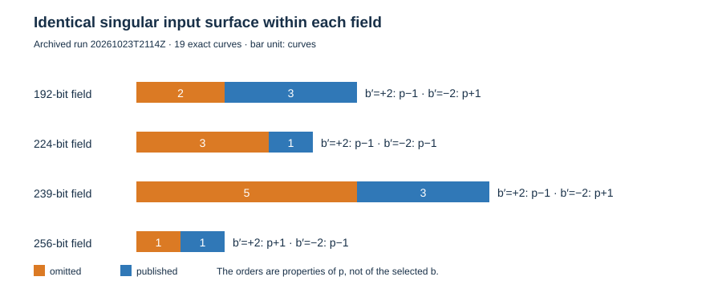
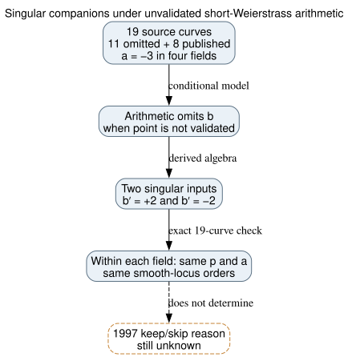

# Singular companions shared by the skipped and published curves

**Date:** 2026-10-23 UTC. **Scope:** Exact algebraic audit of the eleven reconstructed omitted seed classes and eight published controls over the same four prime fields. **Result:** This specific formula-compatible input surface is identical within each field and cannot separate the published and omitted labels.

## Question and exact result

Under the working premise that the original program evaluated all eleven omitted curves and rejected them for a weakness, could it have avoided an implementation weakness involving **singular points**? For the usual short-Weierstrass addition formulas, a scalar routine that accepts unvalidated points can operate on other equations with the same `a=-3`. Two of those equations are singular: `y²=x³−3x+2` and `y²=x³−3x−2`. Their smooth points form finite groups of order `p−1` or `p+1`, determined by the field prime and a quadratic-character check.

**Derived and independently checked:** All nineteen named curves have the same `p` and `a=-3` within each field. Therefore both singular cubics and their smooth-point orders are the same for every omitted and published candidate in that field. This excludes a proposal in which the omitted coefficient `b` uniquely exposes these singular inputs while the published `b` avoids them. The result is conditional on an implementation that skips point validation and whose reached formulas omit `b`; no such historical or deployed implementation was examined. These singular cubics are neither elliptic curves nor isogenous representatives of the source curves.



*Figure 1. Exact counts for the nineteen UIDs in [the sealed primary record](runs/20261023T2114Z/results.json). Each bar unit is one seed-level curve; no statistical uncertainty attaches to these finite counts. Orange is omitted and blue is published. The `p±1` labels are exact smooth-locus orders for the two singular inputs. Editable source: [draw.py](draw.py).*

| Field | Omitted | Published | `b′=+2` smooth order | `b′=−2` smooth order |
| --- | ---: | ---: | --- | --- |
| 192-bit prime | 2 | 3 | `p−1` | `p+1` |
| 224-bit prime | 3 | 1 | `p−1` | `p−1` |
| 239-bit prime | 5 | 3 | `p−1` | `p+1` |
| 256-bit prime | 1 | 1 | `p+1` | `p−1` |

## Why there are exactly two singular companions

For `y²=x³+ax+b′` with `a=-3` over a prime field of characteristic greater than three, the nonsingularity condition is `4a³+27b′² ≠ 0`. Its failure gives `b′²=4`, hence exactly `b′=±2`. The factorizations are exact over the integers:

```text
x³−3x+2 = (x−1)²(x+2)
x³−3x−2 = (x+1)²(x−2).
```

For `b′=+2`, put `u=x−1`; the equation becomes `y²=u²(u+3)`. For `b′=−2`, put `u=x+1`; it becomes `y²=u²(u−3)`. Outside the singular node `(u,y)=(0,0)`, slope `s=y/u` gives `u=s²−c`, with `c=3` or `−3`. Every `s` except a root of `s²=c` gives one smooth affine point; add the smooth point at infinity. If `c` is a square there are two excluded slopes and the total is `p−1`; otherwise there are none and the total is `p+1`. This counts the smooth locus only; the node is never counted as a group element.

The [frozen protocol](PROTOCOL.md) pinned the two input JSON digests, all 19 EC1 UIDs, the discriminant and factorization checks, Euler-character checks, and two small-field enumeration controls before running. [The primary record](runs/20261023T2114Z/results.json) was generated from clean committed source `88750ee2d2` and has 19 rows, four field primes, and four passing small-field controls. Its `complete.ok` binds the result hash. [The independent Sage record](verification/20261023T2114Z/results.json) verified primality of each field with proof enabled, independently checked the polynomial identities and quadratic characters for every UID, and enumerated the smooth points at `p=101,103` for both signs. All 19 UID checks and four enumerations passed, with a separate verification completion digest. The primary run was archived at commit `d07ee660cf`; software and host details are in both records. The source curve's ordinary group order and twist are unchanged by this analysis.

## What this does and does not say

The prior [nonsingular invalid-curve audit](../nist_seed_invalid_curve_surface_20261023/report.md) found that the `b`-independent arithmetic surface is shared within each field. This extension closes its deliberate singular-control gap by identifying and counting both singular cubics exactly. Neither audit tested a point decoder, scalar multiplication implementation, secret-key protocol, or output oracle. Even if an implementation processes a singular point, a useful key-recovery claim still needs a reachable smooth-locus point of suitable order, key reuse, observable outputs, and complete attack cost. Group size alone does not establish those conditions. For the historical selection question, a hidden criterion must therefore depend on something other than this `p,a`-only input surface, such as an actual `b`- or group-dependent mathematical property or implementation behavior supported by an original trace.

The exact identities and row counts are `internal` evidence in the linked immutable records; the smooth-point count is a `derived` algebraic result independently checked by Sage. The standard addition formulas' omission of `b` is visible in the [Explicit-Formulas Database](https://www.hyperelliptic.org/EFD/g1p/auto-shortw-jacobian.html) (`retrieved`, primary). The historical-evaluation premise remains stipulated, not observed; [the selection-rule problem](../../problems/nist-seed-selection-rule-unexplained.md) remains open. Existing canonical ECDLP graphs were checked; this result adds no verified attack edge, so none changes.



*Figure 2. Solid arrows are conditional algebra and exact checks; the dashed endpoint is the unobserved historical decision. Editable source: [inference.dot](inference.dot).*
