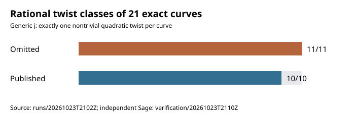
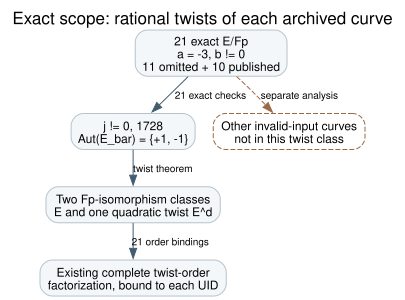

# Rational twist forms of the 21 NIST/ANSI seed curves

**23 October 2026.** **Question:** Under the working premise that the original program reached all eleven mathematically qualifying omitted seed curves, might they share a special quartic or sextic twist that the ten published curves lack?

## Exact result

Every one of the 11 omitted seed-level classes and 10 published controls has prime characteristic above 3, `a=-3`, nonzero `b`, nonsingular discriminant, and `j` distinct from 0 and 1728. The [frozen arithmetic audit](PROTOCOL.md) checked each exact EC1 UID and matched its algebraic quadratic-twist order to the prior [21-row twist archive](../nist_seed_twist_embedding_20261023/analysis.json). Its [write-once results](runs/20261023T2102Z/results.json) report 21/21 matches. A separate [Sage rederivation](verification/20261023T2110Z/results.json) proved the five field primes, recomputed all 21 `j` values, and enumerated exactly two rational twist forms for each curve. One form is isomorphic to the original and one to its quadratic twist. Both run receipts and individual rows are retained. The first Sage attempt [stopped before checking a curve](verification/20261023T2107Z/failure.json) because of a wrong primality API signature; its correction was specified in [an additive protocol](VERIFICATION_PROTOCOL_2.md) before the fresh run.

**Mathematical reason.** For characteristic above 3, a nonsingular short-Weierstrass curve has `j=1728*4a^3/(4a^3+27b^2)`. Since `a=-3` is nonzero and `b` is nonzero, `j` can equal neither 0 nor 1728. Curves with this generic `j` have geometric automorphism group `{+1,-1}`. Over a finite field of odd order, there are exactly two rational forms in that geometric isomorphism class: the original and one nonsquare quadratic twist. [SageMath's finite-field elliptic-curve documentation](https://doc.sagemath.org/html/en/reference/arithmetic_curves/sage/schemes/elliptic_curves/ell_finite_field.html) describes this classification and the exceptional `j` cases (`retrieved`, official implementation documentation). The archived arithmetic and independent Sage enumeration check that the theorem's preconditions apply to all 21 exact inputs (`internal`, independently rederived).

Thus **there is no additional quartic or sextic twist form to inspect for these 21 curves**. The complete factorization and large-prime embedding-degree studies already cover the sole nontrivial rational twist form for each. This closes only the proposed special-twist-form explanation. A different curve accepted as an invalid input need not be a twist of the configured curve; protocol behavior and scalar observability remain separate questions. An unknown weakness of the honest prime-order group also remains possible.

## Reproduction and boundaries

The exact command and clean source commit are recorded in [the primary result](runs/20261023T2102Z/results.json) and [Sage result](verification/20261023T2110Z/results.json). The first used Python 3.12.8 and the second Sage 10.10.rc0. The two runs checked 21 unique UIDs, 11 omitted and 10 published; no historical selection code or logs were used. Source files are [analyze.py](analyze.py), [verify.sage](verify.sage), [render.py](render.py), and [twist_scope.dot](twist_scope.dot). The earlier factorization and embedding-degree records are cited rather than rerun. No attack-cost estimate or research-state transition follows from this result.

The open [selection-rule problem](../../problems/nist-seed-selection-rule-unexplained.md) is unchanged. Existing canonical ECDLP graphs were checked: this theorem limits a proposed twist-form explanation but creates no attack or isogeny edge, so no canonical graph was changed. The original program's treatment of the eleven remains unobserved.
