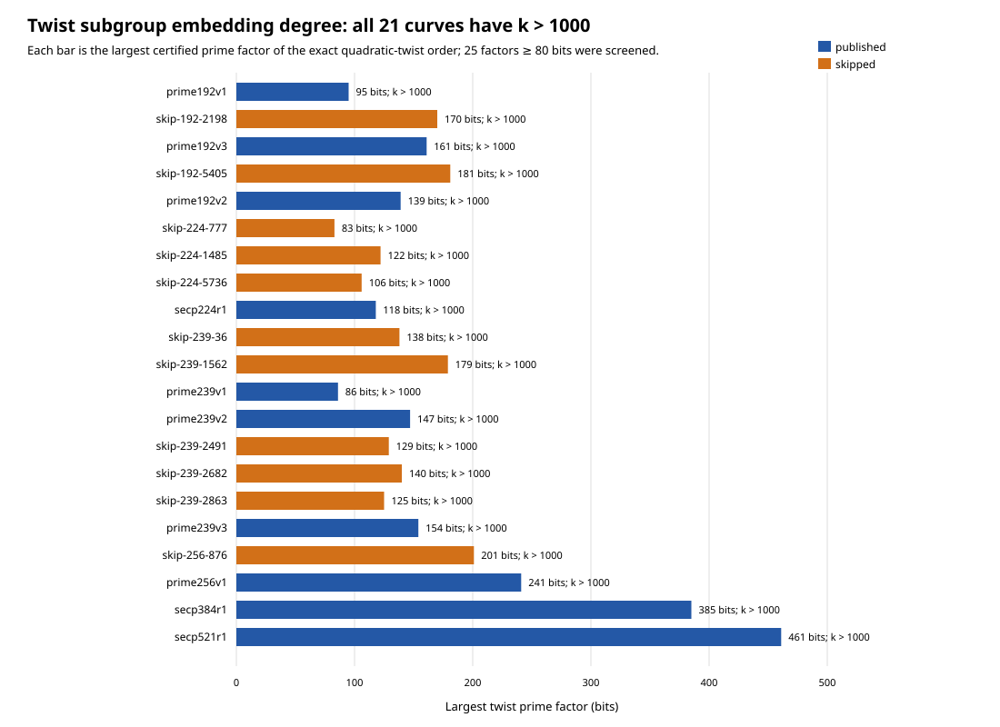
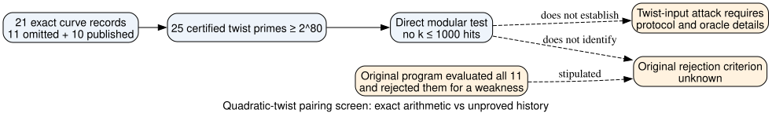

# Large quadratic-twist factors do not explain the eleven skipped curves

**Date:** 2026-10-23 UTC. **Status:** bounded, retrospective arithmetic screen.
**Question:** Supposing the original program evaluated all eleven omitted
curves, do their quadratic twists have a large prime subgroup with unusually
small pairing embedding degree?

## Result

**Derived and replayed:** Across the eleven omitted seed classes and ten
published controls, the exact quadratic-twist orders have **25 certified prime
factors of at least 80 bits**. For every one, `p^k mod ell != 1` for each
`1 <= k <= 1000`. In particular, none hits the historically familiar
`k <= 20` screen. The result applies to all eleven omissions and all eight
same-field published controls, with P-384 and P-521 included as singleton
published fields. This specific twist-subgroup low-embedding-degree predicate
therefore does not mark the skipped curves.



*Figure 1. Largest certified twist prime factor per curve, in bits. The
annotation is the bounded result for **every** twist factor of at least 80
bits, including the four curves with two such factors. Published curves are
blue; skipped classes are orange. Exact EC1 UIDs and all factor-level results
are in [analysis.json](analysis.json); editable source is
[render_visuals.py](render_visuals.py).*

## Method and checks

The [protocol](PROTOCOL.md) fixed the 21 classes, `ell >= 2^80`, two bounds
of 20 and 1000, the controls, and the inference limit before this calculation.
The complete twist factorizations are inherited from the
[initial factor probe](../nist_seed_selection_deep_20261016/twist_factor_probe.json)
(`internal`), [P-224 completion](../nist_seed_selection_followup_20261016/verification.json)
(`internal`), and [two 239-bit completions](../nist_seed_commonality_20261023/report.md)
(`internal`). The analyzer verifies every factor product against the exact
archived twist order and binds those six source files by SHA-256 in its output.
The earlier records provide the factor primality and curve-order evidence;
this screen does not rerun those proofs or the point counts.

For each qualifying factor `ell`, [analyze.py](analyze.py) iterates modular
powers of the exact field prime `p`; [verify.py](verify.py) independently
performs 25,500 direct modular-power checks across the two declared bounds,
checks every factor divides its archived twist order, rechecks the source
digests, and agrees with the stored first-hit values. Positive controls
`ord_7(2)=3`, `ord_11(3)=5`, `ord_7(3)=6`, a negative test through `k=3`,
and injected wrong-product and duplicate-key rejections passed. The exact
commands used were:

```sh
python3 research/nist_seed_twist_embedding_20261023/analyze.py
python3 research/nist_seed_twist_embedding_20261023/verify.py
python3 research/nist_seed_twist_embedding_20261023/render_visuals.py
dot -Tsvg research/nist_seed_twist_embedding_20261023/inference.dot -o research/nist_seed_twist_embedding_20261023/inference.svg
```

The local interpreter was Python 3.12.8; the source checkout before this
uncommitted study was `f9a707668f161c50d085997e3060b90452be718d`.
The analyzer printed `rows=21`, `skipped=11`, `published=10`, and zero hits
at both bounds for both labels. The verifier printed `PASS`, 25 large
factors and 25,500 direct-power checks. The [machine output](analysis.json)
contains the full exact input identity, factor source, bitlength and bounded
result per factor. All 25 same-field omitted-versus-published pairs tie at
both binary low-degree predicates.

## Interpretation

The tested group is the **quadratic twist**, not the published curve's
prime-order group. A twist pairing property would affect an ordinary ECDH
or ECDSA deployment only under a specified failure to validate adversarial
points, a reusable secret operation, and an observable that makes the
subgroup attack usable. No implementation, oracle, transfer, or complete
attack cost was supplied or measured here. The screen does not test smaller
twist factors, degrees above 1000, other invalid-curve companions, or an
unlisted isogenous representative. No full embedding degree was computed:
`k > 1000` is the exact finite-bound statement.



*Figure 2. Solid edges denote arithmetic derived from the pinned sources.
Dashed edges mark the stipulated historical premise and missing attack or
historical evidence. Editable source: [inference.dot](inference.dot).*

The premise that the original program actually reached and rejected all
eleven candidates for a weakness remains **stipulated rather than observed**.
This result rules out one plausible simple property within its bound; it
does not reveal what the authors selected for. The next decisive evidence is
the original generator/review trace or a predeclared mathematical mechanism
that predicts an independent historical decision and gives a reproducible
subgroup consequence. The [selection problem](../../problems/nist-seed-selection-rule-unexplained.md)
remains open. The canonical seed-selection and ECDLP frontier graph sources
were checked; this negative screen adds no verified attack or selection edge,
so no canonical graph changes.
