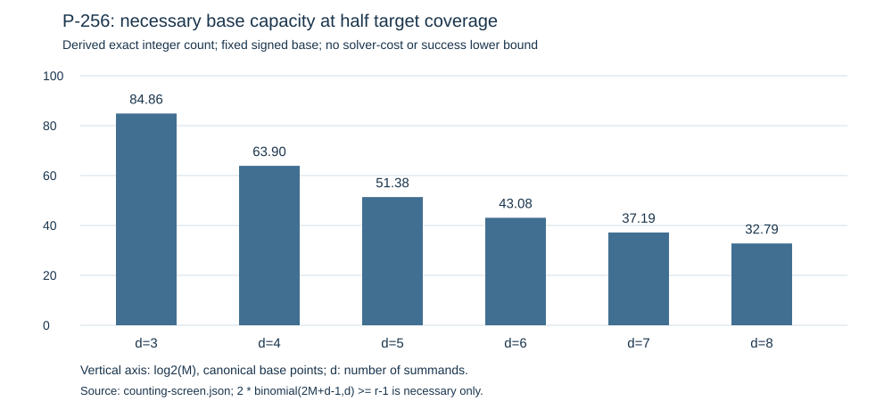

# P-256 factor-base investigation: same-day parallel pass

25 October 2026. All eight planned workstreams have completed a first
implementation or mathematical-screening pass. The work uses published P-256
parameters, a secp256k1 automorphism control, P-224 and Curve448 comparisons,
and explicit same-field covers. These are exact construction/correctness
observations and scoped derivations. No end-to-end ECDLP advantage has been
established.

The tracking PR is https://github.com/aburan28/crypto-autoresearcher/pull/2561.
The public branch currently contains the plan, handoffs, original F1 package
and its cubic-divisor continuation card through c35b9da6a65e019eaa517fc1a5f7774428ff35db.
The larger result payload is retained locally while explicit public-disclosure
approval is pending after automatic approval review refused the upload.
Local isolated engineering checks completed under a recorded custody exception;
they are not represented as canonical scientific promotion gates.

## What was actually implemented

| Track | Concrete result | Remaining decisive obligation |
|---|---|---|
| F1 symmetric/coset bases | Exact symmetric circuit; nine domains and 27 complete signed target sets. A new cubic-divisor formulation removes algebraic multiplicities, completes six query sets through depth 3, and retains 21 certificates with 386 independently replayed critical pairs. | Complete implicit extraction and a cost argument in base size/depth. Three depth-4 continuation process stops remain unknown. |
| F2 auxiliary isogeny bases | Sixteen rational degree-two edges, composite degree 65,536; complete fibres, 16,320 enumerated coordinates, 8,279 accepted target lifts and exact dual checks. | Natural decomposition solving, useful relation density and full cost. Auxiliary smooth group structure does not transfer to P-256. |
| F3 coefficient-labelled bases | A scalar-blind three-partition hybrid solver, separate exhaustive point-sum control, and distinct useful/zero-Q constructed fixtures. Separate Sage checks cover 72 labels and 6,144 signed sums. | A costed natural useful-dependency solver; the known-witness useful fixture is correctness only. See the coefficient-mod-r clarification below. |
| F4 divisor stitching | Exact principal-divisor extraction, signed outside-point cancellation and independent rank checks on 29 cases. Five nonrational divisors remain explicitly unresolved. | Natural all-draw yield/collision/rank growth, scalable signed-cycle handling and target attachment. |
| F5 target representatives | Four explicit maps of degrees 3,5,11,11; symbolic landing and dual identities, 28 point fixtures; complete discriminant certificate gives f_pi=f_E=1. | A matched source/endpoint membership and relation solver paying for discovery and transport. Map existence alone is not cheaper ECDLP. |
| F6 interval/digit lattices | Twenty-eight rectangle and nine digit cases with exact determinant/norm bounds; one intentionally known-offset extraction control. | Other useful-width constructions and certified ordinary-target multivariate extraction. Failure of this sufficient-bound family is not a general impossibility theorem. |
| F7 covers | Explicit smooth nonhyperelliptic genus-three and hyperelliptic genus-two covers; subgroup injection through norm after pullback=[2]; fourteen fibre fixtures and a complementary elliptic count. | Arbitrary-class arithmetic/norm and a costed image-specific relation/descent algorithm. A new Cartier-component derivation is separately checked locally. |
| F8 endomorphism orbits | A genuine signed order-six secp256k1 orbit control: 48 points, 96 constructed rows and exact compression to eight unknowns. | Ordinary-target relation generation, with the same automorphism/compression benefits in the baseline. The fixed symmetry factor is not a new exponent. |

Each track's `report.md`, `result.json` and `report-delivery.pdf` are under
`tracks/f1/` through `tracks/f8/`. F1's additional source and proof are under
`tracks/f1/cubic-divisor/`. All constructed positives are identified as such;
fixed empty cases are not success-rate estimates.

## The most concrete new solver step

The original terminal equations retain a nonreduced symmetric algebra even
when the scalar Dickson fibre is unramified. With S scalar roots, its scheme
length is S^3 while its distinct unordered states number C(S+2,3).

The continuation instead imposes that the monic cubic
h(T)=T^3-s1*T^2+s2*T-s3 divide D_S(T)-c, using a short repeated-squaring
remainder circuit. For a separable fibre, the distinct-coordinate locus is
reduced and has C(S,3) points. Separate two-equal and all-equal strata restore
the repeated-coordinate solutions. Their total count is C(S+2,3).

This formulation completes the fixed depth-3 joint case that the earlier
expanded formulation left unknown. At depth 3 its distinct membership algebra
has dimension 56. At depth 4 the repeated strata complete but the distinct
joint systems retain three recorded watchdog outcomes. Deep witnesses through
depth 96 certify divisibility/Jacobians, not full relation solving. Neither a
short circuit nor one completed case supplies a general cost bound.

## Independent local checks and correction

Isolated reviewers checked the source and certificates without importing
producer arithmetic, including separate point arithmetic, sparse polynomial
division, norm factorization, rank calculations, lattice reconstruction and
fresh isogeny/point-count computations. Their final coverage records are retained in
`reviews/`. Blindness and custody deviations are recorded, including the
unpublished-input exception; no official scientific review pass is inferred.

One precise F3 statement correction is retained in
`corrections/f3-coefficients-mod-r.md`: the conditional uniform-target-coefficient
lemma requires the aggregate coefficient vector to be nonzero in F_r^N. A
nonzero integer vector c=(r,0,...) reduces to zero and always yields B=0.
This qualification does not change the implemented small-signed-coefficient
search or its point certificates. It matters when extending the lemma to
arbitrary multiplicities.

## Other curves and the cover component

The P-224/Curve448 comparison uses generic D_S-c domains at S=16 and 32.
P-224's split construction accepts canonical base sizes 8 and 18. Curve448's
norm-one construction accepts sizes 2 and 4, after retaining 8 and 14
prime-subgroup rejections, and 6 and 14 non-lifts. All four domains and twelve
fixed controls pass separate arithmetic implementations. Hasse-interval and
prime-order witnesses certify group orders r and 4r. The same raw domain size
therefore does not mean the same usable base size.

For the genus-three cover u^4=x^3-3x+b, the new derivation examines its
two-dimensional Prym instead of treating the entire Jacobian as a new target.
At p=3 mod4, Cartier kills dx/u^3 and x*dx/u^3. Frobenius anticommutation
forces an even Prym polynomial T^4+A*T^2+p^2. The corrected Hasse--Witt
congruence and Weil bound imply A=c*p for c=-2,-1,0,1,2. Exact P-256 residues
exclude r from all five candidate Prym orders p^2+c*p+1. An isolated local rederivation confirms the target r-component is unique
without computing the exact A. The full
derivation and primary-source provenance are in `analysis/cartier-proposal/`;
the isolated geometric review records its own proof and controls. No generic
Jacobian solver or destination cost is supplied by this component argument.

## Cardinality and complete-cost discipline

For a fixed signed base of 2M nonzero points, the number of represented
nonzero d-summand targets is at most C(2M+d-1,d). Hence a necessary condition
for half coverage of a uniform nonzero target is

    2*C(2M+d-1,d) >= r-1.

The exact minimum-M boundaries are computed by integer bisection and retained
in `counting-screen.json`. Approximate log2(M) values for arities 3 through 8
are 84.86,63.90,51.38,43.08,37.19,32.79. They are necessary capacities, not
success lower bounds, attack-cost forecasts or claims about every possible
algorithm. Target-dependent F3 bases require a separate argument.

Every prospective comparison still needs construction, membership solving,
root/sign/subgroup recovery, failed queries, partial-relation storage and
stitching, independent rank, linear algebra where applicable, target attachment
and memory. Cold setup and genuinely reusable setup are separate scenarios.
Baselines receive the same subgroup, symmetry and setup reuse. The current
software resource receipts are not matched ECDLP measurements.

## Delivery and next concrete work

The local payload audit covers 716 changed research files and 11,009,714 bytes,
with path/size/SHA-256 manifests and no credential-pattern matches. It is a
delta atop the already public c35 snapshot; full third-party paper downloads
and local rendering drafts are excluded. `verify_delivery.py` checks custody,
parsing, explicit unknown outcomes and compact PDF bytes; it does not certify
prescribed execution or mathematical promotion. The local ZIP is under
`/workspace/p256-research-delivery/`. Publication remains subject to the
pending explicit disclosure decision. Auto-merge is off.

The two next implementation questions are the F1 unexpanded cubic-remainder
extractor and the F3 natural useful-dependency solver. The other tracks retain
their named outstanding obligations, code and controls; none is silently
closed. No whole ECDLP solve, uniform cost theorem, or practical speedup follows
from this pass. Shared problem records track the exact missing interfaces.

Final local review outcome: the F1/F2 and F5/F7 joints passed within their stated coverage; F3/F4/F6/F8 certificates passed with the F3 coefficient qualification corrected additively. The twelve invalid inference/certificate controls in the latter panel were rejected. The geometric review independently reconstructs all four maps and the complementary point count, and checks a p=1 mod4 counterexample. These local outputs retain their custody, partial-blindness and unprobed-model deviations. They are not an official scientific promotion or approval to publish.
