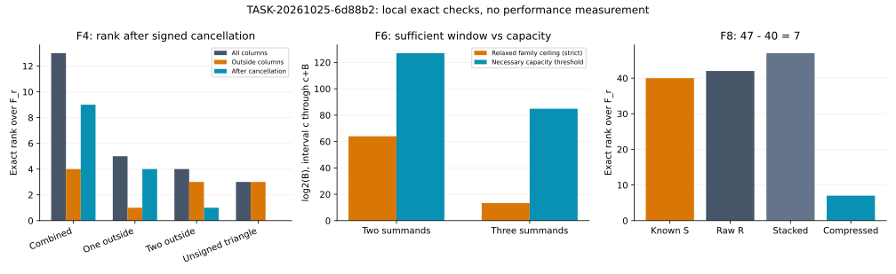
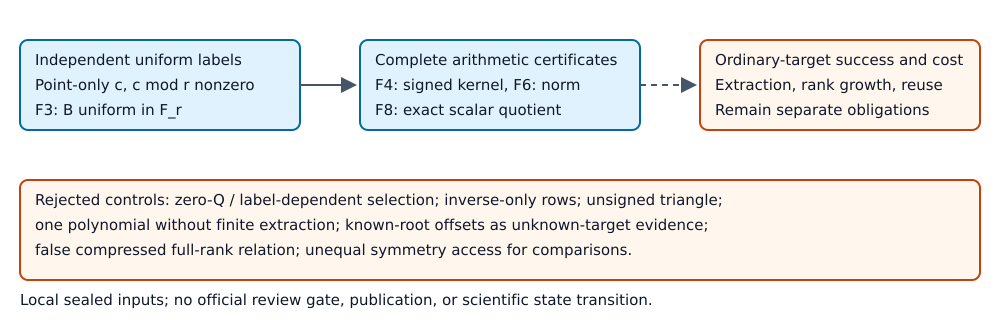

# Local adversarial review: F3, F4, F6 and F8

TASK-20261025-6d88b2, 2026-10-25 UTC. Outcome: the retained arithmetic certificates pass the independent checks, with one narrow mathematical qualification needed in F3. This is a local engineering and mathematics review. It discharges no official scientific review or promotion gate and makes no performance or attack claim.

## Observation

The standalone checker imports no producer module. Its published P-256 and secp256k1 constants are literal definitions, compared against the certificates. It uses new Jacobian arithmetic, modular elimination, integer combinatorics, SymPy polynomial algebra, and python-flint irreducibility checks. Published primality, full curve orders and cofactors remain inherited facts; checking that the generators are killed by their stated prime orders does not independently prove those facts.

The exact command and output are retained in `commands.md`, `independent-checks.stdout`, `independent-checks.stderr`, and `independent-results.json`. All four checker sections passed. The separate `adversarial_controls.py` run rejected all 12 deliberately invalid objects/inferences; its stdout, stderr and machine result are retained. These are correctness checks, without a timing comparison or a sampled yield panel.

| Joint | Independently verified scope | Result and boundary |
| --- | --- | --- |
| F3 | All 72 labelled points, all nine membership polynomials, 1,536 partition-coordinate triples and four sign combinations per triple across the three final cases; target and label equations; candidate scalar verification | Natural fixture: zero relations. Arranged label dependency: one relation, A=B=0. Known-witness useful fixture: one verified nonzero-B relation. Search takes points and partitions only. SHA fixtures are not ideal-uniform sampling evidence. |
| F4 | All 29 final `check-04` divisors; all 100 irreducible norm factors and full products; every retained rational point/multiplicity, anchor multiplicity, signed row, inverse-pair count and complete group sum; all four complete signed kernels, coefficient witnesses, rank identities and stitched group sums | 24 divisors are fully rational; five retain unresolved factors and cannot enter the rational graph. The independent valuation argument uses common polynomial factors and branch nonvanishing, rather than importing or calling the producer's local-series implementation. Six sampler evaluation ranks and kernel dimensions agree. |
| F6 | Complete actual-field f3 and resultant f4 coefficient lists; all 28 rectangular parameter cases and nine digit cases; exact minimum capacity widths; reconstructed nine-row lattice, determinant, integral unimodular change of basis, all row divisibilities and strict norm qualification; exact rational Groebner basis | f3/f4 have 9/125 terms. Eight vectors qualify for integer zero lifting, and this constructed ideal has basis [x-1,y-1]. The offsets are derived from the known points, so this is construction/extraction evidence for that fixture only. |
| F8 | All 48 point actions, eight representative labels, acting/conjugate eigenvalue distinction, 96 complete point-sum rows, every compressed coefficient and symmetry-kernel row; all four modular ranks | Ranks are raw 42, symmetry 40, stacked 47, compressed 7; 47-40=7. The false compressed rank-eight row sums to G, so it is rejected. Compression and the same signed action are available to every comparator. |

The F4 graph triples `(all-column rank, outside rank, cancelled rank)` are `(13,4,9)` for the combined fixture, `(5,1,4)` for one-outside fixtures, `(4,3,1)` for two-outside fixtures, and `(3,3,0)` for the unbalanced triangle. The inverse-only divisor has an empty signed row. Thus ordinary graph cycle counts and completely rational zero divisors cannot substitute for signed relation rank.

Figure: recorded local exact ranks, and F6's independently derived strict relaxed-family ceilings versus the necessary half-target capacity thresholds. The F6 ceilings omit the LLL penalty and are deliberately generous. No bar measures runtime or success rate.

## Comparison and finding

The F3 useful-coefficient law, F4 uniform-section/all-rational formulas, F6 determinant/norm inequality and F8 quotient-rank identity agree with the independent derivations in `blind-derivation.md`, under the explicitly stated hypotheses. One wording qualification is necessary:

**F3-001, medium severity, restricted mathematical statement.** `tracks/f3/report.md:78` allows integer signs or multiplicities c_i. The lemma at lines 106-114 then says any nonzero point-only relation vector has uniform B and zero probability 1/r. It must instead require **c modulo r is nonzero**. The label-pair domain F_r^2 is explicit, but the report never explicitly imposes that domain or nonzero-mod-r condition on c. A nonzero integer vector c=(r,0,...) is always a point relation on this subgroup, while A=B=0 with probability one. It therefore contradicts the unrestricted literal wording.

Reproduction: execute `independent_checks.py`; the `integer_nonzero_vs_modular_nonzero_counterexample` record supplies the actual published r and verifies the subgroup equality. `adversarial_controls.py` separately rejects extending the lemma to that coefficient vector. The proposed correction is “Any relation vector c chosen from points alone and nonzero in F_r^n has B uniform in F_r.” A dated additive correction preserves the sealed report. This finding does not invalidate the implemented distinct-point, three-entry +/-1 search, whose coefficient vector is necessarily nonzero modulo this r.

The independent small-prime controls also construct nonzero point-relation vectors selected using labels: for point scalars t=(1,2,3), take c=t cross b. Then c dot t=c dot b=0 whenever c is nonzero. Counts of such vectors are 120, 336 and 1,320 for r=5,7,11; all have B=0. This confirms why adaptive label-dependent selection must be excluded. For point-only two-coordinate choices, exact conditional uniformity was separately exhausted for every point conditioning at those primes. These algebraic controls are not empirical P-256 success laws.

No additional certificate defect or attack-scope overstatement was found within the inspected final packages. Producer `result.json` summaries explicitly distinguish constructed checks, inherited order facts, and unrun ordinary-target solving/cost obligations.

## Inference and limits

F4 uniform kernel coefficients followed by exact-pole rejection give p^(d-1) projective sections when the top functional is nonzero. For unanchored sections, 2<=m<r, the all-affine-rational probability is binomial(r+m-2,m)/(r*p^(m-1)); seven P-256 fractions and 21 small-prime cases were independently checked. This counts rational divisors anywhere on the curve. It is not base-specific smoothness, signed rank, or a nonuniform/anchored yield law. Duplicate anchors impose no derivatives. Inverse anchors can force a cancelling pair. The actual seed draws were inspected as source and their anchor/rank certificates verified; the producer PRNG byte stream was not regenerated.

F6 uses the one-sided interval c through c+B: M<=B+1 abscissas and at most 2(B+1) signed points. The minimum capacity B values are 170141183440662191106579983831721312255 for two summands and 35148224029723583543551324 for three summands. Both the threshold and B-1 were checked exactly. A symmetric interval has a different cardinality convention. The sufficient inequality is strictly

`n^(2n) * 2^(n(n-1)) * B^(2*s*D*n) < p^(4*K)`.

The family-wide relaxed upper exponents are 1/4 and 5/96. The necessary capacity thresholds exceed those ceilings by exact power comparisons, so this particular sufficient-window construction does not reach that capacity region for any D,m. Failure of a sufficient inequality does not establish failure of LLL, root nonexistence, or impossibility of another shift family. One short polynomial alone also does not establish finite multivariate extraction; the x-1 ideal in two variables is explicitly rejected as zero-dimensional evidence. The bounded lattice's offsets disclose the known root, and general ordinary-target extraction remains open.

F8 compression is an exact quotient by the known symmetry rowspace: rowspace(S)=ker(C), and rank([S;R])-rank(S)=rank(RC). Orbit size six is a fixed dimension fact under the inherited prime-order hypothesis. Generic rho and ordinary relation solvers receive the same six actions and the same reuse assumptions; no runtime ratio or new exponent follows from the rank check.

Historical F3 validation-01, F4 check-01 through check-03 and same-session producer verification runs were not re-executed. The coverage claim is the complete final retained objects listed above, not those older runs, external literature, an ordinary-target solver, exhaustive field-domain roots, sparse graph scalability, or an end-to-end comparison. The F6 unimodular/norm/extraction certificates were verified; no new lattice reduction benchmark was run. Existing unresolved work is named in the producer F3 `problem-record.md`, F4 `obstruction.md`, and F6/F8 report next-step sections. No shared problem record, canonical graph, ledger or scientific state was altered. Canonical graph sources remain unchanged because this check creates no official decision and its local correction is assigned to the coordinator.

## Custody and procedure deviations

Normal committed-and-pushed review inputs are absent. This review uses the local sealed payload under `reviews/local-custody-exception.json`; the disclosure approval is pending. No publishing, Git index, branch, PR, external-message, hypothesis or goal change occurred. The local base is c35b9da6a65e019eaa517fc1a5f7774428ff35db; exact consumed certificate hashes are in `independent-results.json`, with report/source hashes in `review-inputs.json`.

The handoff required recording a derivation before producer numbers were read. While extracting statements with rg and line-range reads, adjacent report prose exposed fixture coefficients/counts and F6/F8 reported quantities. This occurred before `blind-derivation.md` was saved and is a real procedure deviation. The derivation does precede producer source, result.json, verification receipts and numerical certificate reads, but this is **not claimed as a fully blind derivation**. No other reviewer report was read. Every independent numerical check avoids producer imports.

The named `review-adversarial` skill path is absent; the available canonical `review-evidence` and `research-visuals` instructions were read. Their official fetch/merge/archive/publish route is outside and superseded by the explicit local-only handoff. The fixed /usr/local/bin/python3 path and a Typst executable are unavailable; the supplied CPython 3.12.14 environment supplies SymPy 1.14.0 and python-flint 0.8.0. The coordinator owns PDF rendering and inspection through its common pipeline. Runtime model binding remains unprobed, with no fabricated model attestation.

Next action: retain the additive F3 qualification, preserve these local certificates and deviations, and address ordinary-target sampling, complete extraction and matched total-cost obligations only in separately specified work. This review itself supplies no scientific promotion decision.
