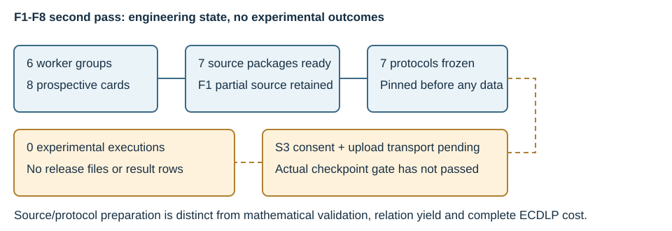

# P-256 factor-base second pass: prepared source and explicit execution gates

26 October 2026. Six sub-agent groups worked across the eight requested
tracks. Seven continuation packages are prepared and their protocols frozen
prospectively. F1 is a preserved partial implementation after a platform
worker halt. **No second-pass mathematical panel, pilot or experimental row
has run.** The first pass remains a separate immutable evidence layer.

| Track | Prepared continuation | Current state |
| --- | --- | --- |
| F1 | Quadratic-chain quotient/exterior operators, proposed extraction proof and fixed inputs | Partial; driver, independent oracle and protocol missing after worker halt |
| F2 | Full 65,536-coordinate target-lift classification and 24 signed queries over six matched domains | Source prepared; protocol frozen; unexecuted |
| F3 | Four-partition MITM with exhaustive Jacobian oracle, eight unplanted cases and distinct useful/zero-Q controls | Source prepared; protocol frozen; unexecuted |
| F4 | Sparse weighted incidence reducer, witness DAG and 128 all-draw anchored sections with graph controls | Source prepared; protocol frozen; unexecuted |
| F5 | Matched source/endpoint membership and relation transport through all four certified isogenies | Source prepared; protocol frozen; unexecuted |
| F6 | Root-independent offsets, 60 alternative-shift width cells, ordinary-target extraction and labelled positive control | Source prepared; protocol frozen; unexecuted |
| F7 | Balanced genus-two classes with both infinities, norm and separate extension-field support checks | Source prepared; protocol frozen; unexecuted |
| F8 | Representatives without supplied scalar labels, complete fixed target queries and symmetry-adjusted ranks | Source prepared; protocol frozen; unexecuted |

The source snapshot is `de1f9bbe50801ba5cccbe915b7aece2a0ea5c5ff`.
Each frozen protocol pins that implementation commit, the actual Python3.12.14
executable hash and its analysis source. Canonical protocol hashes and freeze
commands are in `archive/protocol-freeze-01/result.json`. Source readiness is
not mathematical correctness or a completed fixed-case solve.

## What was checked

Seven draft protocols passed the repository checker before freezing. The
35 Python sources in the seven prepared packages and two partial F1 sources
were parsed with AST without importing their mathematical programs. Seven
negative software fixtures confirm that absent/mismatched releases and changed
protocol bytes fail before invoking a checkpoint process. Those are software
checks, not real S3 gate passes. All eight preparation PDFs, nine pages total,
were rendered with text-preserving compaction and visually inspected.

The new static mathematics is retained in `theory-before-data.md` and each
track's derivation/source notes. In particular, one-anchor pole-three sampling
has an exact rational-slope law and structured path incidence; it does not
justify a random-graph collision model. The cover's infinity-difference class
has zero norm but is nonzero, so matching norms cannot certify class equality.
The lattice's two-summand capacity scale is distinguished from the earlier
three-summand bound. These are scoped derivations, not new measured rates.

## What blocks execution

The current repository rule requires an actual S3 resume checkpoint before
runs. Automatic approval review rejected the attempted upload because specific
disclosure consent was required. The explicit owner question remains pending;
no upload occurred and no skip path was used. Read-only configuration checks
also found no supported checkpoint upload token or AWS CLI/profile/key pair.
Approval and a configured transport are both necessary before the real gate.

F1 has an additional platform halt recorded in `environment/agent-halts-01.json`;
the coordinator's later capacity error is operational too. The partial F1
source is preserved byte-for-byte and its previous depth-four outcomes remain
unknown. No missing execution is represented as an empty solution set.

`RESUME.md` identifies exact source/protocol custody and the next gated action.
Tracking PR: https://github.com/isogeny-labs/crypto-autoresearcher/pull/2561.
No comparative performance result, end-to-end ECDLP advantage, formal proof
certificate, canonical scientific review or official goal/hypothesis transition
is claimed. Native-model bindings remain unprobed.
