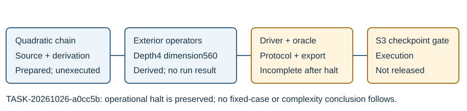

# F1 second pass: partial source and derived extraction design

26 October 2026. This is a Phase A preparation report. No second-pass
mathematical program was imported or executed, and no result on the fixed
depth-four cases is claimed.

The implementation worker prepared `core.py`, `exterior.py`, `inputs.json`,
`derivation.md` and `literature.md` before its turn was halted by a platform
content flag. Their exact bytes are recorded in `partial-source-manifest.json`.
The failure and the coordinator's subsequent model-capacity error are retained
in `../../environment/agent-halts-01.json`. These are operational events,
not evidence about whether the proposed mathematics works.

## Prepared design

The proposed method represents the scalar Dickson fibre by its quadratic-chain
quotient, constructs multiplication operators on the exterior cube, evaluates
the fixed symmetric S4 relation and extracts complete rational characters
from its exact kernel. The distinct-state representation at depth4 has
dimension C(16,3)=560. Two-equal and all-equal strata use separate tensor
representations. These are derived representation sizes and arguments,
not observed kernel dimensions or measured runtimes.

`derivation.md` states the assumptions, the no-root-enumeration boundary of
the primary extractor, the separate enumerative arity-four control and the
explicit matrix growth. `literature.md` records actual source reading and
unresolved solving complexity. The previous depth-four watchdog results
remain unknown; source preparation does not change them.

## What is missing

The retained source has not been checked through a complete driver,
independent point-domain oracle, fixed-panel analysis/export and validated
prospective protocol. Those interfaces must be completed and statically
inspected before a freeze. The arity-four positive-control construction also
needs an explicit availability/refusal rule for rational lifts rather than
an assumption that every algebraic coordinate partition has a rational
positive in the chosen fibre.

No frozen protocol, release, experimental row or passing mathematical
certificate is supplied for this partial package. The S3 disclosure approval
and actual checkpoint gate remain separate execution requirements. Root
preserves the partial implementation and finishes unaffected custody/reporting
work; the blocked sub-agent request is not retried or rephrased.

