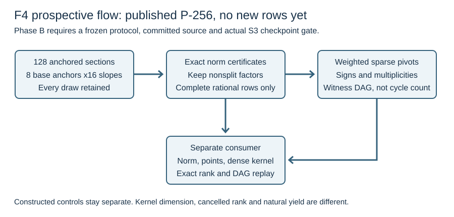

# F4 second pass: streaming signed stitching and anchored sections

26 October 2026 · `TASK-20261026-b71abe` · **Phase A source preparation.**

No second-pass panel, pilot, benchmark or arithmetic program has run. The
prospective source, draft protocol, frozen-analysis candidate and exporter
are prepared for root inspection, source pinning and protocol freeze. Data
collection still requires the explicit root release and a successful real
S3 checkpoint gate. This report contains derived mathematics and planned
checks, not observed second-pass results.

## What changes from the first pass

The first pass used a dense signed-incidence kernel as a correctness oracle
and deliberately engineered coincident outside points. The new source adds
a streaming weighted two-endpoint reducer with arithmetic witness DAGs.
It retains signs, multiplicities, one-endpoint columns, and closures of
unbalanced components. A lone unbalanced triangle must not be called a
cancellation. Separate polynomial, Jacobian-point and dense-kernel routines
check the producer's output; they are separate implementations in this
producer session, not an independent scientific review.

The fixed observation panel specifies 128 exact pole-three sections: sixteen
hash-derived slopes through each of eight base anchors G through 8G over
the actual P-256 field. The inverse-closed base has sixteen inverse orbits,
represented by G through 16G. The program retains every factorization,
nonsplit residual, rejection, complete relation, graph input and failure.
No residual zero is planted in the natural panel. Public scalar-known
anchors and the constructed graph controls are stated explicitly.

## Derived before-data facts

For nonzero P in the published prime-order group, anchored pole-three
sections normalize to `y-y_P+t(x-x_P)`, one for every t in F_p. Residual
unordered rational pairs are the orbits of `Q -> -P-Q` on
`E(F_p) minus {O,-P}`. There is one fixed point. Thus exactly
`(r-1)/2` slopes are fully rational; the ideal uniform-slope probability is
`(r-1)/(2p)`, including repeated zeros. It is not a factor-base or collision
probability. Fixed hash-derived input fractions are descriptive only.

For one anchor, inverse-orbit columns form a path `[k]--[k+1]` plus a
terminal column of weight two. Removing the base anchor gives a boundary
one-outside column from the tangent at P. This is an incidence/half-edge
description; an ordinary loop display has a different valence convention.
Combining eight anchors does not license a random-graph assumption.

The reducer stores pivots with at most two outside entries. Every zero
residual emits a witness with a unique latest input coefficient one. The
resulting independent witnesses number `L-rank(A)`, so they span the full
outside kernel. Their base-row image rank is `rank(D)-rank(A)`; it can be
smaller or zero. Exact integer representatives cancel modulo r, with any
integer-lift multiples of r retained. Details and exceptional cases are in
[the prospective derivation](theory.md).

## Fixed controls and accounting

Four export cells each represent an entire arm-panel, numeric instance 0,
replicate 0. The natural arm generates the 128 unique functions. Its A/A
arm reuses those exact cases in reverse graph order and checks structural
rank equality; it does not create another 128 samples. Seven positive
families cover balanced cycles of lengths 4, 8 and 16, paired unbalanced
cycles, and three explicitly abstract weighted/zero-outside matrix controls.
Four negative mechanisms cover a lone unbalanced triangle and corrupted
cancellation, sign and norm-factor certificates. The omitted-factor control
uses a pinned historical nonsplit input, clearly separated from new data.

Source checks distinguish the pinned implementation commit from runtime
HEAD, verify selected Git-object bytes and the actual Python executable,
and retain host, commands, diagnostic rusage and exact object/call counts.
All clocks have `wall_valid=false`. Scalar-call and factorization counts,
DAG storage, verifier work and witness expansion are not a complete GAE,
attack cost or matched performance comparison. No official scientific or
model-policy admission is claimed.

The source review and transfer limits are in [literature.md](literature.md).
The genus-at-least-two double-large-prime complexity theorem is not
transferred to P-256. This pass leaves natural large-base yield, target
attachment, full solve/rank costs and amortized behavior open. A bounded
absence of collisions would not prove an impossibility theorem.

After an authorized execution, the fresh run directory contains its own
immutable `result.json`, all raw certificates, `rows.jsonl`, analysis graph
and report, and unified `export.json`. This preparation report will not be
silently replaced by a result report.
