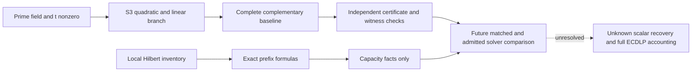

# TASK-20261029-58d7a7: blind cost-bridge review

The seven mathematical/source-accounting joints below hold in the specified
scope. The eighth, software scope, is inconclusive as an execution-integrity
finding: this reviewer audited the fixed test source but ran no tests and read
no software-result receipt. No source defect falsifying the prime-field
complementary-point algorithm or its independent completeness checker was
found. This is not a judgment on any forbidden producer document, which remains
unread, or on an entire research claim beyond these joints.

The independent pre-code derivation is
`research/prime_sat_costbridge_20261029/TASK-20261029-58d7a7/precode-derivation.md`.
Its seal clock was actually observed as `2026-10-29 19:56:55 UTC`; its SHA256
is `5ab5c8bf42429c171fef65acd17edd95196ee1d1f63af647bff012a6bf615910`.
It was not rewritten after source access. There is no separate pre-code
archival custody or independently authenticated read-order timestamp. The
clock and read sequence are reviewer attestations, not a mechanical proof of
the history. Source inspection began with a clock observation immediately
before the first source-reading command at `2026-10-29 19:57:00 UTC`; the
exact first-byte read time was not separately measured.

After sealing, the actual first-read order and content identities were:

| order | permitted source | SHA256 |
| --- | --- | --- |
| 1 | research/prime_sat_costbridge_20261029/reference.py | a05b0c30df5b5b4b9763e6bb422ee5f9212d5345aa573448827cd830ca4678ad |
| 2 | research/prime_sat_costbridge_20261029/check_reference.py | af276a95753493ba8885b19f85cf9d53fe5f52746990256b0d04795aff68451e |
| 3 | research/prime_sat_costbridge_20261029/test_reference.py | 7588f9fb28c793f4eb4f7758504b4c0de3d48bdceb42fd8f20ab883cbffce883 |

No producer arithmetic was imported, and no software/scientific trial or
provider model probe was executed. Reading/hashing source, writing the three
authorized review artifacts, and observing clocks were the only local task
operations beyond the permitted source/policy/literature reads. The literal
source lists and runtime qualifications are in attestation.yaml.

## normal_prefix_counts — holds

Pre-code Sections 1-2 give the independent binomial derivation. For s=2m the
local bit prefixes at the preceding degree, regularity, and cap are respectively

    4^s-sum_{j=0}^{m-1}C(4m,j),
    4^s-sum_{j=0}^{m-2}C(4m,j),
    4^s-sum_{j=0}^{m-3}C(4m,j),

with negative-limit sums zero. All three grouped prefixes are 4^s. The
comparisons are strict at the preceding degree for all s>=2, at regularity
for s>=4, and at the cap for s>=6; the remaining boundaries are equal.
The explicit s=2 triples are (15,16,16) and (16,16,16), s=4 gives
(247,255,256) versus (256,256,256), and s=6 gives (4017,4083,4095) versus
(4096,4096,4096). Thus a claim of uniformly smaller grouped local prefixes
would fail. The relative deficit tends exponentially to zero by the binomial
tail/Stirling argument; this is no asymptotic solver-work comparison.

## ambient_and_actual_work — holds

Pre-code Section 2 independently derives A(n,D)=C(n+D,D). The respective
regularity capacities are C(7s/2+1,3s/2+1) and C(4s+1,s+1); cap capacities
are C(7s/2+2,3s/2+2) and C(4s+2,s+2). At s=2 the grouped regularity and cap
capacities are larger; at s=4 the regularity ordering reverses while the cap
ordering does not. For each fixed degree offset the bit capacity eventually
has the larger exponential base, as proved in the seal. None is a required
number of actual solver rows or columns.

The constant-one control is decisive: the local quotient inventory is
unchanged while the full system becomes trivially inconsistent. An absent
extra equation has the same local inventory and retains every local state.
Local highest-part quotient, full highest-part quotient, affine quotient and
actual elimination workload therefore cannot be interchanged. The accepted
raw-generator regularity and [Salizzoni's source-qualified closure
bound](https://arxiv.org/html/2304.13485) constrain a particular mathematical
closure, without ordering actual solving degrees. The raw quartic s=2 grouped
case keeps cap four and does not meet Proposition 3.13's input-degree<=d_reg
premise. Arbitrary auxiliary encodings inherit no theorem from this check.

## rational_completeness — holds

Pre-code Section 3 derives the rational line identity and, independently, the
quadratic in z with coefficients h^2, 2hc-4t^2, c^2-4t^2(x+r), where
h=x-r and c=-rx-2r^2-a. Its discriminant is 16t^2f(x). Both roots for a
nonzero square, one double root for f=0, and no roots for a nonsquare follow
over the prime field. At h=0 there is one linear root x(2R), not an empty
quadratic-root set. The line identity gives rational witnesses and accounts
for tangent/coincident coordinates; there is no appeal to a generic
algebraic-closure summation theorem for rationality.

The checker implements precisely the independent root construction at
check_reference.py:111-120: the linear branch uses inverse(4t^2), and the
quadratic branch uses inverse(2h^2) and the certified two signs. Both
denominators are nonzero on their branches under the explicit prime/t!=0
premises. The source uses a set to collapse the f=0 double root. The target
and curve checks at lines 65-70 retain nonsingularity and t!=0. A composite
modulus is not certified or admitted as a theorem input merely because an
oddness check permits its parsing; all conclusions remain conditional on
the separately explicit prime premise.

## complementary_reference — holds

Reference.py:159-186 walks the declared D1 order once. It evaluates f(x),
uses Euler classification for nonzero f(x), calls Tonelli-Shanks/the
p=3 mod4 shortcut, includes both signs sorted and zero once, and computes
Q=R-P. D2 membership is a modular interval test or preconstructed set lookup
(lines 24-54). There is no operational all-y loop or D1*D2 loop.

The exceptional cases are sound: P=R gives inverse-point addition and
infinity, which line 179 excludes; P=-R gives doubling of R with denominator
2t!=0; a zero-ordinate lift has x!=r and uses a nonzero ordinary addition
denominator. Reference.py:130-144 includes infinity and inverse/doubling
branches. When 3R=O, x(2R)=r is retained rather than incorrectly discarded
as a coincident coordinate. The mathematical argument covers this branch
although none of the four supplied fixed targets is separately asserted here
to have order three.

All-mode records preserve D1 order, including explicit nonnumeric list order;
projected output is lexicographically sorted and deduplicated at lines
181/187/194. This supplies a deterministic output order separate from the
D1 traversal order. Under t!=0 every ordered coordinate root pair has the
unique rational witness pair proved in the seal, so setdefault does not
silently remove a second required witness. Multiple bit labels for a
coordinate would require separate model accounting outside this interface.

## certificate_checker — holds

The implementation chooses shared nonsquare certificates. Reference.py:81-97
certifies global Z by Euler; each nonsquare row obtains w=sqrt(Z*f(x)) at
line 172. Pre-code Section 4 proves why nonzero w and Euler-certified Z imply
a nonzero nonsquare radicand. Check_reference.py:82-85 certifies Z independently,
and lines 98-102 check exact row keys, value!=0, w!=0 and w^2=Z*f(x).
Lines 103-110 verify roots by squaring, sorted complete signs and correct
zero classification. A false nonsquare classification of a square cannot
pass that character argument. Missing signs and zero-root duplication cannot
pass the root-set equality.

Exact coverage is enforced by both row count and traversal identity
(lines 88-95), rather than only membership in D1. D2 membership is implemented
independently in the checker. Complete projected set equality, canonical
coordinates, deterministic sorting and duplicate rejection are checked at
lines 121-129. A removed x=r root therefore fails even when every remaining
witness is valid. This proof does not import producer enumeration.

Post-code refinement, not a change to the sealed mathematics: the witness
checker uses division-free group equations (lines 41-57), rather than
performing a second affine inversion. For x!=u it checks a slope numerator
v-y and nonzero denominator u-x; for x=u it excludes inverses, requires y=v,
and uses numerator 3x^2+a and nonzero denominator 2y. After checking P,Q on
the curve it verifies numerator^2=(r+x+u)*denominator^2 and
numerator*(x-r)=(t+y)*denominator. In a field these are exactly the affine
addition equations with their denominators cleared. They verify P+Q=R
independently and reject the infinity-sum mutation. They do not prove
execution event counts or primality, both expressly left unverified.

## cost_and_setup — holds

Pre-code Section 5 gives the independent resource model, including domain
construction, memberships, square-root/nonsquare setup, extraction, group
inversions, output, checker work and arithmetic bit costs. There is no
expected-constant justification for a deterministic nonsquare scan.

The following is a post-code specialization of that model, not a revision of
the sealed derivation. Let n0,n+,n- classify D1 and L=n0+2n+, K be the
output count. The source always pays global nonsquare setup, even for empty
domains: supplied Z costs one Euler test, p=3 mod4 uses certified -1 with
one Euler test, and other primes scan candidates 2,3,..., recording all
probes. Exactly n++n- row Euler tests and n++n- square-root calls occur in
all mode: a nonsquare row extracts a twisted root too. This additional root
production cannot be erased by the cheaper checker certificate. General
Tonelli-Shanks at lines 105-112 refactors p-1 and computes powers of Z anew
on every call; a model that charges those only once would undercount this
implementation. It has no all-y scan in extraction.

Using E,S,I,M and mu as defined in the seal, a safe producer expression is

    input reading/normalization + domain construction/indexing
    + qZ*E + O(B1*M) + (n++n-)*(E+S)
    + O(L*(I+M+mu)) + record construction
    + O(K log K) output sorting/comparisons + serialization + input hashing.

Each S here includes its actual per-call Tonelli-Shanks initialization and
root verification. The nonsquare setup's qZ can be O(p) under a trivial
deterministic bound; no random-sampling expectation is claimed for that code.
Python's inverse pow uses a backend-dependent inversion cost, so an exact
Fermat-exponentiation count must not be imputed to its -1 exponent. Field
operations are converted to bit costs using the actual input lengths and
arithmetic backend; unusually large unreduced a,b also have reading/reduction
cost. The recorded euler_probes value describes setup only and is not a
total operation count.

Explicit domains materialize tuple/set storage in the producer and list/set
storage in the checker; modular interval descriptors support generation and
membership without such a full index. Both sides independently pay their
input and membership setup. The producer retains every visited certificate
and all output witnesses; output sorting and JSON hashing/serialization are
additional costs. This source does not implement a streaming-output bound.

For all mode the checker pays independent setup and input hashing, one
Euler(Z), O(B1) row checks, at most one inversion per root-containing D1 row,
at most L second-root memberships, complete output comparison/deduplication,
and O(K) field operations for division-free point/sum verification. It needs
no new square-root extraction. First mode has the visited-prefix costs and
the same actual startup costs. Its last record may certify both signs even
when only the first qualifying witness is returned; that is sound and costs
more than merely checking a lone point. The checker explicitly refuses to
claim verification of execution counters.

## mode_and_software_scope — inconclusive

The output-mode semantics hold by source audit: reference.py:182-191 stops
after a witness in first mode and always sets complete=false there. The
checker rejects a contradictory flag at line 77; its successful first-mode
verdict leaves completeness_verified=false at line 138. An empty first-mode
result is accepted only after full lift coverage with no expected projected
root, yet still receives no completeness flag. This is a deliberately stricter
validation obligation for an unsuccessful first-mode answer, not a claim of
complete certification from that mode.

The fixed test source matches all four contract curve/target fixtures at
test_reference.py:9-10; assert_all compares with an independent tiny full-y,
full-pair oracle that is confined to that file. Interval wrap, empty and full
domains and nonnumeric explicit ordering are exercised at lines 70-80.
Other tests explicitly target missing/duplicate D1 rows, missing x=r root,
missing sign, false global Z, zero/corrupt w, inverse-sum witness, false
first completeness/exhaustion, duplicate projected output, wrong input digest,
duplicate input coordinates, singular/off-curve/zero-ordinate targets and
invalid supplied nonsquares. The two root paths are covered by p=5/13 and
p=7 fixtures; zero radicands occur in the fourth fixture.

Coverage limitations remain. There is no dedicated test mutating a genuinely
square radicand into a nonsquare-status row with a purported twisted witness;
the character proof and source checks reject it, but the required 'false
nonresidue' control is represented directly only by invalid supplied/global
Z tests and corrupted w on already-nonroot rows. An explicit per-row
misclassification test would make that interpretation unambiguous. Invalid
instance checker tests at lines 180-185 reuse a result for the unmodified
input, so input-digest mismatch can also reject mutated inputs without
isolating each later validation rule. No fixture specifically certifies the
3R=O branch or all values of the Tonelli-Shanks 2-adic valuation. These
limitations do not refute the symbolic source argument.

No test was run by this reviewer, no pass/fail result was read, and no
software-integrity receipt is certified by this report. The execution-status
component of this joint is therefore inconclusive. Source reasoning is not
silently upgraded to passing tests or all-prime execution evidence. Fixed
software fixtures supply no comparative timing, scaling, success-rate or
scientific solver evidence even if another authorized runner observes passes.

## decision_boundary — holds

The blind derivation and audit establish a usable conditional mathematical
baseline and define costs a future admitted comparison must count. They do
not establish that a new producer report agrees: that comparison belongs to
the Coordinator after sealing, and no unblinding occurs here. A future test
must compare matched domains, encoding semantics, first/all output modes,
construction/reuse, actual solver work, memory, reconstruction and independent
checking, and include this one-domain complementary baseline. Its source and
protocol need prospective admission. Local normal prefixes or ambient
capacities cannot stand in for actual observed rows, and arbitrary auxiliary
representations require their own validity proof.

No scalar extraction, unknown-scalar recovery, novelty conclusion, first/last
fall-degree comparison, general prime-field ECDLP advantage, research-goal
closure or official scientific transition is warranted. The requested
gpt-6.1-sol/xhigh/native_codex/fork_turns none settings are not independently
authenticated provider observations. The native Codex task path is exposed;
an opaque UUID, authenticated model/effort and probe result are unavailable.
Fallback/substitution is recorded under the prospective amendment with no
degraded requirements or claimed Opus execution. This is one fresh reviewer,
not a multi-model quorum or proof-assistant verification.

This embedded diagram is a review communication artifact only. No PDF was
rendered within the explicit three-file/no-execution reviewer scope; root
owns any later report rendering and archival binding. The native independence
checker is to be run unchanged by root after these outputs are sealed; its
result is unknown to this reviewer. No further scientific content or
unblinding is accepted after this report.
