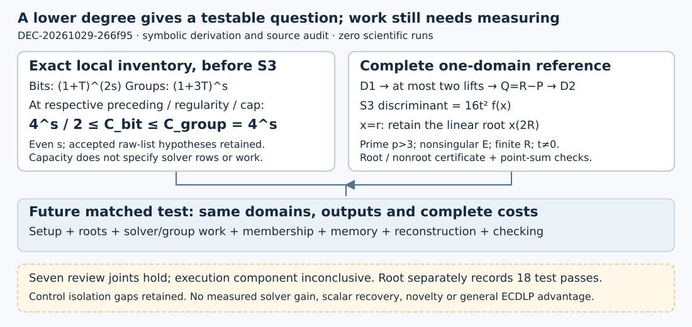

# A cost bridge from lower degree to a testable solver question

**DEC-20261029-266f95 — approve scoped archival acceptance.** The frozen producer and one independent derivation agree on the symbolic counts and conditional complementary-point reference. Seven review joints hold. The software execution component remains **inconclusive in the independent review**; a separate root-observed receipt records **18 fixed correctness tests passing**. No comparative or scientific run occurred.

## Observation and exact scope

Producer TASK-20261029-2e3655 is published at `8c9cbfb9c785367887433d3a7a1215ed9daeaeee`; its eight-path snapshot is `c15cf8e7a3e0bfa4e72c3a6da898d491f1086288`. Reviewer TASK-20261029-58d7a7 sealed a pre-code derivation, then audited only the permitted implementation/test sources. All three review artifacts were published at `844cbdf419c4731bac3ab6df9cf0e66f65e1a420`. The unchanged native independence check passed at `2026-10-29T20:01:23.964499+00:00`; exact parsed receipt and checked hashes are in [review-inputs.json](review-inputs.json).

For the accepted **even-s raw generator lists**, assume s≥2, p>max(3,s), nonzero original weights, two disjoint s-bit coordinate blocks, nonsingular short Weierstrass curve, and finite rational target R=(r,t), t≠0. Prior DEC-0857a9 establishes d_bit=1+3s/2 and d_group=s+1. This review concerns the accounting consequences, not a new proof of those premises.

The local highest-part quotients, **before S3**, have Hilbert series (1+T)^(2s) and (1+3T)^s. Their prefix counts are

    C_bit(D) = Σ[j≤min(D,2s)] binom(2s,j)
    C_group(D) = Σ[j≤min(D,s)] binom(s,j)·3^j.

| Paired position | Bit cutoff | Group cutoff | Exact comparison |
|---|---:|---:|---|
| One below regularity | 3s/2 | s | C_bit < 4^s for every even s≥2 |
| Regularity | 3s/2+1 | s+1 | Equality only at s=2 |
| Mutant closure cap | 3s/2+2 | s+2 | Equality only at s=2,4 |

In every row, **4^s/2 ≤ C_bit ≤ C_group=4^s**. These local inventories have the same exponential order. Ordinary ambient capacities instead equal binom(2s+D,D) and binom(3s+D,D). Neither capacity fixes actual rows, columns, pivots, fill, or search work. A constant-one equation makes a system trivially inconsistent without changing its local-domain inventory. The full highest-part quotient and the affine solution quotient are also distinct objects.

*Symbolic formulas and a method diagram, not measurements. Sources: producer Sections 1–4 and the reviewer’s pre-code Sections 1–5. No RUN IDs, samples or uncertainty bars apply.*

## Comparison: a complete one-domain reference

For **any mathematically prime p>3**, nonsingular E:y²=f(x)=x³+ax+b, finite R=(r,t) with t≠0, and duplicate-free affine domains D1,D2, enumerate the rational lifts over D1 and test Q=R−P against D2. Domains may overlap. Infinity is excluded. All mode returns the complete ordered projected set with witnesses; K≤2|D1|−1_{r∈D1}. First mode always declares completeness false.

The independent completeness calculation sets h=x−r and c=−rx−2r²−a:

    S3(x,z,r) = h²z² + (2hc−4t²)z + c²−4t²(x+r)
    discriminant = 16t² f(x).

For h≠0, a checked root y²=f(x) gives all second roots (−(2hc−4t²)±4ty)/(2h²). Zero y gives one root. At h=0 the equation is linear, with its unique root x(2R); P=R yields infinity and P=−R yields the finite complement. Tangencies, zero ordinates, and order-three targets remain covered symbolically.

The separate checker imports no producer helpers. It verifies one lift-status record per D1 coordinate, all roots/signs, the complete projected set after D2 filtering, and independent point-sum equations. A global Euler-certified nonsquare Z permits a nonroot certificate w≠0, w²=Zf(x). **Producing w costs a square root too.** Witness sums are checked with division-free chord/tangent equations. The parser supplies no primality proof; correctness remains conditional on the prime premise.

| Independent joint | Actual verdict |
|---|---|
| Local prefix counts; ambient/actual-work distinction | holds; holds |
| Rational completeness; complementary reference | holds; holds |
| Certificate checker; costs/setup; decision boundary | holds; holds; holds |
| Mode and software scope | Mode semantics hold by audit; execution component inconclusive |

The reviewer found no source defect falsifying the conditional algorithm/checker. It ran no tests and read no result receipt. Root’s separate one-attempt receipt records 18 passes on fixed p=5,7,13 fixtures, including two p=7 curves, with tiny exhaustive test oracles. Those are software checks, not a comparative sample or an all-prime execution proof.

## Inference and required accounting

With B1=|D1|, a safe producer expression is setup + O(B1·(E+S_actual+G+M+1)) + O(K log(K+1)) output comparisons + certificate/output construction and serialization. E is Euler testing; S_actual includes each root call’s initialization/verification; G is group work; M is D2 membership. Every nonsquare row needs its twisted root. Deterministic nonsquare search is charged by actual probes, without an expected-constant claim. `euler_probes` counts setup only.

The checker independently pays setup, one Euler(Z), O(B1·(I+M+1)) root/certificate work, output comparison, and O(K) field operations for division-free witnesses; I is field inversion. It extracts no new square roots. Domain indexing, expected hash-lookup assumptions, actual input bit lengths, retained records, serialization, and field-operation bit costs remain charged. Root extraction uses ordinary Tonelli–Shanks, without a constant-time claim.

This makes a future matched test concrete: same domains, projection multiplicity, first/all mode, exceptions, setup/reuse, actual solver work, memory, reconstruction and checking, with the complementary reference included. Any comparative execution needs a new frozen protocol and native admission. Local capacities neither establish nor rule out an actual SAT/Gröbner gain. The reviewer’s sharper asymptotics remain outside the frozen producer acceptance.

## Limitations, custody and next action

Coverage gaps remain: no isolated mutation of a genuinely square radicand into a nonsquare row; invalid-input checker mutations can also fail on the changed input digest; no dedicated order-three target fixture or all Tonelli–Shanks valuations. These limit control claims, without refuting the source proof. Isolate them in a prospective additive software amendment before comparative use; do not edit this snapshot.

The pre-code seal clock (19:56:55 UTC), hash and read order are attested, not independently authenticated or separately archived before source access. The exact first-byte read time is unknown. Implementation-specific cost and division-free-check refinements are labeled post-code. One reviewer is not a quorum or a line-by-line blind audit of producer prose. Model/effort were requested as native gpt-6.1-sol/xhigh, without provider authentication or an opaque UUID. No post-dispatch messages were exchanged.

Root reported an additional S3 checkpoint push failure because the required profile/upload token was unavailable and AWS profiles were empty; no upload, bypass or retry followed. Source/review custody is Git-published, with no verified new S3 copy. Root must render/inspect every PDF page and bind the exact nine-path ledger union before archival effect. Pending render/custody fields are explicit in the manifest.

Historical `diagram.svg`, `review-summary.svg`, and `grouped-review-summary.svg` under the regularity study were inspected and left unchanged: they describe immutable prior proof/review scopes. This new diagram supplements them; no shared frontier status changes. No H/EV/KN or goal transition is made. Formal verification, novelty, actual solving-degree or runtime gain, unknown-scalar recovery and general ECDLP advantage remain unestablished. GOAL-PFDR-fd09e0 remains active; prior PNEXT `invalid_output` remains unchanged.

Primary-source boundaries: [Salizzoni, Definitions 2.4–2.5 and Propositions 3.10/3.13](https://arxiv.org/html/2304.13485) concerns the specified mutant closure and qualified upper bounds, not actual solver necessity. The raw grouped s=2 list retains quartic maximum input degree; Proposition 3.13’s input-degree premise does not hold there. [RFC 9380, Appendix I](https://www.rfc-editor.org/rfc/rfc9380.html#appendix-I) and [F.2.1.1](https://www.rfc-editor.org/rfc/rfc9380.html#appendix-F.2.1.1) supply standard square-root and sqrt-ratio mechanisms, not novelty or performance evidence for this implementation.
