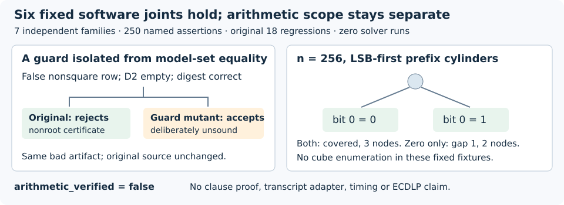

# Fixed checker controls and sparse prefix coverage

**DEC-20261029-76b793: approve scoped archival acceptance.** All six software review joints hold. The independent reviewer actually executed seven fixed families containing **250 passing named assertions**, followed by the exact original **18-test regression suite**, with two return-zero suite invocations and no repair or repeat. Producer execution separately passed seven families and the same 18 regressions. These are fixed correctness observations, not scientific samples or performance measurements.

This decision adds execution evidence to the source-audited cost bridge. **DEC-20261029-266f95 retains its historical independent-execution-inconclusive finding.** All original sources, tests, receipts and scientific statuses remain unchanged. The new utility has no transcript adapter and always reports `arithmetic_verified=false`.

| Fixed review joint | Actual result and its limit |
|---|---|
| False nonroot isolation | On the p=5 fixture, empty D2 keeps the projected set empty. The false nonsquare row fails exactly `invalid nonroot certificate`; suppressing only that guard in an isolated in-memory mutant admits the same bad artifact. The mutant certifies nothing. |
| Rehashed input guards | Correctly recomputed digests exclude digest mismatch as the cause. Duplicate domain, singular curve, off-curve target and zero target ordinate fail their four named guards; `solve` rejects them too. |
| On-curve wrong sums | The fixed (0,4) projection survives both mutations. The original checker separately rejects wrong sum abscissa and same-abscissa wrong ordinate; independent addition verifies the latter is −R. |
| Exceptional/root paths | At p=7 the order-three target preserves the unique (0,0) projection with (−R,−R), and its deletion fails completeness. At p=17 the general-root path agrees with an independent tiny group oracle; v₂(p−1)=4, Z=3 and two deterministic setup probes are checked. |
| Prefix coverage | Nine cover/gap cases and eleven invalid inputs pass. Three n=256 cases use no cube enumeration; each returned gap is independently checked against its domain and all supplied prefixes. |
| Execution custody | Both independent commands actually ran. All frozen hashes agree before, after and at Coordinator inspection; command/stream digests and embedded harness bytes also match. |

The diagram shows recorded fixed outcomes, not a benchmark. The source references are `prefix_cover.py`, the unchanged `reference.py` and `check_reference.py`, and the independent harness/receipt under `TASK-20261029-3c8d06/`. All file identities and exact commands are in `review-inputs.json`.

The utility covers **LSB-first prefix cylinders**. A pair `(d,k)` represents n-bit assignments whose lowest d bits equal k. Optional auxiliary range is `bits >> m < bound`. A terminal trie node covers its subtree; an absent valid child gives a concrete zero-filled gap. Prefixes whose minimum auxiliary value already exceeds the range are pruned. Empty prefixes, duplicates, overlapping prefixes and empty auxiliary domains are explicitly covered by the fixed tests.

The n=256 two-half cover, one-half hole and empty-prefix cover allocate **3, 2 and 1 nodes**, respectively; the one-half gap is **1**. The auxiliary boundary cover has 13 nodes, its hole has 12 nodes and gap 5; the censored fixture has gap 2. Source accounting is at most `1 + sum(depth)` allocated nodes and **O(number of prefixes + sum of depths)** input/trie operations, plus integer-bit, input and output costs. Many zero-depth inputs still require validation; an exponentially long prefix list remains expensive. These observations and source reasoning are not a formal all-input complexity proof or a measured advantage.

One separate reviewer authored assertions without reading the producer's new tests, results or README, but could read/import the fixed targets. This is independent software testing, not blind theorem derivation. Its epoch-1 dispatch failed at a provider usage limit before outputs or suite invocations; that failed release is preserved. The same blinded actor resumed under epoch 2 after permitted administrative identity/ownership messages. Native Codex gpt-6.1-sol/xhigh/fork-none was requested; authenticated serving model/effort and opaque session UUID remain unknown. One reviewer is not a review quorum.

The unchanged native independence checker passed at **2026-10-30T00:51:34.094187+00:00**. Coordinator recomputed its source hash, all four review hashes, each argv/stdout/stderr digest, embedded harness identity and all frozen before/after/current source hashes. The manifest embeds the exact parsed native receipt plus the original receipt-file SHA256, without claiming identical JSON serialization. No additional software test or solver was run for synthesis.

Producer source `47c25f284d` is bound by the five-path snapshot `dc4d2997af67`. Review source `6edcddc5ae` and completed epoch-2 release `f020b956bb` bind four outputs. Ledger TASK-20261029-5a7c65 was claimed at `a513bd23b5`, epoch 1. Prior PR2679 merged; this continuation uses `codex/prime-sat-controls-review-20261030`. Root inspected fresh main `bd4288fa68` against `c98828b779` and found no scoped changes. The reconciliation receipt's earlier null execution field is a pre-review observation, superseded by the sealed execution receipt.

Full ledger validation refused **155,566 off-disk tracked paths**; no bypass occurred. Scoped pre-change hygiene and the pre-PDF artifact-store check passed according to root, without establishing full-ledger/final-head approval. Prior PDF artifact uploads and remote readbacks succeeded. The separate checkpoint helper earlier selected no admitted credential transport, despite working ambient AWS CLI access. A configured-provider credential export is now available to root, but the new checkpoint bridge has not uploaded at synthesis. Actual later rendering, artifact and checkpoint outcomes belong in the manifest; none is assumed here. Root must render/inspect the PDF and bind the exact ten-path archive.

Finite tests do not prove all-prime software correctness. Four malformed inputs isolate four guards, and p=17 does not cover every Tonelli–Shanks valuation. The 250 assertions are related checks within seven families. Probe/node counts and wall timestamps establish only narrow software/custody facts. No formal proof, novelty, solving-degree gain, measured solver speedup, scalar recovery or general ECDLP advantage is established. No H/EV/KN or goal transition occurs; GOAL-PFDR-fd09e0 remains active. Historical PNEXT `invalid_output` remains unchanged.

The next concrete integration candidate is a separately admitted adapter for the existing LSB-prefix transcript. It must validate every algebraic refutation, each model/projection fiber and the auxiliary domain **before** coverage can support a completeness conclusion. A Boolean gap need not be an arithmetic model. Arbitrary-literal clauses from a future partial-trail propagator do not fit this prefix interface directly; they require a separate proof/completeness interface or explicit restriction with conversion cost charged. No such adapter or solver execution is accepted here.

The existing regularity producer/review diagrams and prior cost-bridge review diagram were inspected and left unchanged: each records a separate historical scope. This new diagram adds fixed software observations without changing any canonical scientific relationship or frontier status.
