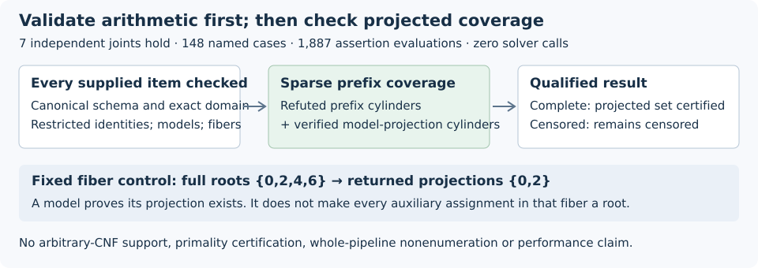

# Arithmetic-validated prefix transcripts: fixed integration accepted

**DEC-20261030-676356 approves scoped archival acceptance of the additive adapter.** All seven independent review joints hold. One independently authored suite executed **148 named cases and 1,887 assertion evaluations**, all passing, with zero forbidden solver/search calls. The fixed four-arm curve fixture agrees with the original exhaustive verifier for complete/censored acceptance and all prescribed negative mutations. This establishes fixed software compatibility and checking behavior, not a measured solver advantage.

The implemented callables are `verify_transcript(...)` and `verify_encoding_search(cell, arm, answer)`. They accept the existing learner’s transcript shape while preserving the original encoding, arithmetic core and sparse-cover utility byte-for-byte. No expected-model census is an operational argument, and no solver, polynomial search or historical PNEXT replay occurred.

| Independent joint | Named cases | Actual observation |
|---|---:|---|
| Canonical schema | 66 | Malformed scalars, sparse masks/aliases, coefficients, containers and missing fields fail; invalid items after a closing proof are still rejected. |
| Prefix identities | 18 | Separate variable-set arithmetic confirms the fixed nonconstant identity; coefficient, restriction and clause mutations fail. |
| Model/fiber scope | 9 | Full models are checked, repeated projections rejected, and the four-root/two-projection fixture retains its projected-only interpretation. |
| Exact domain | 19 | Independent tiny domains agree with numeric bounds; missing, repeated, below-bound, partial and projected clauses fail. Empty-domain records are still validated. |
| Coverage/censoring | 5 | Missing coverage rejects a complete claim. Covered censored input stays censored. The n=256 constant-refutation fixture uses one prefix/node. |
| Legacy integration | 28 | All four fixed arms match direct unchanged `verify_search`; missing model14, missing leaf0, multiplier corruption, invalid model0 and duplicate projection14 fail both interfaces. |
| Actual execution/custody | 3 | One successful suite, unchanged source/harness hashes and no guard-sentinel calls; all attempts and outputs retained. |

The adapter first parses every generator and multiplier, checks each exact restricted identity, validates all model assignments, rejects repeated projections and verifies the supported domain. Only then does it pass the refuted prefix cylinders and valid model-projection cylinders to the trie. Any actual root avoids the refuted cylinders; coverage therefore places its **projection** in the returned set. A valid model proves that its projection exists, without asserting that every auxiliary assignment in its cylinder is a root.

The domain is either the full cube or the exact legacy full-width auxiliary-range exclusion CNF. Shape, distinct blocked values and cardinality establish equivalence to the numeric bound without enumerating missing assignments. Arbitrary CNF is unsupported. `cover_complete` records coverage; `projected_model_set_complete` additionally requires declared `complete`. Censored status is never promoted. An uncovered integer is a coverage gap, not an arithmetic SAT witness.

In the fixed **p=5, a=b=1, s=2, R=(0,1)** fixture, a separately written curve/group oracle gives coordinate pairs **(2,3), (3,2), (3,3)** and packed projections **11, 14, 15** in every arm. Canonical full witnesses are 11,14,15 for quartic/membership and 11,14,79 for quadratic/quadratic_aa. The known witness P=(2,4), Q=(3,4) sums to R. Test-only enumeration was limited to the fixed generic n≤5 domains and this n≤7 legacy fixture; the old exhaustive checker was used only there. The synthetic n=256 constant-one refutation is not a 256-bit curve or ECDLP result.

The generic API checks Boolean-quotient identities modulo canonical integer p≥2 and returns `prime_field_verified=false`. The identity implication needs no primality certificate; the EC wrapper’s curve interpretation still assumes mathematical primality and its explicit curve/target/digit conditions. The decoded-mapping API rejects integer/string mask aliases but cannot guarantee that an upstream raw JSON parser rejected duplicate identical textual keys.

Only the **certificate-completeness phase** removes the old explicit 2^n exhaustion loop. Parsing, restriction, identity term-pair arithmetic, model evaluation, domain validation and trie counters are separate from construction and witness checks. Input/trie work follows the number of prefixes plus their total depth, with at most one plus that depth sum allocated nodes; integer/input/output costs remain additional. Certificates may themselves be large, the legacy range CNF can have 2^w−p clauses, and membership build still enumerates its truth table. The fixed membership arm records 32 curve tests and 64 transform subtractions as construction costs. No whole-pipeline scaling or timing conclusion follows.

Producer execution retained two successful attempts: **239 assertions, then 242** after adding three already specified rejection checks before snapshot. The adapter and fixed fixtures did not change; the new harness did. Independent execution used one invocation with 148 named cases and 1,887 evaluations. These are different counting units and are not summed, ratioed or treated as independent scientific samples.

Coordinator verified the actual source/receipt identities, 148 distinct cases, all 1,887 outcomes and per-joint tallies. The unchanged native gate passed at **2026-10-30T02:14:17.077910+00:00**. Its parsed receipt, original-file hash, commands and exact custody chain are in `review-inputs.json`; synthesis ran no software suite. The reviewer’s formatting-only receipt compaction preserved its payload: Coordinator reproduced both the disclosed original pretty-file hash and current canonical digest. No extra execution occurred.

This was one independent assertion/execution review with permitted target-code access, not blind theorem derivation. The reviewer disclosed a missing policy path, delayed restoration/read of another policy before execution, and a mandatory external non-scientific runtime-policy read. No mathematical unblinding or target change was reported. Requested model/effort and opaque session identity remain unauthenticated.

The producer snapshot, sealed review, completed reviewer release and current ledger claim are published. Root merged PR2755’s main head cleanly and restored unchanged scoped bytes. Scoped hygiene/artifact policy passed; full ledger validation refused **155,609 off-disk tracked paths**, without bypass. A prior-branch in-progress checkpoint and RESUME/metadata readback passed, with no restore test. Final PDF inspection, ten-path archive and final checkpoint remain root-owned; the manifest distinguishes actual observations from pending outcomes.

Finite testing establishes neither universal correctness, formal verification, novelty, degree reduction, search efficiency, runtime speedup nor scalar recovery. Historical PNEXT `invalid_output`, old decisions and all H/EV/KN statuses remain unchanged. **GOAL-PFDR-fd09e0 remains active.** The five prior mathematical/cost/control diagrams were inspected and retained as historical records; the new diagram adds this integration observation without changing a canonical scientific relationship.

Future partial-trail clauses may use arbitrary literal subsets, so the prefix interface does not directly certify them. Such search changes need a separate completeness/proof interface or an explicit prefix restriction with conversion costs. Local membership construction and modular coefficient-root certificates remain unadmitted alternatives; no further experiment or implementation is authorized by this acceptance.
