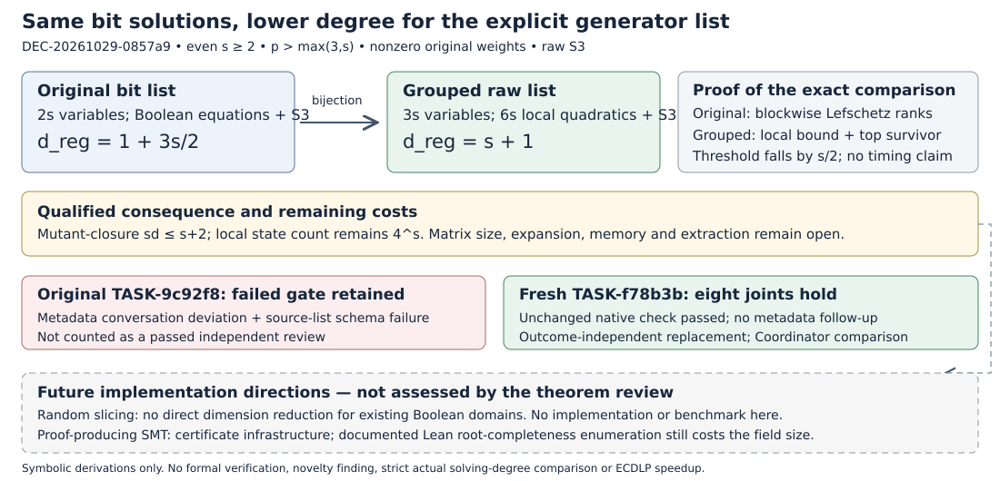

# A checked degree reduction by grouping pairs of bits

**DEC-20261029-0857a9 — approve scoped archival acceptance.** One admissible fresh blind reviewer independently derived all eight mathematical joints. Coordinator comparison supports the frozen producer's even-width, raw-S3 statement. The original review remains procedurally failed. This is a symbolic result about explicit polynomial generators; no scientific trial, formal verification, novelty finding or general ECDLP speedup is claimed. Official archival effect requires the separate native ledger binding.

## Accepted scope and inference

Let p>max(3,s), with even s>=2. Use a nonsingular short Weierstrass curve over F_p, finite rational target R=(r,t) with t!=0, and two disjoint s-bit affine abscissa maps with nonzero original weights. F0 consists of the 2s Boolean equations and the raw fixed-target S3 quartic. Group bits into pairs within each coordinate. Fg replaces each pair by three nonzero-word indicators, lists their Boolean equations and pairwise products, and substitutes the bit projections into raw S3. It contains 3s variables and 6s local quadratics plus S3; no circuit auxiliaries or affine reduction are included.

For each pair, the allowed indicator states are zero and the three unit vectors. Projection b0=u10+u11, b1=u01+u11 has inverse u10=b0(1-b1), u01=(1-b0)b1, u11=b0*b1. This gives exact bit models and isomorphic affine quotients in different rings. Coordinate injectivity is a separate requirement when distinct coordinate models are intended.

Using the first degree filled by the ideal of the **listed generators' highest homogeneous parts** [1],

\[
d_{\rm reg}(F_0)=1+\frac{3s}{2},\qquad
 d_{\rm reg}(F_g)=s+1,\qquad
 d_{\rm reg}(F_0)-d_{\rm reg}(F_g)=\frac{s}{2}.
\]

The local top quotient is a tensor product of s factors k⊕k³ with square-zero positive part. Its Hilbert series (1+3T)^s gives the upper bound. Quotienting each degree-one factor by its coordinate contribution preserves nonzero top degree and kills the raw quartic top, proving equality. Separately, blockwise weighted Lefschetz ranks at p>s give the exact original threshold, including a surviving preceding-degree component [2]. The general local construction over any field gives H(T)=∏g(1+(2^w_g−1)T), exact local threshold G+1 and only an upper bound for arbitrary added equations.

Salizzoni's degree-compatible **mutant-closure** convention gives sd_sigma(Fg)<=max(d_reg(Fg)+1,4)=s+2 [3]. At s=2 the raw degree-four input must still be charged. No strict comparison of actual solving degrees follows.

## Observation and comparison

The producer TASK-e95503 was frozen at `25750271e9` and snapshot-bound at `6a298121de`. Fresh successor TASK-f78b3b was sealed at `f282866e49`; its unchanged native independence check returned zero with all joints attested. Hashes match the sealed inputs, and the attestation records no administrative follow-up or procedure deviation. Full TASK IDs, commit identities, exact receipt and source hashes are in `grouped-review-inputs.json`.

| Joint | Successor verdict | Coordinator comparison with frozen producer |
|---|---|---|
| Local models | holds | Zero and unit states over any field; zero word retained. |
| Bijection and ideals | holds | Explicit inverse and quotient isomorphism; ambient ideals differ. |
| Representation counts | holds | Actual widths; 3s variables, 6s local quadratics for even s. |
| Hilbert series | holds | Local highest-part series distinguished from full quotient. |
| Regularity | holds | General upper bound; exact frozen even-s raw value. |
| Baseline | holds | Blockwise maximal ranks and nonvanishing establish equality. |
| Solving-degree transfer | holds | Source-qualified upper bound; degree-four boundary retained. |
| Costs and scope | holds | More variables and unchanged state count prevent a runtime inference. |

The seven false-control classes are addressed: omit pairwise products; remove the zero word; add unanalyzed circuit variables; remove the baseline's characteristic/weight assumptions; add constant one; let group width grow; or transfer mutant closure to arbitrary matrix truncation/runtime. Each loses a necessary premise or overstates the conclusion. For example, adding z=u² to u²−u leaves highest-part ideal (u²) in k[u,z], so a reconstructible auxiliary can destroy finite regularity. A constant-one generator gives threshold zero.

Both sealed reviews also derive odd-width and locally reduced-list extensions, including a separate s=2 proof. Those reviewer-derived statements are retained **outside this decision's accepted frozen producer scope**; they are not silently promoted to a broader accepted theorem.

## Procedure and retained failure

Original TASK-9c92f8 returned mathematically concordant derivations but failed the native gate twice: its source list used objects instead of strings, and it truthfully declared a metadata-only exchange prohibited by its original conversation rule. Its report, attestation and exact failure remain unchanged. No mathematical unblinding is alleged. The exchange receipt preserves that exact original reply bytes/timestamp are unavailable after compaction.

The decision to commission a fresh replacement was published at `095e8d3a51` **before** root received original verdicts or read the outputs. The successor retained all eight questions and controls; only its new prospective policy permitted typed administrative metadata. It used none. Count one admissible blind review, not two passed reviews; Coordinator synthesis is not another independent review or a line-by-line independent audit of producer prose. Native gpt-6.1-sol/xhigh was requested, but provider model/effort were not authenticated. The original remains failed under the native failure-provenance archive route.

## Limitations and implementation directions

The local quotient still has dimension 4^s, equal to the original assignment count. Fixed-width local construction is linear, but expansion of the quartic can require O(N^4) terms. Larger widths incur exponential variables/constraints. Elimination columns, rows, fill-in, memory, arithmetic, reconstruction and checking remain unmeasured. No arbitrary auxiliary-variable encoding inherits the bound. There is no established first/last-fall-degree improvement, strict actual solving-degree comparison, solver speedup, unknown-scalar recovery or general prime-field ECDLP advantage. Historical PNEXT `invalid_output` and all old statuses remain unchanged.

**Implementation directions not assessed by this theorem review.** Randomized finite-field slicing returns a checked SAT witness or UNKNOWN and targets positive-dimensional systems [4]; the present Boolean domains are already zero-dimensional or empty, so no direct dimension-reduction benefit follows. Proof-producing finite-field SMT offers cvc5/FFPACHECK/Carcara and Lean-SMT infrastructure [5]. Its documented Lean root-completeness check evaluates the whole field; efficient verified GCD remains future work. Neither implementation was installed or run here, and no source performance was reproduced. Benchmark counts are omitted because the author copy's introduction and Table I disagree. The narrow materialized-path search found no mentions; it is not a whole-repository novelty or never-tried finding. These directions supply no premise for theorem acceptance.

Next: render and inspect this report, complete actual metadata and verify the twelve-path ledger archive; then separately admit any implementation, broader theorem or formalization work with full costs. GOAL-PFDR-fd09e0 remains active. No H/EV/KN promotion is made. Existing `diagram.svg` and `review-summary.svg` remain historical two-summand records; `next-leads.svg` remains its earlier candidate snapshot. Their labels were inspected and left unchanged; no shared frontier graph is changed by this bounded TASK decision.

## Primary sources and record anchors

1. [Caminata–Gorla, Definition 1.4](https://arxiv.org/html/2112.05579v2).
2. [Phuong–Tran, Theorem 2.7](https://arxiv.org/html/2211.13548).
3. [Salizzoni, Definition 2.5 and Proposition 3.10](https://arxiv.org/html/2304.13485).
4. [Goharshady et al., Randomized Satisfiability Checking, Algorithm 1 and Section IV](https://repositum.tuwien.at/handle/20.500.12708/230467?mode=full).
5. [Saccomani et al., Proof Production, Sections III–V and footnote 1](https://hanielbarbosa.com/papers/2026fmcad-ffproofs.pdf).

Producer: `grouped-proof.md` Sections 2–6. Admissible independent derivation: `TASK-20261029-f78b3b/blind-review.md` Joints 1–8. Failed original: `TASK-20261029-9c92f8/`. Governing successor plan and technical failure receipts: `coordination/prime_sat_regularity_20261029/grouped-review/replacement-01/`. Derived formulae are symbolic, not measured; no performance chart is warranted.
