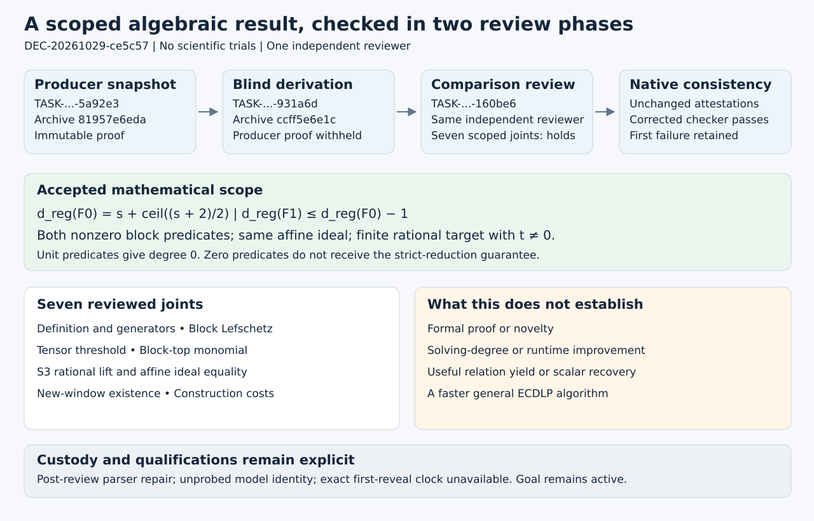

# A checked regularity reduction for the specified two-summand presentation

DEC-20261029-ce5c57 approves archival acceptance of a scoped independently checked algebraic derivation. The baseline degree of regularity is exact; adding two nonzero exact membership predicates reduces it by at least one while preserving the same affine ideal. This is not a solving-degree or runtime result. No hypothesis/evidence/corpus promotion or persistent-goal completion is made. Official archival acceptance requires the separate native ledger binding.

## Exact scope

Let E/F_p be nonsingular in short-Weierstrass form, with p>3, and let R=(r,t) be a finite rational target with t≠0. Encode each of two candidate abscissas by an injective affine map of s≥2 Boolean variables with nonzero weights and 2^s≤p. Let F0 consist of the Boolean equations and the fixed-target S3 quartic. Let F1 additionally contain each block's exact multilinear rejection predicate M_i: value1 for a nonsquare cubic value and value0 for square values including zero. Both M_i must be nonzero.

Using the degree at which the ideal of the *listed generators' highest homogeneous parts* fills the homogeneous component,

- d_reg(F0) = s + ceil((s+2)/2) = 1+s+floor((s+1)/2), exactly;
- d_reg(F1) ≤ s+floor((s+1)/2) = d_reg(F0)−1;
- (F0) = (F1) in the same affine polynomial ring.

This is the generating-system convention of [Caminata–Gorla, Definition1.4](https://arxiv.org/html/2112.05579v2). A zero rejection polynomial does not satisfy the nonzero-per-block premise. A constant-one predicate gives a unit ideal, trivial inconsistency and degree0. No exact augmented value is claimed for arbitrary nonconstant predicates.

## Observation

The producer proof is frozen at SHA256 `2858005e9837f15d3f61901002c16d60aa4ffdd038f8beb3ea7b3bbca62c65f1`. Producer snapshot TASK-20261029-13be29 is bound to commit `81957e6edae3144c333d28a648e8f8f79ca38706`. The separate blind snapshot TASK-20261029-d7cc8b is bound to `ccff5e6e1cc0b804df97c812b689f517a00b8eb1`. Both actual native archive contracts were checked before this decision was prepared.

One fresh reviewer, `/root/regularity_blind_reviewer`, first completed TASK-20261029-931a6d without the producer proof, then continued as comparison TASK-20261029-160be6 after the blind archive. These are two phases of one independent reviewer, not two independent reviews or models. Full input hashes and archive bindings are retained in [review-inputs.json](review-inputs.json). There were no scientific trials or numerical sweeps for this proof review.

The original independence check returned two failures because Git-addressed citations of the reviewer's own authorized blind files did not match their repository-relative identities. Read-only Git-blob hashing confirmed identical bytes. A documented native parser repair retained the same grants and attestations. The corrected check returned0 with no findings; its checker SHA256 is `8f26e440b28214f1bbd59167011d9737c9d7020eb6b3b287dd8cd536d6950bc0`. The technical regression receipt reports113 passing tests, including9 new identity tests. These counts are software-check results, not scientific sample sizes. The initial failure and an initial sparse-checkout test-import failure remain preserved. See the [linked problem](../../problems/review-git-source-identity-mismatch.md).

## Comparison

The Coordinator inspected the proof, blind derivation, comparison arguments and unchanged check inputs. All seven assigned comparison joints are `holds` within their stated scope.

| Joint | Result and reason | Exact review anchor |
|---|---|---|
| definition_and_generators | holds — Correct listed-generator highest-part convention; affine Boolean equations remain distinct from their homogeneous tops. | review.md §1; blind-rederivation.md §4 |
| block_lefschetz_and_characteristic | holds — Weighted blockwise maximal ranks require nonzero weights and characteristic zero or p>s; no p>ms premise is introduced. | review.md §2; blind-rederivation.md §§1–2 |
| tensor_exact_threshold | holds — Full multigraded rank computation gives vanishing above the threshold and a surviving preceding-degree component. | review.md §3; blind-rederivation.md §2 |
| membership_top_degree_kill | holds — Complement multiplication generates the full block-top monomial; unit and zero cases are separate; general augmented result is an upper bound. | review.md §4; blind-rederivation.md §3 |
| s3_top_and_affine_equivalence | holds — Quartic top is the product of block squares; the rational line identity and split Boolean algebra prove the same affine ideal. | review.md §5; blind-rederivation.md §§4–5 |
| nonzero_membership_window_bridge | holds — Hasse ensures a rejected start for a new window on an odd-order curve at p>3; no unchanged-fixed-window or useful-yield guarantee. | review.md §6; blind-rederivation.md §6 |
| cost_and_claim_boundary | holds — Construction, coefficient storage and coordinate search are charged; no solver, scalar-recovery or runtime advantage follows. | review.md §7; blind-rederivation.md §§6–7 |

The full worked arguments are in [review.md](review.md) and the [archived blind derivation](TASK-20261029-931a6d/blind-rederivation.md). For odd s, the central binomial coefficients may tie; the rank cutoff used by both derivations handles that tie. The producer's brief “strict unimodality” wording does not invalidate the derived threshold. The expected coordinate-search bound requires uniform independent sampling; no fast deterministic guarantee is inferred.

## Inference

Modulo the variable squares, the quartic top is L1²L2². Blockwise strong Lefschetz supplies maximal multiplication ranks under p>s and nonzero weights; tensor ranks establish both the vanishing threshold and a nonzero component immediately before it. The external input is [Phuong–Tran, Theorem2.7](https://arxiv.org/html/2211.13548).

A nonzero homogeneous squarefree block form generates its full top monomial: multiply a nonzero support term by its complement; all other terms acquire a square and vanish. Removing each block-top component yields the augmented upper bound. The algebra-only m-block extension has exact baseline (m−1)s+ceil((s+e)/2) and upper bound (m−1)(s−1)+ceil((s+e)/2), for m≥2,1≤e≤s and characteristic0 or p>s. It does not establish elliptic rational-membership equivalence at higher arity.

Rationality is a separate argument. Writing N=x1*x2−r(x1+x2)−2r²−a gives S3=N²−4t²(x1+x2+r). At a zero, lambda=N/(2t) defines a rational line through −R whose cubic intersection factors at x1,x2,r, including multiplicities. This supplies rational ordinates even when coordinates coincide. The Boolean quotient is a product of copies of F_p, so functions vanishing on all S3 zeros belong to its generated ideal. Thus the affine ideals agree. The [Kosters–Yeo summation-polynomial definition](https://arxiv.org/html/1503.08001) supplies context; its algebraic-closure statement alone would not prove this rational lift.

For a newly chosen window on an odd-prime-order curve at p>3, [Hasse's theorem](https://math.mit.edu/classes/18.783/2023/LectureNotes7.pdf) gives at least p/2−sqrt(p)>0 rejected abscissas. Choosing one as a window start makes its rejection predicate nonzero when 2^s≤p. This does not repair a pre-existing all-valid window or prove useful factor-base yield.

## Limitation

A lower generating-system degree does not lower an invariant attached only to the common affine ideal. It proves neither a solving-degree nor first/last-fall-degree decrease, and no SAT/Gröbner runtime, relation-yield, scalar-recovery or general ECDLP advantage.

Dense membership construction still costs O(2^s log p) field multiplications for character tests, O(s2^s) transform operations and O(2^s) field elements per distinct domain. Coordinate search is additionally charged: uniform independent sampling has an expected bound, while a deterministic scan may require p tests. A constant-one window is empty and cannot be presented as a useful factor base.

No proof assistant or novelty audit was used. Runtime/model/effort were reported as native Codex, gpt-6.1-sol and xhigh under the prospective substitution; no provider probe independently authenticated those values. The exact first-reveal wall-clock timestamp was not separately recorded; archive order and the reveal event were. The native checker tests declared-read consistency, not honesty of every attestation or mathematical truth.

The historical PNEXT native receipt remains invalid_output. Neither its measurements nor its separately reported supplemental mathematical replay were independently revalidated or used as proof evidence here. The producer's historical empirical aside is outside this decision. All old records and producer proof-status remain unchanged.

## Next actions and graph inventory

Complete PDF rendering/inspection and the existing native ledger archive. Then proceed to the separately admitted grouped-indicator package and a fresh blind-only review. Future grouped, higher-arity and single-invalid-word leads are not findings of this decision. The broader persistent objective remains active.

The study's original diagram/report and `knowledge/leads/ecdlp/ic-prime/LEAD-ICP-shared-coefficient-membership.yaml` were inspected and left unchanged. The old producer report remains a faithful pre-review snapshot; the canonical lead concerns a different coefficient-membership mechanism and receives no disposition change. The new diagram communicates proof obligations and custody. There is no performance plot because this review produced no measured scientific dataset.
