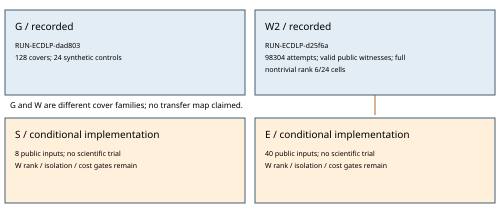

# Implemented Prym experiments and recorded results

Updated 2026-10-21 for [issue #2414](https://github.com/aburan28/crypto-autoresearcher/issues/2414) and [PR #2415](https://github.com/aburan28/crypto-autoresearcher/pull/2415). This is an implementation and observational report, with no scientific-state promotion or attack-cost advantage. [status.json](status.json) tracks the exact stages and gates.

Two admitted experiments have run. Both independent checkers passed. The source-labelled relations are concrete, but the fixed generator did not attain complete unknown-column rank on its whole panel. Selector and blind-recovery implementations retain their prerequisites; neither has run as a scientific experiment.

| Stage | Recorded scope | Result and limit |
|---|---|---|
| G, RUN-ECDLP-dad803 | 64 primary covers, 64 matched companions, Fp/Fp2 and forward/reverse enumeration, 24 synthetic controls | All prescribed checks passed. Frobenius overlap on 3/64 primary and 4/64 companion covers. No complete independent genus-3 Frobenius certificate or Jacobian maps. |
| W2, RUN-ECDLP-d25f6a | Eight fresh curves, three seeds, 64 public source scalars and 64 fixed sampled branches each; 98,304 attempts, 11 controls | Every accepted witness and reported rank passed independent checking. Six cells attain rank U>0, six have U=0 from public anchors, twelve have rank below U. No speed comparison. |
| S | Separate training/attack/census workers; real, shuffled-label, split-product and transported-coordinate arms; eight new public input curves | Implemented, not admitted or executed. W2 rank prerequisite unmet, isolation unavailable here, complete-cost baseline unbound. |
| E | Forty public instances with subgroup bits 11,13,15,17; salted challenges, output seals, same-base IC comparator, finite rho and independent final checker | Conditional implementation, not admitted or executed. Rank/S-benefit/isolation/current-best complete-S gates remain open. |



The [geometry run report](../../../experiments/EXP-ECDLP-da4ba3/reports/run-20261019T0603Z/report.md) and [W2 run report](../../../experiments/EXP-ECDLP-cded08/reports/run-20261021T1437Z/report.md) contain exact commands, clean revisions, units, resources, raw links and inspected PDFs. Specifications remain the source of execution authority. The historical phrase “32 covers” is still unidentified and is not the input catalogue.

## Code and observations

[relations.py](relations.py) implements cubic interpolation on C:y²=x⁶+A x²+B, with pi1=(x²,y) and pi2=(B/x²,B y/x³). For public a it lifts -[a]P, adds three signed native base lifts and factors the residual quadratic. A successful principal function supplies sum(e_j F_j)=[a]P. Independent EC arithmetic, Vandermonde interpolation, polynomial factors, infinity terms and auxiliary norm sums check the witness. False scalars/signs, missing infinity terms, repeated intersections, unknown tuple-first labels and post-hoc kernel locators are rejected. This is existing fixed-generator engineering scope, not a compact router beyond P1546.

[projection.py](projection.py) removes columns whose logs the declared public source schedule already reveals. Rank is modulo the actual prime r, with consistency, pivot and solution certificates. Both F101 bases became entirely public (U=0); the two F211 curves reached U in all seeds; F431 cells fell short; F4099 cells accepted no rows. These observations concern exactly the frozen 64-branch stream, not general impossibility or deployed-curve security.

[selector_pipeline.py](selector_pipeline.py) integrates the histogram selector, finite canonical sampling, identity A/A, shuffled labels, independent auxiliary labels, coordinate transport and an [independent census](census.py). Canonical IDs determine train/holdout membership independently of seed. Models freeze before holdout/census. Attack workers receive no census truth. Finite-support exhaustion is retained rather than repaired by duplicates or replacement curves. Training, rejections, feature acquisition and rank work are recorded as partial raw units, not complete weighted S.

[blind_recovery.py](blind_recovery.py) wires the candidate to the existing `mitm`, m=2, `harvest=off` IC solver with identical base points. This concrete comparator is not qualified as current best at every size. The parent draws uniform synthetic k, writes a salted hiding commitment/private verifier file, passes only public P,Q/configuration, and seals exact attack stdout before consulting k. All seeds repeat the same Q; no multi-target amortization is claimed. Native E authority is checked before a scientific challenge. Explicit target witnesses and final kP=Q checks are independent. The finite plain rho comparator is not a certified optimized usable-action reference.

## Prospective inputs and remaining gates

The original S request was impossible on its smallest field: the genus-2 Hasse bound at p=101 allows at most 125,440 canonical candidates under that full-source policy, fewer than the requested 131,072 train-plus-holdout candidates. The revised, unapproved S design uses fresh A=1 curves at p=4099,8191,16381,32749, excludes W fixtures, and explicitly bounds sources at 256. This revision precedes all S acceptance labels; W2 results are disclosed as already seen. Finite-support exhaustion still has to be measured and retained.

Eight S and forty E inputs were materialized with all rejected searches, then independently checked for field/subgroup primality, curve order, generator and native maps. EC1 field/curve/generator metadata supplies shared IC/rho identity; instance/base IDs remain separate. No log labels or E secrets were supplied. [input-validation.json](input-validation.json) records these checks; input construction is not an S/E relation or recovery measurement.

Required isolation is **unavailable here**: Landlock returns ENOSYS; bubblewrap cannot set up its user-ID mapping. [isolation.py](isolation.py) refuses workers with no unisolated fallback. The software test checks refusal, not successful isolation. An enforceable file/network boundary must be demonstrated in a suitable runtime before secret-separated execution.

S/E remain `review_required`. Other gates include full orbit/stream and cost audits, a nontrivial full-rank constructor, independently qualified current-best IC and complete S weights, optimized reference binding, and fresh native plans/handoffs/archive/admission. Conditional entrypoints are not execution approval. Original frozen W files remain intact; W2 is a fresh-ID schema-only successor after review found a missing manifest certificate field. No completed stream was extended after outcomes.

## Validation and next step

Thirteen [software controls](software-tests.txt) pass: planted principal-function/census agreement, false witnesses, rank, aliases, coordinate and identity A/A, finite support, V2 manifest schema, same-base IC/planted descent, output-seal mutations, gates and isolation refusal. Planted scalar/base tests are not scientific blind recovery. The earlier isolation test failed because the capability is missing; the revised test explicitly checks refusal and the limitation stays open.

```sh
PYTHONPATH=research/prym_experiment_design_20261019/implementation python3 -m unittest discover -s research/prym_experiment_design_20261019/implementation -p 'test_*.py' -v
```

Next: a prospectively frozen source constructor or distinct repair yielding useful rank, then the same matched controls and complete-cost baseline. A selective filter alone does not supply missing independent equations. The compact-router problem stays open. No canonical scientific frontier graph changed; these dated diagrams describe implementation and finite observations. The accompanying PDF was visually inspected before publication.
