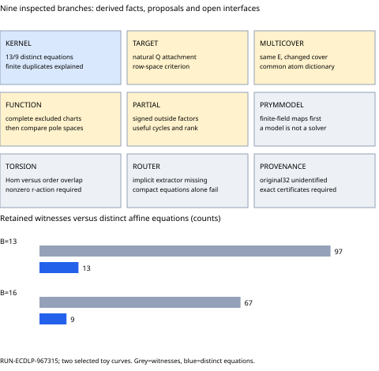

# Prym follow-up: relation diversity, charts and new leads

27 October 2026. RQ-ECDLP-002 / GOAL-ECDLP-001 / BATCH-581771. This round is a source-grounded search and deterministic review of retained data. It launches no new scientific trial, generates no target, and changes no hypothesis or goal status. The prior experiment and sealed review remain immutable. Nine named branches were inspected; this is not an exhaustion theorem for every Prym construction.

## What the retained evidence now explains

RUN-ECDLP-967315 completed 4,587,520 attempts on E: Y^2=U^3+2U+B over F_4099. B=13 has subgroup order4021 and generator(0,264); B=16 has order4111 and generator(0,4). The sixteen-atom base contains one public anchor, leaving fifteen unknown columns. All figures below are exploratory post-data deductions of the already sealed matrices, not fresh samples.

| B | Native witnesses | Distinct affine equations | Rank/U | Nullity | Identifiable individual logs |
|---|---:|---:|---:|---:|---:|
| 13 | 97 | 13 | 13/15 | 2 | 0 |
| 16 | 67 | 9 | 9/15 | 6 | 0 |

Every distinct equation is independent. Each repeated group has exactly one source scalar, interpolation polynomial and complete six-point zero divisor. Its multiplicity is exactly the number of admissible triples chosen from the five remaining zeroes: exclude x=0 and require distinct norm x-coordinates. The actual and predicted subset sets match for every group. Multiplicities are4/7/10 on B13 and2/4/7/10 on B16. This explains the numerical loss of equation diversity within the retained stream. It does not establish a constructor-wide rank bound or an asymptotic obstruction.

Both column-support graphs are connected, and every column is represented. The separate advisory session independently reproduced the matrix ranks, kernels, absence of identifiable individual logs, distinct-equation counts and weighted-pair deductions. Its full support pattern has matching rank15, so connectivity or an unused-column explanation is insufficient. The later complete-divisor multiplicity explanation is root-derived and separately labelled; it is not a new sealed scientific review.

## What deficient rank still determines

For consistent Mz=b over F_r, the value of v*z is fixed by these equations exactly when v annihilates ker(M), equivalently v is in rowspace(M). A certificate lambda*M=v gives v*z=lambda*b. A new row w raises rank exactly when w*K is nonzero for a basis K of the right kernel. These are standard linear-algebra facts. They apply to the supplied equations alone, not every relation that the elliptic group may satisfy.

No unit vector is identifiable in either matrix. None of the225 signed support-at-most-two directions (units and e_i plus/minus e_j, counted up to sign) is identifiable. Arbitrary coefficients are different: each matrix has exactly one projective identifiable pair. Indices are zero-based in projection.unknown_points, with z_j the canonical atom log relative to P.

    B13: z_0 + 310*z_12 = 1599 (mod 4021)
    B16: z_1 + 2*z_5 = 60 (mod 4111)

Both identities have explicit retained-row combination certificates and separate elliptic point checks. Neither determines either individual logarithm, and neither adds an independent equation. The kernel-column scan covers15 singletons,105 pairs and455 triples per curve; the numbers of minimal three-column circuits are442 and2. The uniform-vector fraction r^(-nullity) is an exact vector-space count, not a model for geometric target descent.

A prescribed public Q still needs a naturally generated certificate beta*k+alpha=v*z, beta nonzero modulo r, with v in the rowspace. Then k=(lambda*b-alpha)/beta. Selecting v first and manufacturing its known-log point reverses the required interface. Natural target attachment, failed queries, setup, memory and source return remain unmeasured. This is why full-base rank need not be the sole acceptance criterion, while a row-space test alone is not a descent algorithm.

## First new collector comparison: isolate x=0

The current cover C:y^2=x^6+2x^2+B is smooth at its rational x=0 points. Its elliptic map is(U,Y)=(x^2,y). The complementary map(W,V)=(B/x^2,B*y/x^3) extends to the elliptic identity at x=0. The existing producer and independent checker ALREADY implement that extension:16 and6 accepted witnesses respectively contain a residual zero root.

The exclusions are narrower: lift_source rejects x=0, and descriptor rejects an interpolation constraint there. Thus public source a=1 is omitted, and each of29/33 active source blocks loses C(15,2)*4^3=6,720 branches containing the known anchor. The observed D counts194,880/221,760 match that identity. This is a deliberate frozen chart restriction, not a correctness defect in the old experiment.

The first prospective comparison should change only source/constraint x=0 handling, reusing the same E, P, sixteen atoms, original64-source order, cubic law and complete35,840 branches per source. Preserve the old reference; retain repeated-x, pole-order, sign/deck and canonicalization checks. Verify full principal, E1 and E2 witnesses, including source-zero, constraint-zero, residual-zero and transported controls. Score distinct projected affine signatures and new kernel syndromes, then rank; native witness counts alone are insufficient. Acceptance labels for this changed arm have not been collected.

## A second constructor boundary: pole completion

The old constructor also rejected417/451 cases when v(x)^2-F(x) lost its degree-six term. A leading cubic coefficient plus/minus1 may give valid degree-five or degree-four intersections with unequal infinity pole orders. Those cases need new principal-divisor certificates, not reuse of the fixed(3,3) witness.

The two C infinity points map to O on E1 and(0,+/-B) on E2. If their pole multiplicities are m_plus,m_minus, the E2 pole contribution is(m_plus-m_minus)*(0,B). Requiring the old zero companion sum would be wrong. Complete this cubic boundary with x=0 policy held fixed; compare any larger Riemann-Roch function space separately, charging its parameter enumeration and residual factorization. No excluded case was replayed here, and the number of additional useful equations is unknown.

## Same elliptic curve, genuinely different covers

Let f(U)=U^3+A*U+B be separable in odd characteristic. For c=f(t) nonzero, define the smooth genus-two cover

    C_t: y^2=f(x^2+t)
    pi_t(x,y)=(x^2+t,y) in the SAME E.
    E'_t: V^2=W^3+(3*t^2+A)*W^2+3*t*c*W+c^2
    (W,V)=(c/x^2,c*y/x^3).

Expansion proves the displayed equations, and t=0 reproduces the old family. Smoothness follows because a repeated root of f(x^2+t) would force either f(t)=0 or a repeated root of f. Distinct t values have distinct branch support over E; this is known quadratic-pullback geometry [1], not a new attack construction. Cover automorphisms/isomorphisms and equivalent projected relation spaces still need accounting.

A comparison such as t=0,-1 requires a fresh common projected atom base whose points lift to BOTH covers. The old sixteen atoms need not all lift after translation. Match canonical E atom IDs/signs and use identical public sources before stacking rows; unrelated E curves or native C columns cannot be stacked. Changing the cover, common-base selection and projection each incurs cost. Rank gain after the second cover is unmeasured. P1546's fixed-branch accounting still applies to an explicit finite catalogue; this proposal measures finite relation-space diversity rather than claiming an exponent improvement.

## Five filed follow-up candidates

These are complete falsifiable adaptations with controls, scope, prior-art/lead references, heuristic-validation routes and explicit unknown complexity. They are proposals, not experiment approval or validated new algorithms.

| Proposal | Concrete follow-up | Status |
|---|---|---|
| IDEA-20261027-d434c8 | Retained kernel features and natural target-row certificates | adaptation; unexecuted |
| IDEA-20261027-0bbc32 | Translated quadratic covers of the same E as a row-space control | adaptation; unexecuted |
| IDEA-20261027-d217c2 | Pole-complete Riemann–Roch filtration for the native constructor | adaptation; unexecuted |
| IDEA-20261027-ef2530 | Signed partial cycles with a nonzero Q coefficient | adaptation; unexecuted |
| IDEA-20261027-d5c1ee | Isolated x=0 completion of the native source/interpolation chart | adaptation; unexecuted |

The retained-kernel diagnosis recommended by the generator is now carried out in this round. The first new collector test is the isolated x=0 arm. Target-row construction remains the decisive recovery interface. Pole completion, partial relations and aligned same-E cover comparisons follow under separate protocols. Signed partial cycles must retain outside identities and both norm components, reject zero-Q coefficients modulo r, and count independent equations after all aliases. Existing P-256 F3/F4 work is a predecessor, not a natural-target success result.

## Coverage and precise remaining gaps

| Branch | Present scope/status | Missing operation |
|---|---|---|
| KERNEL | derived post data | A general constructor invariant is not established. |
| TARGET | known criterion open constructor | A natural public-Q relation with such a v and nonzero Q coefficient. |
| MULTICOVER | known geometry proposed comparison | Common liftable projected base and measured new syndrome/rank after paid second cover. |
| FUNCTION | source derived unexecuted | Exact witness/checker handling for pole strata; extraction cost for added higher-degree parameters. |
| PARTIAL | proposed | Exact signed residual representation, cancellation graph, source/Q coefficients, useful rank and total work. |
| PRYMMODEL | known construction open finite field interface | Finite-field field-of-definition, explicit isogeny, nonzero subgroup action and destination relation algorithm. |
| TORSION | known obstruction scoped | An additional efficient correspondence with field/kernel/r-action certificates, or a nonlinear public router. |
| ROUTER | open without new extraction mechanism | A substantive branch-selection/extraction method beyond rewriting those equations. |
| PROVENANCE | unidentified | Exact curve equations, field/primes, maps, complete Frobenius polynomials and reproducible decomposition certificates for those items. |

In the present genus-two family the Prym is elliptic. A genus-three double cover instead has a two-dimensional Prym; the two settings cannot be conflated. Enolski-Fedorov construct related genus-two Jacobians for a complex(1,2)-polarized Prym family [2]. Applying those formulas over finite fields needs field-of-definition, specialization, explicit-map and subgroup certificates. A model or point-count match does not supply a solver.

Tate's theorem identifies base-field algebraic homomorphisms through Galois-equivariant Tate modules [3]. Coprime Frobenius polynomials imply Hom(E,A)=0 over that field. Abstract order-r overlap is a different condition: the map kP to kT is not efficiently evaluable on Q merely because T exists. The natural anti-invariant projector kills the pullback E component. These facts constrain direct transfers; auxiliary nonlinear relation construction remains a separate question.

Diem's plane-quartic theorem gives an expected O-tilde(q) class-group DLP algorithm for nonhyperelliptic genus-three curves [4]. Comparing that stated destination bound with a source subgroup r of scale q does not supply a cheaper-than-square-root source algorithm. This is a scope check for that solver, not a lower bound on every image-specific method.

The merged P-256 study already has explicit same-field covers, subgroup injection, a scoped component calculation, unexpanded membership circuits and partial stitching certificates. Its stated custody/model/blindness limits remain. A new native Dickson remainder wrapper was rejected here as a new algorithm: a compact incidence equation does not solve implicit extraction. High-degree/implicit/target-dependent routing remains an open operation with no new extractor supplied in this round.

The original32covers source remains unidentified. The external Genus3Covers repository [5] is a concrete code/data lead, read at README level only; its Magma code was not executed and it has not been equated with those32 objects. No new Frobenius decompositions were computed.

## Sources, validation and limitations

[1] Claus Diem, Families of elliptic curves with genus2 covers of degree2, introduction and normalized-cover discussion: https://arxiv.org/pdf/math/0312413 . Primary source retrieved/read; construction/gluing context, no DLP algorithm claimed.

[2] Enolski and Fedorov, Algebraic description of Jacobians isogeneous to certain Prym varieties with polarization(1,2), introduction/Theorem1.1: https://arxiv.org/pdf/1411.6143 . Primary source retrieved/read; its over-C assumptions are retained.

[3] Yuri Zarhin, Homomorphisms of abelian varieties over finite fields, Theorems11.1-11.2 and Corollary11.3: https://arxiv.org/pdf/0711.1615 . The original Tate PDF timed out; this primary proof text was read instead.

[4] Claus Diem, On the discrete logarithm problem for plane curves, Theorems1-2: https://www.numdam.org/article/JTNB_2012__24_3_639_0.pdf . The exact plane-model hypotheses are retained.

[5] AndrewVSutherland/Genus3Covers README: https://github.com/AndrewVSutherland/Genus3Covers . A candidate source, not the original catalogue or a new computation.

Internal primary sources are P1546 at main351c9c021, IDEA-20260909-4c5ee9, RQ-ECDLP-002, the merged P-256 report, RUN-ECDLP-967315 and its sealed independent review. The retained raw logical SHA-256 is8f3d5b98b91b01dab9694e3a4c59a4559dbd7bcfa1cb7c4a3045475948fdb007. Full curve IDs, source hashes and row certificates are in derived/*.json and advisory/ranking.json.

The Joux-Vitse PDF request returned403 and the Frey-Kani PDF URL redirected to a profile; unseen theorem claims were not used. No crypto-kb retrieval MCP is exposed. The generated ledger indexes, full rendered frontier/147-lead atlas and relevant original records were checked, but sparse corpus gaps prevent an exhaustive novelty claim. Full ledger validation refused this sparse checkout; scoped native schema and hygiene checks are distinct from that full gate.

Root arithmetic scripts import no producer arithmetic, reproduce rank/kernel identities, enumerate finite coefficient/support or interpolation-subset sets, and retain certificates. The separate advisory cross-check is explicitly not a sealed independent scientific review of this new search. Historical counts and graphs remain unchanged; this dated graph adds derived equation diversity and search coverage. Four neutral exploratory daily gauges distinguish distinct equations and duplicate witnesses while preserving72 existing Prym series. No new timing, S, speedup, prescribed-computation proof, fresh target recovery or deployed-curve weakness is established.

Executable retained-data review commands are the three scripts in derived/: review_matrices.py with its explicit input/output arguments, review_matroid.py and review_duplicates.py. Outputs are write-once; do not rerun over existing files. Final archive records bind the exact sources, outputs and checks. An execution successor still needs a separately complete runnable frozen protocol, custody/checkpoint support and the normal run route.
