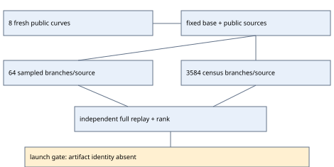

# Prym relation-rank census — prospective implementation, 2026-10-25

Implemented, with six passing planted software controls. **No scientific census trial has run.**
Experiment [EXP-ECDLP-d6d8e8](../../experiments/EXP-ECDLP-d6d8e8/specification.yaml)
remains `review_required`; no approval, evidence verdict, or hypothesis transition is recorded.
Tracks [issue #2414](https://github.com/aburan28/crypto-autoresearcher/issues/2414),
H-ECDLP-51f052 and IDEA-20260909-4c5ee9.

The question is whether the previously observed rank deficiency comes with too few
accepted rows or with dependent rows in a larger **finite** collector stream.
The earlier W2 run, RUN-ECDLP-d25f6a, recorded 448 accepted rows in 98,304 attempts:
six nontrivial full-rank cells, six all-public cells, and twelve deficient cells.
Those observations have been seen; the new panel has no observed relation-acceptance labels.

## Fixed comparison

The same eight-atom factor base and public source scalars `1..64` are used in both arms.
One fixed seed orders sources; it is not an independent curve replication. The sampled
arm uses 64 distinct tuple/sign branches per source. The census arm enumerates all
`binomial(8,3) * 4^3 = 3,584` branches. Each fixture therefore has 4,096 sampled
attempts and 229,376 census attempts. Eight fixtures give **1,867,776 prescribed
attempts**. These are derived workload sizes, not completed measurements.

Fresh fixtures follow a fixed prospective rule: A=2, the first two eligible B values
at each p in {101,211,431,4099}, excluding the prior W, S and E panels. Require prime
nonanomalous group order, smooth cover and quotients, and eight distinct norm classes.
Public input construction inspected 135 candidates, retained in `fixtures.json`;
independent order, generator, norm, freshness and EC1 checks pass in `input-validation.json`.
No factor-base logarithm table or target secret was generated.

| p | B | prime group order r |
| --- | --- | --- |
| 101 | 21, 30 | 107, 97 |
| 211 | 10, 24 | 199, 197 |
| 431 | 7, 65 | 433, 443 |
| 4099 | 13, 16 | 4021, 4111 |

All base points exposed by the declared public sources, including their negatives,
are removed in **both** arms. U=0 remains calibration and cannot count as unknown-log
recovery. The collector never stops at full rank and never adds anchors, replacement
fixtures or branches based on outcomes.

## Implemented measurements and checks

`rank_census.py` records every branch status in compact source blocks, with per-attempt
commitments. Accepted principal-function witnesses, row locations, exact rank modulo r,
source-end checkpoints, first full-rank location and a right-nullspace basis are retained.
The nullspace certificate concerns only the tested matrix; it proves no universal cap.

`check_census.py` imports the independent arithmetic and census implementations rather
than the collector. It independently decodes the branch grid, reconstructs all statuses,
replays accepted witnesses, checks complete public-column removal, rank progression,
finite nullspaces, atom-permutation A/A and sample-rowspace containment in the census.
An independent replay is not a prescribed-computation proof; none is supplied here.

The constructor and factor-base rules stay fixed. Native source-labelled cubic
interpolation is inherited from the earlier prototype; this introduces no new compact
router or demonstrated Prym-selector benefit. Distinctness here means fresh input
curves and an expanded prospective branch census, not a new algebraic mechanism.

Costs retain input-search counts, raw field/group/hash counters, online and final-certificate
matrix units, per-arm wall/CPU diagnostics, cache sizes and peak self RSS. Pow internals,
Python bookkeeping, byte movement, process-group peak sampling and independent counter
verification remain incomplete. These vectors are **not complete weighted S**, and no
timing, IC, rho or deployed-curve advantage is claimed.

## Software validation and present execution gate

Exact command: `python3 -m unittest discover -s research/prym_rank_census_20261025 -p 'test_census.py' -v`.
Six tests pass; `software-tests.txt` retains the output. They use the explicitly planted
F19 fixture, including a known valid relation, missing/changed branch data, false source
labels, false kernels, public-column removal and finite nested schedules. They do not
collect labels on the prospective eight-curve panel.

The repository now requires large raw data to be stored in
`s3://setec-astronomy-artifacts/store` using `tools/artifacts/artifacts.py`.
The configured runtime has no artifact-store identity. A normal AWS CLI access attempt
returned exit 255, “Unable to locate credentials.” `infrastructure-status.json` preserves
the command and observation. No credential files were inspected and no login was attempted.
Required next access is a configured identity with GetObject, PutObject and ListBucket
on the canonical prefix, followed by successful ordinary tool access. This access gap
prevents approval/launch with complete required archival custody; it says nothing about
the mathematics. The launcher retains native admission and clean-source checks.

After access is available, refresh and verify exact prospective source/input hashes,
require native preapproval, record and publish Coordinator approval, verify ordinary
`execution_state: ready`, claim the executor and run the fixed native trial. Publish raw
records before the derived run report. Resolve independent review before any scientific
state change. Larger-rank success would enable a separately admitted cost comparison;
finite deficiency would motivate one prospective constructor or base change.

Worker isolation remains a separate condition for future S/E blind recovery. Existing
frozen W/W2 artifacts and conditional S/E gates are preserved.

Sources: internal, retrieved from the immutable W2 report and run artifacts;
AGENTS.md at merged main ab0609ebe; current frozen prospective config, source and input files.
`diagram-source.json` and `render_design.py` generate this report's diagram and inspected PDF.
