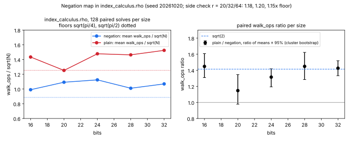

# The negation map in `index_calculus.rho` (2026-10-20)

**Change.** `crypto_autoresearcher.index_calculus.rho.pollard_rho` used to
walk on points (`A = 1`, about `√(πN/2)` steps). It now walks on the
classes `{X, −X}` by default (`A = 2`, about `√(πN/4)`), with two guards.
A Wiener–Zuccherato look-ahead replaces a flipped step that would take the
same jump again. A 16-point window catches short cycles, which the walk
leaves by doubling the member with the smallest `x`. These are the same
guards as crypto's matched reference
(`ic_boundary::RhoWalk::negation()`). The look-ahead's discarded additions
and the escapes' doublings are counted in `walk_ops`.

`negation=False` (CLI `--rho-walk plain` on `solve`, `sweep` and `census`)
runs the old walk. On 15 instances at 16, 20 and 24 bits it returned
bit-identical `k`, `walk_ops`, `setup_ops`, `walks` and `distinguished`.
Every `sweep`/`census` rho row and the `solve` output now record
`rho_walk` / `walk`.

**Why.** The IC census and sweep rows compare index calculus against this
rho. Without the negation map that reference is about `√2` too slow, which
flatters IC by `√2`. crypto's measurement audit records this as finding
X02/X03 (`docs/ic-measurement.html` in aburan28/crypto).

## Measurement

`measure.py`, seed 20261020. Sizes 16, 20, 24, 28 and 32 bits; 8
prime-order curves per size (`generate_prime_order_curve(bits, c)`, c =
0..7); 16 planted logs per curve. Each instance was solved by both walks
with the same seed. All 1,280 solves verified `kP = Q`. Unit: `walk_ops /
√N`. The interval is a cluster bootstrap over curves (4,000 resamples).
Records: [results.json](results.json).

| bits | pairs | negation | /√(π/4) | plain | /√(π/2) | plain/negation [95%] | look-ahead share | escape share | wall plain/neg |
|--:|--:|--:|--:|--:|--:|--:|--:|--:|--:|
| 16 | 128 | 0.991 | 1.118 | 1.435 | 1.145 | 1.448 [1.309, 1.608] | 0.0259 | 0.0016 | 1.024 |
| 20 | 128 | 1.092 | 1.232 | 1.253 | 0.999 | 1.147 [0.978, 1.346] | 0.0257 | 0.0007 | 0.934 |
| 24 | 128 | 1.124 | 1.269 | 1.478 | 1.180 | 1.315 [1.194, 1.418] | 0.0259 | 0.0007 | 0.981 |
| 28 | 128 | 1.011 | 1.140 | 1.464 | 1.168 | 1.449 [1.285, 1.622] | 0.0257 | 0.0007 | 1.101 |
| 32 | 128 | 1.069 | 1.207 | 1.525 | 1.217 | 1.426 [1.332, 1.519] | 0.0257 | 0.0007 | 1.085 |
| **all** | 640 | 1.057 | 1.193 | 1.431 | 1.142 | **1.353 [1.281, 1.425]** | 0.0257 | 0.0007 | 1.081 |

- The pooled saving is 1.353. Its interval reaches `√2 = 1.414` but sits
  mostly below it. The negation walk runs 1.19× its floor and the plain
  walk 1.14× its floor, so about 4% of the `√2` is lost. The look-ahead
  accounts for 2.6% of the walk's additions, and escapes for 0.07%.
- The 20-bit row (1.147 [0.978, 1.346]) is the outlier: its plain walk
  happened to land at its floor (0.999).
- **Side check, table size** (`jumps.py`, [jumps.json](jumps.json); 384
  solves each at 24–32 bits): with r = 20, 32 and 64 jumps the negation
  walk ran at 1.183, 1.201 and 1.150 times its floor (standard errors
  0.03). No size is clearly better, so the default stays at r = 20.
- **Wall time** (descriptive, single shared VM, interpreted Python): 1.08×
  pooled. Most of the counted saving goes to interpreter overhead per
  step. A first version with a generator-expression cycle scan was 0.76×
  (slower); the committed loop keeps a plain list of abscissae and returns
  identical counts.

Tests: `tests/test_index_calculus_fp.py` adds two. The first checks the
default walk, its counters and the plain walk's zero guards. The second
checks that on a 20-bit curve over 24 paired solves the negation walk is
within `√(πN/4)` bounds and below plain.

Companion study in aburan28/crypto:
`research/rho_negation_audit_20261020/`. It covers the ecbench matched
reference (`rho.negation`, plain/negation 1.371 [1.257, 1.491] at 28–40
bits) and the same fix in `volcano-rho`. There, the ICMS adapter asks this
solver for `--rho-walk plain` so its `rho.plain` label stays true.

Not changed: `harness/rho.py` (Floyd) and `harness/walk.py` (DP), the toy
KN-TECH-001 walks. They still walk on points.

PDF: [REPORT.pdf](REPORT.pdf).
