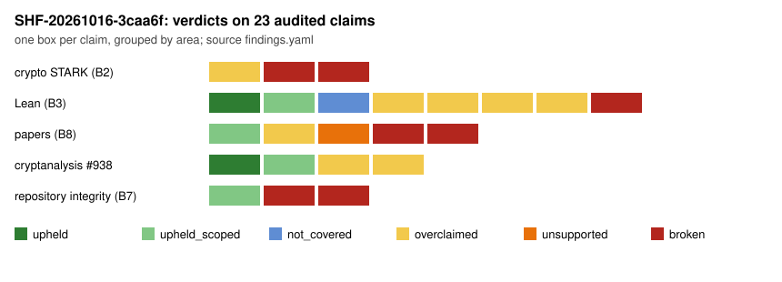

# Sheriff case SHF-20261016-3caa6f

This case is the first run of the `sheriff` skill: a deterministic sweep of all
three repositories at deep tier, plus an independent reader pass on four
joints. It is an **audit record**. It is not a validation report or a review
gate, it changes no research state, and it repairs nothing. Each finding says
what is wrong and what would fix it, and the repositories' owners and the
Coordinator decide what follows. The verdicts are in
[`findings.yaml`](findings.yaml) (`tools/sheriff.py check-case` passes) and the
sweep is in [`sweep.json`](sweep.json) / [`sweep.md`](sweep.md).

## Scope

| repository | commit audited | how |
| --- | --- | --- |
| crypto-autoresearcher | `3f78e0521b` (`origin/main` at sweep time) | in place, on the sheriff branch before its first commit |
| crypto | `3e7bcb7bc8` (`origin/main`) | in place; `ecbench` built from this commit |
| cryptanalysis | `77b5c02b96` (`origin/main`) | sparse worktree; four large data directories left out |

- **Sweep:** `python3 tools/sheriff.py sweep --target all --deep`. The
  instrument is `tools/sheriff.py` as committed in `1b199e221`.
- **Canary:** **passed**, 15 planted defects caught and 0 false positives.
- **Checkers:** 7 passed, 5 failed and 1 was advisory. Four were `not_covered`:
  no Lean toolchain fits in this container's disk.
- **Readers:**
  - `validator`: receipts, certificates, controls and preregistration of #938;
  - `red-team`: the #938 cost model;
  - `validator`: Lean;
  - `validator`: paper numbers;
  - the session itself: STARK mutation controls and a re-check of every
    load-bearing reader finding.

**Prior.** The prior was reconstructed when the case was composed, not written
before reading. That is a procedure deviation from B0. The pre-sweep survey had
already shown crypto's STARK verifiers discarding values and several Lean
projects without axiom audits, so those findings confirm a prior. The #938
findings do not, because no prior was held on it.

## Verdicts

23 claims audited:

| verdict | count |
| --- | --- |
| upheld | 2 |
| upheld (scoped) | 4 |
| overclaimed | 8 |
| unsupported | 1 |
| broken | 7 |
| not covered | 1 |

Findings: 2 blockers, 9 majors and 15 minors.

### Blockers: nothing may cite these until fixed

1. **crypto's STARK verifiers accept proofs of false statements (S1; C1–C3).**

   The case's mutation-control program
   ([`scripts/stark-mutation`](scripts/stark-mutation/src/main.rs), output
   [`checks/stark-mutation.jsonl`](checks/stark-mutation.jsonl)) built four
   proofs of false statements, and both verifiers accepted all four:

   - `stark::verify` accepted a proof that 1 doubled seven times is 12345.
   - `stark::verify` accepted an empty proof with no queries.
   - `stark_v2::verify` accepted an honest proof presented for a different
     boundary.
   - `stark_v2::verify` accepted an empty proof.

   Honest proofs verify. Why the mutants pass:

   - v1 never checks a transition (`let _ = val`).
   - v2 never relates the composition to the trace, and discards both
     challenges and the boundary.
   - Neither re-derives its query positions, or checks how many queries there
     are.
   - Neither has a negative test.

   The stated "~256-bit conjectured soundness" is a soundness error of 1.
   Nothing outside `crypto/src/zk` uses this code, so **no current research
   result depends on it**. It must never back a claim.
2. **The LLL degeneracy note reports an implementation bug as a curve property
   (P1; C12).**

   The note calls secp256k1's LLL failure "a curve-specific arithmetic
   phenomenon". crypto's own record
   (`research/notes/lattice-hnp/RESEARCH_GLV_HNP.md:232-251`) says it was an
   `f64` overflow in the Gram–Schmidt norms, fixed by scaling, with 8/8 seeds
   recovered on the 2026-09-27 re-run.

   An exact check ([`checks/f64-overflow.txt`](checks/f64-overflow.txt)) shows
   that among secp256k1, P-256 and brainpoolP256r1, only secp256k1's n⁴ exceeds
   `f64::MAX`. That is exactly the "curve specificity" the note reports. The
   PDF was rebuilt on 2026-10-11 with the superseded claim.

### Major

- **M1, unparseable record on main.** `ledger/decisions/DEC-20261016-5d2fb8.yaml`
  does not parse (line 91), so `check_merge_hygiene --absolute` fails on main.
- **M2, ledger errors beyond the baseline.** `validate_ledger` reports 349
  errors on main beyond its 1,210-entry baseline:
  - missing keys and required fields;
  - evidence citing runs the validator cannot index;
  - decisions about experiments it cannot index.

  Sampled references exist in git, so these read as schema and indexing
  failures, not missing artifacts. The CI gate compares head against base, so
  absolute errors accumulate on main
  ([`checks/validate-ledger.txt`](checks/validate-ledger.txt)).
- **L5, generic invariance used beyond its scope.** crypto's conductor-gap
  study calls a rho deviation "noise by theorem". Its Lean theorem covers only
  algorithms whose steps depend on group-operation outcomes (BSGS). ecbench's
  rho and kangaroo pick steps by hashing the point representation
  (`generic.rs:275`), so for them invariance holds only in expectation. The
  ℓ = 8209 rho interval that excluded 1 is unexplained, not noise by theorem.
- **L6, axiom claims with no retained evidence.** `#print axioms` claims for
  S3Roots and conductor_gap have no retained output, no audit file and no CI.
- **P3, an unsupported count in structural-completeness.** "16 562 ordinary
  curve instances" is a hard-coded literal in a different script's print
  statement. The cited scripts give another count.
- **P4, a wrong count in structural-completeness.** "All 621 primes p ≡ 1
  (mod 6) with p ≤ 5000": there are 330
  ([`checks/count-primes.txt`](checks/count-primes.txt)).
- **P5, assumptions dropped from the structural-completeness abstract.** The
  abstract says "proven … empirically verified" without the standing
  assumptions and tested ranges the body states.
- **K3, a changed field meaning in the cryptanalysis n=83 baseline row.**
  `s_ic_setup` changed meaning. B's 32.848 included the 520.8 s rank stage;
  the new 0.8856 excludes it. A setup comparison across rows shows a 37×
  "improvement" that is accounting. The cold figures (32.93 → 9.68) are
  comparable.
- **S2, an unfounded soundness formula.** stark_v2's soundness formula is not
  a STARK bound (see S1).

### The newest headline result holds within its stated scope

cryptanalysis #938, "n83 stacked producer: end-to-end cold 3.2391 [2.9809,
3.5240], improvement", is **upheld (scoped)**:

- **Preregistration.** It is provable from GitHub records: the protocol commit
  `24abca74` is the parent of the result commit, and CI ran once on it.
- **Re-derivation.** The primary ratio re-derives exactly (3.2390811991742288)
  from `protocol.json` alone, without the producer's analysis code.
- **Controls.** All controls pass their frozen gates.
- **Certificates.** Independent GF(2^83) arithmetic confirms `[k]G = Q` for all
  20 points and Q0.
- **Receipt.** `verify_receipt.py` reproduces `result.json` byte for byte. The
  401 run files match the CI artifact.

The scope it actually earns:

- one GitHub-hosted runner class and one run (Tier 1), with no other-host
  replay;
- a wall-time ratio, of which about 1.48× is host-independent operation counts;
- factor-base construction charged to neither arm.

It is an engineering improvement and a success under "Every improvement is a
success". Its gap to tuned rho, 94.4 [73.5, 125.3] cold, is the distance that
remains. The baseline row and ratchet deltas need correcting (K3, K4). The
cheapest falsification is a cross-host replay of the first 100 attempts of
rank block K1, ordered kS, kP, kP, kS: about ten minutes.

### Minor

All minors are listed in `findings.yaml`:

- **L1:** the THM_QUOTIENT_DESCENT1 axiom is a labelled stub and provable.
- **L2:** the background claim in THM_QUOTIENT_DESCENT1.md is false.
- **L3:** `native_decide` is called "proved".
- **L4:** TreeSplit miscounts the frob gap −1 cells (5, not 6).
- **L7:** the program paper's abstract says "proved in Lean".
- **P6:** the semaev paper cites artifacts only in its README.
- **R1, K1, K2, K4:** #938's scope and wording.
- **E1:** 7 killed ecbench sessions still read `running`.
- **E2:** CI never re-verifies 167 of 255 ecbench sessions, because they lie
  outside its globs.
- **X1:** two runbook sessions are unaudited.
- **X2:** three fb-archive files are unindexed.
- **X3:** instrument corrections, below.

## Per beat

| beat | result |
| --- | --- |
| B2 execution proofs, STARK/zk | No result in any repository is execution verified: every milestone of `docs/execution-proof-chain.md` is open, and no claim found says otherwise. The repository's own STARK code is unsound (S1). |
| B3 Lean | There is no `sorry`, `admit` or unlabelled custom axiom. Holes: one labelled stub axiom (L1). Trusted-base escapes: `native_decide` in TreeSplit (L3). There are statement-fidelity overreaches (L5, L7, C5), and axiom claims without evidence (L6). Builds, axiom audits and `lean4checker` are **not covered** (no Lean). |
| B4 certificates | #938 holds on all 20 points. LLL note: see P1. |
| B5 cost accounting | #938 is an engineering improvement. Its baseline-row semantics changed (K3). |
| B6 statistics and preregistration | #938 is preregistered, its A/A and planted controls pass, and nothing was excluded. The conductor-gap rho interval was dismissed by an inapplicable theorem (L5). |
| B7 provenance and integrity | Main has an unparseable record (M1) and 349 ledger errors (M2). 248 of 255 ecbench sessions pass integrity. One coverage gap in crypto's CI (E2). |
| B8 prose and numbers | Of the 47 untraced numbers in the three worst-tracing papers: 15 recompute, 14 were sweep false positives, 11 come from uncited artifacts, 3 are unsupported, and 4 are constants or parameters. Of the papers' claims, one is a superseded claim (P1), one count is wrong (P4) and one is unsupported (P3). |

## Not covered, and what would cover it

- **Lean builds, axiom audits and `lean4checker` in all three repositories.**
  - crypto-autoresearcher: `./formal/setup.sh`, then `lake build && lake env
    lean AxiomAudit.lean`.
  - crypto: per project, `lake exe cache get && lake build`.
  - cryptanalysis: `tools/lean/proof-gate.sh`.

  This container had about 4 GB of free disk, too little for the Mathlib cache.
- **Mutation controls for groth16 and plonk.** The sweep flagged crypto's
  `groth16.rs` (no negative test) and `plonk.rs` (`let _ = omega`), but the
  joint was not worked.
- **Leads not read:**
  - 16 proof-language leads and 283 strong-word leads outside the four joints;
  - 137 minor sweep findings, most of them untraced paper numbers in other
    papers and Lean projects without CI;
  - the 20 Lean files in `cryptanalysis:experiments/n83-packed-root-capacity-20261013`
    that have no toolchain pin;
  - the 3,337 legacy runs that `check_run_source_provenance` lists as unpinned.
- **Other-host replays** for #938 and for any ecbench session.

## Instrument corrections (X3)

The sweep is an instrument, so its defects are reported here, and each one is
fixed in `tools/sheriff.py` in the same PR:

- **ecbench checker.**
  - The sweep's ecbench checker omitted `--allow-interrupted` and matched
    `session.json` files from another harness. Its `sweep.json` row is
    superseded by [`checks/ecbench-sessions-rerun.txt`](checks/ecbench-sessions-rerun.txt).
  - It now selects sessions by schema and lists the ones outside CI's globs.
- **Number extraction**, found by the papers reader:
  - lists like `{19,37,79,109}` were read as thousands groups;
  - bibliography volumes and pages were counted as results;
  - 3-digit integers were skipped, which hid P4;
  - paths cited relative to the paper were not resolved.

  The canary now plants each of these.
- **Sparse checkouts.** The `fb-refs` failure was caused by the sparse
  worktree, not by the repository. Checker failures in a sparse checkout are
  now annotated.
- **Instrument identity.** Each sweep now records its instrument's sha256.

## What this case does not establish

- **Not a ruling on the hypotheses.** It establishes nothing about the truth of
  any hypothesis, and changes no status.
- **Only the audited claims.** The claims not inventoried here are neither
  upheld nor refuted. A clean sweep row means only that the check ran and
  passed on the recorded commits.
- **No execution proofs.** It establishes no execution integrity for any run,
  and replays are not proofs.
- **#938 at its stated scope only.** That 3.24× holds on another host class
  remains untested.
