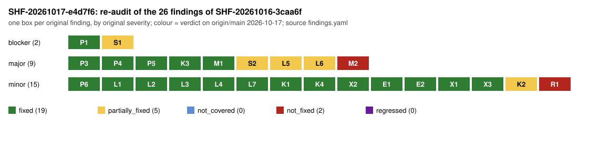

# Sheriff case SHF-20261017-e4d7f6: re-audit of SHF-20261016-3caa6f

This is an independent re-audit of every finding of
[`SHF-20261016-3caa6f`](../SHF-20261016-3caa6f/findings.yaml) on current
`origin/main`, followed by the normal deep sweep of all three repositories. It
is an **audit record**. It is not a validation report or a review gate, it
changes no research state, and it repairs nothing. The fix PRs' descriptions
were not trusted: every check was re-run.

The verdicts are in `findings.yaml`, with the per-original-finding table under
`original_finding_verdicts`; `tools/sheriff.py check-case` passes. The sweep is
in `sweep.json` and `sweep.md`, and the chart is `verdicts.svg`.

**Result: 19 of 26 findings are fixed, 5 are partially fixed (S1, S2, L5, L6,
K2), 2 are not fixed (M2, R1), and none regressed. Blocker S1 is not cleared:
both STARK verifiers still accept proofs of false statements.**

## Scope and binding

| repository | commit audited | how |
| --- | --- | --- |
| crypto-autoresearcher | `ea8a9f6f1d` (origin/main) | in place, on branch `claude/sheriff-reaudit-3caa6f` |
| crypto | `42b9ca8a5a` (origin/main) | sparse partial clone, anonymous read; `ecbench` built from this commit |
| cryptanalysis | `4fa77724f6` (origin/main) | sparse partial clone, anonymous read |

- The sweep was `tools/sheriff.py sweep --target all --deep` with the
  instrument at sha256 `f91dd78f…` (recorded in `sweep.json`). The canary
  passed: 15 planted defects caught, 0 false positives.
- This session produced none of the audited results or fixes.
- **Access limits.** `add_repo` for `aburan28/crypto` was refused by the
  permission classifier, and the GitHub API has no access to crypto or
  cryptanalysis from this session. So the CI runs of the crypto and
  cryptanalysis fix PRs are `not_covered` (`checks/ci-runs.txt`).
- **Disk limits.** Disk was tight, about 4 GB free at best, which limited the
  Lean coverage: only module-level builds were possible. The disk filled twice
  during the run, and nothing was lost.

## Prior

The prior was written before any fix was read; the file is `prior.md`. I
expected S1 to be partially fixed (the four known mutants patched, new mutants
still accepted). I expected S2, P1 and P3–P5 to be fixed in text, L1 possibly
not to compile, L6's workflows possibly never to have run, M2 at or above 287
and R1 not fixed. The audit confirmed the S1, L6, M2 and R1 expectations and
refuted the L1 one.

## Verdict table: the 26 original findings

| id | sev | claimed fix | verdict | basis (re-run here) |
| --- | --- | --- | --- | --- |
| **S1** | blocker | crypto#2014 | **partially_fixed** | 0/4 original mutants accepted, but 9 of 31 new mutants are accepted, including 3 frozen-heart forgeries of false statements in `stark_v2` (finding V1) |
| P1 | blocker | crypto#2015 | fixed | correction, PDF and re-run consistent; exact n⁴ > f64::MAX only for secp256k1; exact LLL recovers 5/5 on all eight curves |
| S2 | major | crypto#2014 | partially_fixed | old formula gone; the new 240/40-bit claim does not hold for this verifier (V2) |
| L5 | major | crypto#2026 | partially_fixed | narrowed in README, PROTOCOL and GenericInvariance; TransferBound and README §5 still overreach (L-N2) |
| L6 | major | crypto#2026 | partially_fixed | conductor_gap built and audited here, `[propext]` only; S3Roots build and both CI runs not covered; no log committed |
| P3 | major | crypto#2026 | fixed | 26,278 / 9,864 / 0 violations re-derived independently |
| P4 | major | crypto#2026 | fixed | 330 of 669 primes; CM-73 set {19, 37, 79, 109} reproduced |
| P5 | major | crypto#2026 | fixed | the abstract carries the assumptions and ranges |
| K3 | major | cryptanalysis#942 | fixed | `setup = cold − online` on every row; blind n=83 gives 9.66731 against the row's 9.6673 |
| M1 | major | autoresearcher#2293 | fixed | hashes match the registry; the replacement differs by one indent; hygiene `--absolute` passes |
| **M2** | major | autoresearcher#2296 | **not_fixed** | `validate_ledger`: **330** new errors (claimed 287); the triage is not done and the gate is disabled |
| L1 | minor | autoresearcher#2298 | fixed | **built here** on the pinned v4.35.0-rc1 and Mathlib `7fa22735`: axioms `[propext]`; proves-too-much fails as required; never built by CI |
| L2 | minor | autoresearcher#2298 | fixed | `S ∈ E(k)`, with a dated correction |
| L3 | minor | crypto#2033 | fixed | TreeSplit built here; the Leak theorems are kernel-checked; `replay_ok` is labelled compiler-trusted |
| L4 | minor | crypto#2033 | fixed | 5 cells at gap −1 and 15 at 0; dated correction; PDF regenerated |
| L7 | minor | crypto#2033 | fixed | "its root identity, Proposition 1, is proved in Lean" |
| P6 | minor | autoresearcher#2298 | fixed | artifacts cited with a key table; hashes match; replay byte-identical |
| K1 | minor | cryptanalysis#942 | fixed | wall-time label; 1.4773 operation-count ratio re-derived |
| K2 | minor | cryptanalysis#942 | partially_fixed | the uncharged phase is disclosed, but there are no group-op counts, so no GAE band |
| K4 | minor | cryptanalysis#942 | fixed | paired within-run deltas 305.8238 → 94.4168 and 0.13304 → 0.13912 |
| **R1** | minor | none | **not_fixed** | no other-host replay; the disclosure only was added (as expected) |
| X2 | minor | cryptanalysis#942 | fixed | `fbarchive.py verify`: 2,681 archives, 0 problems |
| E1 | minor | crypto#2033 | fixed | 256/256 sessions pass `--replay 0 --allow-interrupted`; the sessions themselves are untouched |
| E2 | minor | crypto#2033 | fixed | CI enumerates sessions by schema; ci-scope triggers on any session file |
| X1 | minor | autoresearcher#2298 | fixed | both sessions re-audited here with fresh nonces: clean at the same journal tips |
| X3 | minor | sheriff PR | fixed | the instrument digest is recorded; the canary passes; new instrument defects are filed as I1 |

## Blockers first

**V1 (blocker; S1 is not cleared): both STARK verifiers still accept proofs of
false statements.** The four original mutants are now rejected, and the module
has negative tests (`cargo test --release --lib zk::stark`: 18 passed). The B2
reader then wrote 31 new mutants, and the session re-ran them
(`scripts/readers/stark/new-mutants.session-rerun.jsonl`, the same nine
acceptances):

- **stark_v2, frozen heart.** `transcript_to_fri` (`stark_v2.rs:226-240`)
  absorbs only `FS_TAG` and the two commitments, never the public boundary
  values, n, the AIR, β or q. The prover therefore picks the public input
  after drawing α₁ and α₂, so that the boundary pole cancels, and `verify`
  accepts. This happened in both the fast and the default configuration, and
  for a row-6 boundary. The control with v+1 is rejected. The forgery is
  deterministic.
- **stark v1.** q is taken from the proof (`stark.rs:504`). A false output
  proved with q=1 is accepted. A rejected 20-query forgery cut to 3 queries is
  accepted. Grinding two broken rows at q=20 succeeds (attempt 107), and
  zero-fold FRI is accepted. v1 is documented as a spot-check that may not back
  a claim.
- Nothing outside `src/zk` uses these modules, so no research result depends
  on them.

The fix is to absorb the full statement before α₁, fix q and the FRI depth in
the verifier, and add these mutants as tests. Until then, mark both modules
unsound in their docs and at README:484.

No other blocker. P1 is fixed.

## New and residual findings

| id | sev | beat | what (short) |
| --- | --- | --- | --- |
| V1 | **blocker** | B2 | frozen-heart forgery in `stark_v2`; prover-chosen q, truncation and grinding in v1 |
| V2 | major | B2 | the stated 240/40-bit bound does not hold for this verifier and ignores SHA-256's limit |
| CI1 | major | B7 | 19 of 22 crypto-autoresearcher workflows are `disabled_manually`, including `validate` and `lean-verification` (since 2026-10-12); #2296 and #2298 ran only Cursor checks |
| M2-R | major | B7 | 330 new ledger errors and rising; 319 against the claimed 287 is unexplained; no triage record |
| V3 | minor | B2 | malleability (last FRI root, non-canonical values), a panic on oversize values, no out-of-domain sample, no README marker, test gaps |
| L-N1 | minor | B3 | `crypto:tools/lean/trusted-native.txt` still allow-lists the Leak theorems |
| L-N2 | minor | B3 | L5 residue: TransferBound docstring, rho/kangaroo under TransferBound, README §5's bold conclusion, "S = 1 is a theorem" |
| L-N7 | minor | B3 | no committed axiom-audit logs (L6 residue) |
| L-N8 | minor | B7 | `THM_QUOTIENT_DESCENT1.md` rewritten in place, without a dated note for the Status change |
| L-N9 | minor | B3 | the theorem is named "descends" but proves commutation (disclosed in the header) |
| P-N1 | minor | B8 | the LLL note's P-521 "catastrophic cancellation" mechanism is unsupported |
| P-N2 | minor | B6 | LLL re-run counts are probe executions; P-521 ran at k_bits=384, not 390 |
| P-N4/5/6 | minor | B8/B7 | P3 wording edges; recount README provenance; Markdown twin keeps the "unconditional" paragraph |
| P-N7 | minor | B8 | "exactly the gap −1 cells" remains in RESULTS.md:52 and report.typ:29 |
| E1-R | minor | B7 | never-finalised sessions have no records hash binding |
| R1-R | minor | B7 | no other-host replay of n=83 (carried) |
| K-N1..4 | minor | B5/B8 | missing GAE counts; "all reusable work" against the uncharged phases; mixed ratchet fields; an fb-archive gzip sentence; roundings |
| I1 | minor | B9 | instrument: `tree_digest` is identical for every clean tree; the sessions checker audits only the sparse worktree (6 of 256) and reports pass; sparse coverage loss; Lean found only on PATH |

## Per beat

- **B2.** The original harness gives 0/4 acceptances. The new mutants are
  accepted 9 of 31 times, as listed above. Rejected in both modules: a
  tampered and re-committed value, a wrong public input, a wrong AIR, a valid
  proof of another statement, a dropped FRI root or opening, and reordered or
  duplicated queries. Rejected in v2: a one-fold-short FRI, a tampered final
  constant, a zero composition, α₁ = 0, too few queries, and a blow-up
  mismatch. Honest controls accept 500/500. The v1 escape rates match
  (1−k/n)^q with |z| ≤ 1.35.
- **B3.** Session builds, logs in `scripts/lean-build/`:
  - **TranslationDescent:** builds, with axioms `[propext]`. Both
    proves-too-much variants (3•T and T=0) fail.
  - **conductor_gap:** 9 theorems, `[propext]`.
  - **TreeSplit:** the Leak theorems depend on `[propext, Quot.sound]`;
    `replay_ok` relies on a compiler axiom, which is disclosed.
  - **S3Roots:** not built, because its `Mathlib.Tactic` closure does not fit
    on disk.
  - **Fidelity:** the Lean reader passed statement fidelity a–e for
    TranslationDescent, and confirmed L2 on curves over F_1009 and F_211.
- **B4/B8 (papers).** The P1, P3, P4, P5, P6, L4 and L7 numbers were all
  re-derived blind. The deterministic sweep's untraced-number leads for the
  four papers the fixes changed went down: LLL 7→0, structural 23→0,
  rootfinding 19→4 and semaev 17→6. The remaining 4 and 6 were left to the
  papers reader, who traced every number in those papers. `make check` is not
  covered, since there is no TeX or Typst toolchain inside the producer trees.
- **B5.** K3 was checked on every row. The n=83 value was re-derived blind
  from the raw records. The GAE band still cannot be computed (K2/K-N1).
- **B7.**
  - M1 passes. M2 fails at 330.
  - 256/256 ecbench sessions pass integrity, and both runbook sessions
    re-audit clean.
  - `fbarchive.py verify` passes.
  - The CI gates of crypto-autoresearcher are disabled (CI1).

## Sweep leads, confirmed or dismissed

- **Confirmed:**
  - `lean.native_decide` on TreeSplit `Replay.lean:249`: disclosed as
    compiler-trusted, already covered by L3.
  - `check.ledger` (M2-R).
- **Dismissed as sparse-checkout artefacts:** `check.zk-stark-tests`,
  `check.curve-names`, `check.ecbench-bounds`, `check.fb-archive` and
  `check.fb-refs`. Each fails on a file outside the sparse set. The tests were
  re-run after adding the inputs (18 passed), and `fbarchive.py verify` was
  re-run with `toycurve.py` and `gf2n.py` supplied (0 problems).
- **Pre-existing, not regressions, not examined in this case (`not_covered`
  for their claims):**
  - `zk.no_negative_test` on `src/zk/groth16.rs`;
  - `zk.discarded_value` (`omega`) on `src/zk/plonk.rs:368`;
  - `lean.no_axiom_audit` on `formal/smoke`;
  - `lean.unpinned` on `research/endosweep_lean_review_20261016/evidence/R1`.
- **New untraced-number leads (227).** They sit in papers the fixes did not
  touch: `eigen-seta`, `ecdlp-constant`, `frobenius-orbits`, and the program
  paper's sections. Their cited artifacts are outside the sparse checkouts.
  This is coverage loss, not regression (I1c).
- **Five new strong-claim leads.** The LLL one is P-N1; the recount `.txt`
  ones are verbatim script output (P-N5).
- **63 original leads "gone".** These are mostly paths outside the sparse set.
  Only these were verified as genuinely resolved: the axiom stub, Leak's
  `native_decide`, the three missing axiom audits, and the stark
  discarded-value and trust-comment leads.

## Not covered, and the command that would cover it

- **CI runs for the crypto and cryptanalysis fix PRs** (L6, L3, E2, K):
  attach `aburan28/crypto` and `aburan28/cryptanalysis` to the session, then
  list the runs of `conductor-gap-lean.yml`, `rootfinding-s3roots-lean.yml`,
  `tree-split-structured-v-lean.yml` and `ecbench.yml`.
- **S3Roots build and axiom audit:** `cd papers/rootfinding-decomposition/lean
  && lake exe cache get && lake build && lake env lean AxiomAudit.lean`
  (needs about 6 GB of disk).
- **The whole `formal/` workspace build, `tools/verify_formal_targets.py` and
  lean4checker:** `./formal/setup.sh`, `python3 tools/rebuild_formal_root.py
  --workspace formal`, `cd formal && lake build && lake env lean
  AxiomAudit.lean`.
- **The 287 baseline at #2296:** run `python3 tools/validate_ledger.py` in a
  full worktree at `ecdb13bdff` (`experiments/` is 5.9 GB).
- **`refs.py check`, `curve-names`, `ecbench bound check`, and every sweep
  lead in papers whose artifacts sit outside the sparse sets:** re-sweep with
  full checkouts.
- **`make -C papers/<paper> check`:** needs TeX or Typst in the producer
  tree's build.
- **R1:** a replay of rank block K1 on another host class.

## Problem records

The skill asks for a `problems/` record for a recurring or blocking
obstruction. Two obstructions qualify:

- CI1: the disabled CI gates have recurred since 2026-10-12, and they block
  machine evidence for every fix.
- V1: the unsound STARK verifiers.

This session was asked to commit only the case directory, so neither record is
written here. Whether to file them is left to the Coordinator.

## What this case does not establish

- That any STARK verifier in `crypto:src/zk` is sound. The opposite is shown
  for both.
- That the crypto or cryptanalysis CI workflows ran or passed.
- That the whole `formal/` workspace builds. Only the TranslationDescent module
  closure was built.
- Execution of anything: replays, hashes and audits are not execution proofs.
- Anything about results in papers or directories outside the sparse
  checkouts.
- The cause of the gap between 319 and 287 in the ledger count.

Readers:

- `readers/stark.yaml`: validator, B2.
- `readers/lean.yaml`: validator, B3.
- `readers/papers.yaml`: validator, B8. It discloses a blindness breach: it saw
  one commit message after its P3 recount had already finished.
- `readers/costmodel.yaml`: red-team, B5.

The reader reports were written in a scratch staging directory and copied
verbatim. Absolute `/tmp/...` paths in them refer to that staging copy; the
files are under `scripts/readers/` here.
