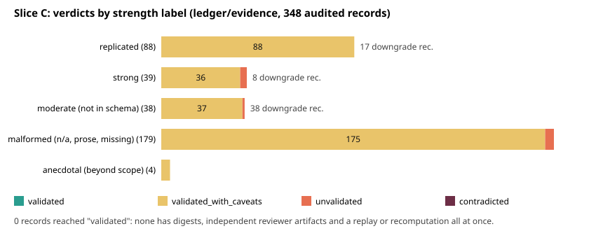

# Sheriff case SHF-20261019-ccc409: ledger/evidence, slice C

Audit record of `ledger/evidence/` in `aburan28/crypto-autoresearcher` at `origin/main` `d0f70c0a09`. It changes no research state, edits no record and applies no downgrade; `recommended_strength` is a recommendation to the Coordinator. Per-record verdicts: `verdicts.jsonl` (348 rows). Sibling repositories `crypto` and `cryptanalysis` are other slices and are not checked out here.

## Headline

- **No record reached `validated`.** 348 records audited; every one is `validated_with_caveats` or `unvalidated` (8 unvalidated). No record has digests, a cited independent reviewer artifact and a replay or recomputation all at once.
- **Downgrades recommended:** 8 of 39 `strong`, 17 of 88 `replicated`; the 38 `moderate` records use a label the schema does not have (25 map to `replicated`, 13 to `preliminary`); 179 malformed labels need a Coordinator assignment.
- **Independence is the weak joint.** Of 39 `strong` records, 3 cite independent reviewer artifacts; 21 are Coordinator-only or unreviewed; 15 assert independence in prose only.
- **Run records were edited in place** for 5 evidence records (F1), including the `strong` EV-ECDLP-284817 and EV-ECDLP-fd61e4.
- **Counts differ from the brief** (see Census). Where this audit's count differs it is the on-disk count.

## Prior

Written before reading any record (`PRIOR.md`). Held: most `replicated` rest on one instrument; `strong` outruns its cited reviewers; `moderate` is schema-invalid; digests rarely declared; the brief's counts do not match. Not anticipated: records cite their evidence by prose path or task id rather than `run_ids` (my first pass wrongly marked 55 such records unvalidated; fixed and disclosed below), and the run-record rewrites.

## Census

| class | brief | on disk | note |
| --- | --- | --- | --- |
| replicated | ~101 | 88 | |
| strong | 41 | 39 | |
| moderate | 39 | 38 | label not in schema |
| strength reads `n` | 63 | 76 read `n/a` | plus 91 other non-enum values (29 long prose), 11 missing, 1 unparsable (malformed total 179) |
| preliminary | 301 | 299 | listed, not audited |
| inconclusive | 123 | 134 | listed, not audited |

`anecdotal` (4 records) is a valid schema value that my harness bucketed with the malformed; they were audited and are shown separately. Total audited 348; core scope (replicated+strong+moderate) 165.

## Verdicts

| class | n | validated | with caveats | unvalidated | contradicted |
| --- | --- | --- | --- | --- | --- |
| replicated | 88 | 0 | 88 | 0 | 0 |
| strong | 39 | 0 | 36 | 3 | 0 |
| moderate (not in schema) | 38 | 0 | 37 | 1 | 0 |
| malformed (n/a, prose, missing) | 179 | 0 | 175 | 4 | 0 |
| anecdotal (beyond scope) | 4 | 0 | 4 | 0 | 0 |

`validated_with_caveats` is the default when everything cited resolves and nothing failed; it does **not** mean the claim was checked beyond that. Nothing is `contradicted`: the one record I recomputed (EV-ECDLP-284817) reproduces, with a metric-definition caveat.

### Per-class checks

| class | with run_ids | digests ok / bad / none | independence ok / no / asserted-only |
| --- | --- | --- | --- |
| replicated | 44 | 11 / 3 / 74 | 22 / 5 / 61 |
| strong | 22 | 3 / 0 / 36 | 3 / 21 / 15 |
| moderate (not in schema) | 11 | 2 / 2 / 34 | 21 / 7 / 10 |
| malformed (n/a, prose, missing) | 39 | 1 / 0 / 178 | 54 / 0 / 125 |
| anecdotal (beyond scope) | 0 | 0 / 0 / 4 | 1 / 0 / 3 |

`independence_ok` is a cited-artifact check: true only when a non-Coordinator reviewer is named and its report or task resolves on disk. I did not read each reviewer's authorship; instrument and author difference is therefore established for the cited artifacts, not proven. Theoretical records with no review cited are `false`.

## Recommended strength changes (not applied)

| evidence | claimed | recommended | basis |
| --- | --- | --- | --- |
| EV-ECDLP-284817 | strong | preliminary | one run, n_eff=8 groups after its own pseudo-replication correction, one instrument, no independent review, and the run record was rewritten in place |
| EV-ECDLP-81f4d4 | strong | preliminary | single run/experiment and no cited independent reproduction: multiple instances not shown on disk |
| EV-ECDLP-fd61e4 | strong | preliminary | single run/experiment and no cited independent reproduction: multiple instances not shown on disk |
| EV-FALSIFY-2a5e46 | strong | preliminary | single run/experiment and no cited independent reproduction: multiple instances not shown on disk |
| EV-FALSIFY-40291d | strong | replicated | reproduced (>=2 runs/experiments, or this audit's replay passed) but Coordinator self-review only: no cited independent validator or red team |
| EV-FALSIFY-67150b | strong | replicated | reproduced (>=2 runs/experiments, or this audit's replay passed) but Coordinator self-review only: no cited independent validator or red team |
| EV-JINV-a8c812 | strong | preliminary | single run/experiment and no cited independent reproduction: multiple instances not shown on disk |
| EV-VOLC-3529e8 | strong | preliminary | single run/experiment and no cited independent reproduction: multiple instances not shown on disk |
| EV-BINSTD-8a1bbf | replicated | preliminary | empirical record with <=1 run, 1 experiment and no cited independent reproduction: nothing on disk shows a second reproduction |
| EV-CERTBIN-091c56 | replicated | preliminary | empirical record with <=1 run, 1 experiment and no cited independent reproduction: nothing on disk shows a second reproduction |
| EV-CERTBIN-4a9d2f | replicated | preliminary | empirical record with <=1 run, 1 experiment and no cited independent reproduction: nothing on disk shows a second reproduction |
| EV-CERTBIN-5c9e14 | replicated | preliminary | empirical record with <=1 run, 1 experiment and no cited independent reproduction: nothing on disk shows a second reproduction |
| EV-CRYPTO-ad7fa2 | replicated | preliminary | empirical record with <=1 run, 1 experiment and no cited independent reproduction: nothing on disk shows a second reproduction |
| EV-ECDLP-7e970a | replicated | preliminary | empirical record with <=1 run, 1 experiment and no cited independent reproduction: nothing on disk shows a second reproduction |
| EV-ECDLP-feb897 | replicated | preliminary | empirical record with <=1 run, 1 experiment and no cited independent reproduction: nothing on disk shows a second reproduction |
| EV-ECRANK-6695dc | replicated | preliminary | empirical record with <=1 run, 1 experiment and no cited independent reproduction: nothing on disk shows a second reproduction |
| EV-HQC-3a0372 | replicated | preliminary | empirical record with <=1 run, 1 experiment and no cited independent reproduction: nothing on disk shows a second reproduction |
| EV-HQC-469c08 | replicated | preliminary | empirical record with <=1 run, 1 experiment and no cited independent reproduction: nothing on disk shows a second reproduction |
| EV-HQC-4973ff | replicated | preliminary | empirical record with <=1 run, 1 experiment and no cited independent reproduction: nothing on disk shows a second reproduction |
| EV-HQC-927899 | replicated | preliminary | empirical record with <=1 run, 1 experiment and no cited independent reproduction: nothing on disk shows a second reproduction |
| EV-HQC-e458ef | replicated | preliminary | empirical record with <=1 run, 1 experiment and no cited independent reproduction: nothing on disk shows a second reproduction |
| EV-SCURVE-44f051 | replicated | preliminary | empirical record with <=1 run, 1 experiment and no cited independent reproduction: nothing on disk shows a second reproduction |
| EV-SSI-0c529c | replicated | preliminary | empirical record with <=1 run, 1 experiment and no cited independent reproduction: nothing on disk shows a second reproduction |
| EV-SSI-4b17e7 | replicated | preliminary | empirical record with <=1 run, 1 experiment and no cited independent reproduction: nothing on disk shows a second reproduction |
| EV-SSI-7a3e91 | replicated | preliminary | empirical record with <=1 run, 1 experiment and no cited independent reproduction: nothing on disk shows a second reproduction |

The 38 `moderate` records and the malformed ones are in `verdicts.jsonl` (`recommended_strength`, `strength_ceiling_supported`). Rule: empirical `replicated` needs a second run or experiment or a cited independent reproduction; `strong` additionally needs a cited independent reviewer, else `replicated`. If the Coordinator's policy does not require independent review for `strong`, 2 of the strong downgrades fall away. Theoretical or analytical records keep their label as **unconfirmed**, not endorsed: the derivations were not re-derived here.

## Findings (blockers first; none is a blocker)

**F1 (major, B7).** Run records modified in place after first commit. 5 evidence records cite runs whose result or log files (raw-result, stdout, analysis) changed after they were added (EV-ECDLP-284817, EV-ECDLP-fd61e4, EV-IC-002, EV-JMV-05a150, EV-PMA-fbdd4c); 5 more cite runs with manifest-only edits. AGENTS.md says records are immutable and a defect is superseded by a new run. EV-ECDLP-284817 / EV-ECDLP-fd61e4 cite RUN-SEMAEV-f48dd1-grid, whose raw-results.json and analysis.yaml were rewritten by three commits on 2026-08-07 (metric correction, pseudo-replication correction). The EV-IC-002 edits are the declared duplicate-id repair (CORR-20260802-004).  
*Would fix:* Supersede the corrected runs under new RUN ids and rebind the evidence records through corrections; do not edit the old runs. The Coordinator decides.

**F2 (major, B7).** Strength vocabulary is not the schema's. schemas/evidence.schema.json allows {anecdotal, preliminary, replicated, strong, inconclusive, contradictory}. 38 records say 'moderate', 76 say 'n/a', 91 carry other out-of-vocabulary values (29 of them long prose, 11 of which read as strong, decisive or replicated), 11 have no strength field and 1 does not parse. The brief counted 63 records reading 'n'; the tree has 76 reading 'n/a'.  
*Would fix:* Coordinator to assign a schema value to each (recommended_strength in verdicts.jsonl gives the ceiling the evidence supports) or amend the enum by decision record.

**F3 (major, B7).** Most 'strong' labels have no cited independent reviewer. Of 39 strong records, 3 cite independent reviewer artifacts that resolve on disk, 21 name the Coordinator only or nothing, and 15 assert independence in prose without a cited artifact. 8 strong records are recommended down: EV-ECDLP-284817->preliminary, EV-ECDLP-81f4d4->preliminary, EV-ECDLP-fd61e4->preliminary, EV-FALSIFY-2a5e46->preliminary, EV-FALSIFY-40291d->replicated, EV-FALSIFY-67150b->replicated, EV-JINV-a8c812->preliminary, EV-VOLC-3529e8->preliminary.  
*Would fix:* Coordinator to apply or reject the recommended downgrades; independent review is required by AGENTS.md before a claim-changing result.

**F4 (major, B7).** EV-ECDLP-81f4d4 (strong) cites RUN-ECDLP-8e13c2, which does not exist under experiments/*/runs/ (it appears only as `predecessor_run` in a later task's manifest); EV-SIG-008 cites five RUN-EXP-SIG-008-* ids that do not resolve.  
*Would fix:* Supply the run records or relabel the evidence as unverified; the audit cannot resolve them.

**F5 (minor, B7).** EV-HAWK-af783e does not parse as YAML (line 48); EV-XEDN-005 and EV-XEDN-006 are stubs holding only claim_tier. Tools that load ledger/evidence cannot read them or find no strength.  
*Would fix:* Re-record under new ids; records are immutable.

**F6 (minor, B7).** Digest coverage is thin. Only 22 of 348 audited records have a sha256 declared in a cited run record that could be re-verified; 17 such records verified, 5 did not (EV-CERTBIN-091c56 and EV-ICPERF-433fa5: code inputs changed after the run, bench.py matches neither its declared nor its frozen digest).  
*Would fix:* Declare file digests in run manifests; pin code inputs by commit.

**F7 (minor, B8).** EV-ECDLP-284817 defines oracle_marginal_ratio as candidates_verified_B / candidates_verified_C. Recomputed from raw-results.json that ratio is 3.108 per group (2.53 pooled); the stated 3.754 +- 3.187 [1.36, 11.237] reproduces only as the mean over groups of per-cell ratios. Direction unchanged.  
*Would fix:* State the metric as mean of per-cell ratios.

**F8 (minor, B7).** Audit instrument limits, disclosed: the digest walker produced 3 false mismatches (spec/snapshot digests beside file digests), found by hand and overridden; the first replay attempt was void (empty sparse checkout, all 40 not_covered, kept as *_attempt1_void_*); the replay normaliser was too narrow and 3 of its fails were re-diffed by hand (timestamps and platform only). Replay covers 6 of 40 sampled records.  
*Would fix:* None for the ledger; a re-audit is a new SHF case.

## Per-beat results

- **B1 claim inventory:** one claim per label class (C1-C4 in `findings.yaml`); per-record statements are in `verdicts.jsonl`.
- **B2 execution proofs, zk:** n/a; no audited record cites a verifier. Execution proofs are open (docs/execution-proof-chain.md), so nothing here is execution-verified.
- **B3 Lean:** n/a; none of the audited records references a `.lean` file, so `statement_fidelity_ok` is not a Lean check anywhere. It is null except EV-ECDLP-284817 (false, metric definition). Statement fidelity beyond that was not covered for the remaining records.
- **B4 certificates:** `certificate_refs` were checked for existence only; no certificate was re-verified. `recomputed_ok` is null for all records but EV-ECDLP-284817.
- **B5 cost accounting:** not covered (no matched-rho comparison audited).
- **B6 statistics/prereg:** not covered, except the pseudo-replication point inside EV-ECDLP-284817 (n_eff=8 of 40).
- **B7 provenance:** run resolution, digests, immutability from git history; F1-F6.
- **B8 numbers:** a 4+-digit decimal trace (not a recompute) is recorded in each record's notes.

## Replay

Seed committed before any replay (`replay_seed.txt`, commit `c958749f69`). Eligible = records whose cited run has `command.txt`: 113. 40 sampled with `random.Random(int(nonce,16)).sample` over the sorted ids. Results (Haiku shards `replay_out*.jsonl`): {'fail_or_env': 7, 'not_covered': 27, 'pass': 3, 'pass (manual re-diff)': 3}. 6 replays reproduced their committed result files; 3 flagged 'fail' were re-run by me and differ only in timestamps, platform, python version and a regenerated `preregistered_at` (EV-FALSIFY-440677, EV-SEMBIN-07960c, EV-MONO-d90e9c). `not_covered` dominates because most commands are not a single repo-local python3 script (multi-line, shell, rust, external paths) and 7 failed on environment (absolute scratch paths, missing env vars, a perf meter self-test). A replay proves nothing about the 308 records not sampled; 40 of 113 eligible gives low power against sparse fabrication.

## Division of labour

Haiku 5.5 (`validator-sweep`, frozen command cards, no interpretation): ran the audit harness over four shards, ran the replay shards. Sonnet 5.5 (this session): wrote the harness and composer, re-checked every flag (5 digest mismatches: 3 were instrument false positives, 2 real code drift; 3 replay fails: noise; the run rewrites; the unresolved runs), recomputed EV-ECDLP-284817 from raw cells, read about 12 records for strength and fidelity, and made every verdict. The first replay attempt was void because my script's sparse checkout failed (`git sparse-checkout init -q`), leaving every row not_covered; the outputs are kept as `*_attempt1_void_*`.

## Not covered, and what would cover it

- Re-derivation of metrics for all records except one: needs a per-record recomputation script; start with `ledger/evidence` records citing `raw-result.json` with cell-level data.
- Reviewer authorship and instrument identity: read each cited `validation_report.yaml` / `red_team_report.yaml`.
- Theoretical derivations: independent re-derivation.
- `python3 tools/sheriff.py sweep --target all --deep` (Lean builds, ledger validator, merge hygiene) and the sibling repositories: other slices.
- Replay of non-python commands and runs needing external data or credentials.
- The pending runbook-session audit `RBS-XEDN-a7cd25` (`tools/runbook.py pending-audits`) concerns EXP-XEDN-0c0182; I did not run it, and EV-XEDN-005/006 are stubs that cite nothing.

## What this case does not establish

That any record's science is right or wrong. `validated_with_caveats` means the cited artifacts exist and nothing failed, not that the claim was verified. A bounded replay, a zero-hit count or an unread record proves no absence. Recommended downgrades are a reading of the on-disk evidence under the stated rules, for the Coordinator to apply or reject.

## Appendix: records listed, not audited

Preliminary (299): EV-AES-048545, EV-ALBIN-001, EV-ALECF-001, EV-ALISO-001, EV-ALPF-001, EV-ALR-001, EV-ALR-002, EV-ARGON-209ece, EV-BGT-816536, EV-BINSTD-01a202, EV-BINSTD-0db227, EV-BINSTD-0e42ac, EV-BINSTD-1a0c8d, EV-BINSTD-1e1815, EV-BINSTD-2a4191, EV-BINSTD-2d34cb, EV-BINSTD-2d41c3, EV-BINSTD-2f89cc, EV-BINSTD-3685c4, EV-BINSTD-375f15, EV-BINSTD-461d48, EV-BINSTD-56c2bc, EV-BINSTD-6298f1, EV-BINSTD-66a996, EV-BINSTD-671f89, EV-BINSTD-71eabe, EV-BINSTD-769c7c, EV-BINSTD-78ca0d, EV-BINSTD-7b4373, EV-BINSTD-7eacca, EV-BINSTD-813422, EV-BINSTD-8b7f33, EV-BINSTD-8edd9b, EV-BINSTD-91ea96, EV-BINSTD-93aee1, EV-BINSTD-95f692, EV-BINSTD-a894c0, EV-BINSTD-b4e120, EV-BINSTD-c3d1c5, EV-BINSTD-c45564, EV-BINSTD-d3a6be, EV-BINSTD-e9b8ff, EV-BINSTD-f0a4ab, EV-BINSTD-f1d8e2, EV-BINSTD-f541ea, EV-BINSTD-fba851, EV-BINSTD-fe3b64, EV-BND-4b8a88, EV-BND-bf659a, EV-CERTBIN-2b8da1, EV-CERTBIN-383c07, EV-CERTBIN-5c2947, EV-CERTBIN-691499, EV-CERTBIN-6c3e0a, EV-CERTBIN-db7f15, EV-CERTBIN-f218ae, EV-CRYPTO-001, EV-CRYPTO-002, EV-CRYPTO-003, EV-CRYPTO-004, EV-CRYPTO-005, EV-CRYPTO-006, EV-CRYPTO-007, EV-CRYPTO-008, EV-CRYPTO-009, EV-CRYPTO-010, EV-CRYPTO-011, EV-CRYPTO-012, EV-CRYPTO-013, EV-DEP-001, EV-DIFFP-b878aa, EV-DREG-004, EV-DREG-006, EV-DREG-007, EV-DREG-008, EV-DREG-4500cd, EV-DS-001, EV-DS-002, EV-DS-003, EV-DS-004, EV-DS-006, EV-DS-007, EV-DS-008, EV-DS-009, EV-DS-010, EV-ECDLP-004, EV-ECDLP-005, EV-ECDLP-006, EV-ECDLP-007, EV-ECDLP-009, EV-ECDLP-011, EV-ECDLP-012, EV-ECDLP-013, EV-ECDLP-014, EV-ECDLP-015, EV-ECDLP-016, EV-ECDLP-2e9680, EV-ECDLP-3dc2db, EV-ECDLP-5035ed, EV-ECDLP-60e266, EV-ECDLP-65b004, EV-ECDLP-6783b8, EV-ECDLP-6a4ebc, EV-ECDLP-6bdff6, EV-ECDLP-6e79be, EV-ECDLP-855daf, EV-ECDLP-921b5d, EV-ECDLP-9d41e7, EV-ECDLP-b3e847, EV-ECDLP-ce9b50, EV-ECDLP-f5c698, EV-ECDLP-f6b3f5, EV-ECDLP-f83a17, EV-ECQ-d9ffe6, EV-ECTD-001, EV-ECTD-002, EV-ECTD-14f9a2, EV-ECTD-8c098d, EV-ENDO-118b3a, EV-ENDO-545cfd, EV-ENDO-7628a0, EV-ENDO-eb58c4, EV-ENDO-fb5823, EV-EQD-001, EV-FAEST-001, EV-FAEST-002, EV-FCP-001, EV-FCP-002, EV-FCP-003, EV-FIND-002, EV-FIND-003, EV-FROB-576872, EV-FROB-b6e1e9, EV-GOAL-DREG-001-B003, EV-HQC-163374, EV-HQC-67a6ec, EV-HQC-75c05b, EV-HQC-7e4b28, EV-HQC-9a30d3, EV-HQC-b71230, EV-HQC-bfb257, EV-HQC-db1fd9, EV-IC-001, EV-ICEX-001, EV-ICI-0bdaaa, EV-ICINV-343679, EV-ICINV-8afb64, EV-ICINV-c68f13, EV-ICPERF-988da7, EV-ICPERF-a8080e, EV-INSTR-600710, EV-INSTR-acb893, EV-INSTR-ffbb5a, EV-MGD-001, EV-MLDSA-56e35b, EV-MLDSA-faf2ec, EV-MLKEM-001, EV-MLKEM-002, EV-MLKEM-003, EV-MLKEM-004, EV-MLKEM-011, EV-MLKEM-012, EV-MLKEM-013, EV-MLKEM-014, EV-MLKEM-015, EV-MLKEM-016, EV-MLKEM-017, EV-MLKEM-019, EV-MLKEM-021, EV-MLKEM-09d715, EV-MLKEM-0cf1df, EV-MLKEM-26cf46, EV-MLKEM-2e668d, EV-MLKEM-553b83, EV-MLKEM-5a8ec5, EV-MLKEM-890e2a, EV-MLKEM-94c773, EV-MLKEM-94f036, EV-MLKEM-c47a1e, EV-MLKEM-c50030, EV-MLKEM-ce1884, EV-MLKEM-eac95b, EV-MLKEM-ee220e, EV-MONO-001, EV-MONO-002, EV-MONO-1ef611, EV-MONO-a0a89c, EV-OIFP-105ac9, EV-PEC-2e67ff, EV-PEC-857664, EV-PFDR-1faf10, EV-PFDR-55d067, EV-PFDR-ad6274, EV-PFDR-d90ccd, EV-PFDR-f6b76c, EV-PSEUDO-066646, EV-PSEUDO-28f914, EV-PSEUDO-35bcc3, EV-PSEUDO-417718, EV-PSEUDO-65a7ea, EV-PSEUDO-6b3146, EV-PSEUDO-a7f625, EV-PSEUDO-dab370, EV-PSEUDO-dd0c51, EV-QSP-3bcfa9, EV-RELN-001, EV-RELN-ed92ff, EV-SDEG-001, EV-SEMAEV-001, EV-SEMAEV-1e67f2, EV-SEMAEV-473ea1, EV-SEMAEV-47d130, EV-SEMAEV-4857cc, EV-SEMAEV-5d7580, EV-SEMAEV-6ef060, EV-SEMAEV-94f6d5, EV-SEMAEV-95eebe, EV-SEMAEV-b3db54, EV-SEMAEV-e8ae55, EV-SEMBIN-0c8bf4, EV-SEMBIN-36f27d, EV-SEMBIN-4614e7, EV-SEMBIN-71e5cd, EV-SEMBIN-c59cfb, EV-SEMBIN-d1cf99, EV-SEMBIN-d40877, EV-SIG-009, EV-SIG-010, EV-SSI-001, EV-SSI-002, EV-SSI-003, EV-SSI-004, EV-SSI-005, EV-SSI-006, EV-SSI-007, EV-SSI-008, EV-SSI-009, EV-SSI-010, EV-SSI-011, EV-SSI-012, EV-SSI-013, EV-SSI-014, EV-SSI-015, EV-SSI-016, EV-SSI-017, EV-SSI-018, EV-SSI-019, EV-SSI-020, EV-SSI-021, EV-SSI-022, EV-SSI-023, EV-SSI-024, EV-SSI-025, EV-SSI-026, EV-SSI-027, EV-SSI-028, EV-SSI-029, EV-SSI-030, EV-SSI-031, EV-SSI-032, EV-SSI-033, EV-SSI-034, EV-SSI-035, EV-SSI-036, EV-SSI-037, EV-SSI-038, EV-SSI-039, EV-SSI-040, EV-SSI-041, EV-SSI-042, EV-SSI-0a57ab, EV-SSI-0eb0b1, EV-SSI-17c854, EV-SSI-1a95bc, EV-SSI-3d46eb, EV-SSI-59f7a2, EV-SSI-804e09, EV-SSI-8aaad0, EV-SSI-b7c3a1, EV-SSI-d4e892, EV-SSI-d9d1a4, EV-SSI-fcda7e, EV-SSIQ-0fc992, EV-SSIQ-3efbe0, EV-SSIQ-48d274, EV-SSIQ-69ba8b, EV-SSIQ-a64d92, EV-SSIQ-c3df82, EV-SSIQ-e43afd, EV-STR-002, EV-STR-003, EV-STR-004, EV-SUBRES-001, EV-SYMF-d46055, EV-WESO-ea9525, EV-XOR-d84f2b, EV-YIELD-7c3195, EV-YIELD-ca4b02, EV-YIELD-e1adbf

Inconclusive (134): EV-AES-1cd9e1, EV-ARGON-43acd9, EV-BINSTD-030b4e, EV-BINSTD-0da481, EV-BINSTD-163b42, EV-BINSTD-4d3c15, EV-BINSTD-53bc6d, EV-BINSTD-56dda7, EV-BINSTD-5cd3c9, EV-BINSTD-602614, EV-BINSTD-69cb29, EV-BINSTD-90c856, EV-BINSTD-a692eb, EV-BINSTD-a99d47, EV-BINSTD-cd47a8, EV-BINSTD-dc1bc5, EV-BINSTD-ee69b6, EV-BINSTD-f2f987, EV-BINSTD-f9262a, EV-CERTBIN-6e815c, EV-CERTBIN-cc1d02, EV-CERTBIN-e1ba19, EV-CRYPTO-45aa4e, EV-CRYPTO-4a91d7, EV-CRYPTO-da976f, EV-CRYPTO-eee427, EV-DS-005, EV-DS-1e5e91, EV-DS-84d006, EV-DS-8da1cf, EV-DS-8ddf9e, EV-DTREE-2e8f6a, EV-DTREE-b47c19, EV-ECDLP-002, EV-ECDLP-008, EV-ECDLP-00ae97, EV-ECDLP-010, EV-ECDLP-048824, EV-ECDLP-1d522d, EV-ECDLP-2484b5, EV-ECDLP-2a7e77, EV-ECDLP-2fa02f, EV-ECDLP-31e91c, EV-ECDLP-44f481, EV-ECDLP-56cf10, EV-ECDLP-59a023, EV-ECDLP-5add2c, EV-ECDLP-6a0e86, EV-ECDLP-7190c8, EV-ECDLP-7c2e94, EV-ECDLP-7caba0, EV-ECDLP-80828d, EV-ECDLP-8a5106, EV-ECDLP-8ef054, EV-ECDLP-924941, EV-ECDLP-96bf56, EV-ECDLP-a06b46, EV-ECDLP-b0ae7a, EV-ECDLP-b909d7, EV-ECDLP-b91d4a, EV-ECDLP-bf53c2, EV-ECDLP-c055e7, EV-ECDLP-c345c8, EV-ECDLP-c4c325, EV-ECDLP-cb151c, EV-ECDLP-cbc6d2, EV-ECDLP-d39cae, EV-ECDLP-d71c79, EV-ECDLP-e6f5f2, EV-ECDLP-fdbe31, EV-ECDLP-fe122c, EV-ENDO-e8d3e5, EV-FROB-2fe225, EV-FROB-a85eaf, EV-FROB-b53a91, EV-FROB-e61994, EV-GFPN-fc5950, EV-GGM-002, EV-HAWK-001, EV-HQC-dd85c1, EV-ICEX-16e3ec, EV-ICINV-6b6264, EV-ICPERF-090b10, EV-ICPERF-54ac6b, EV-IT-001, EV-IT-002, EV-IT-006, EV-IT-008, EV-IT-aefd12, EV-LHW-9ca475, EV-LPF-001, EV-MCE-332f99, EV-MLKEM-563ebd, EV-MLKEM-bdbfba, EV-MLKEM-cca527, EV-MLKEM-d8f627, EV-OIFP-97e46d, EV-PFDR-cf6ee5, EV-QSP-2c78d3, EV-RELN-335cd2, EV-RELN-3c9a24, EV-RELN-543f9b, EV-RELN-99c688, EV-RELN-b3c6ef, EV-RELN-cc045d, EV-SCURVE-8e5c70, EV-SEMBIN-3e91a7, EV-SEMBIN-5e2b97, EV-SEMBIN-7ea861, EV-SEMBIN-c6e9ad, EV-SEMBIN-c71cad, EV-SEMBIN-f7c576, EV-SSI-12c22e, EV-SSI-279763, EV-SSI-4b4733, EV-SSI-5d954c, EV-SSI-5f24c2, EV-SSI-65dc17, EV-SSI-c33130, EV-SSI-c9bfe1, EV-SSI-d214df, EV-SSI-e454e0, EV-SSI-f1fbad, EV-SSI-fb9df2, EV-SSI-fddf21, EV-SSIQ-028c9f, EV-SSIQ-29fcbb, EV-SSIQ-334ab9, EV-SSIQ-87d21a, EV-SSIQ-94de20, EV-SSIQ-9a0396, EV-SSIQ-ae9112, EV-SSIQ-f3ce32, EV-WESO-af78c1
