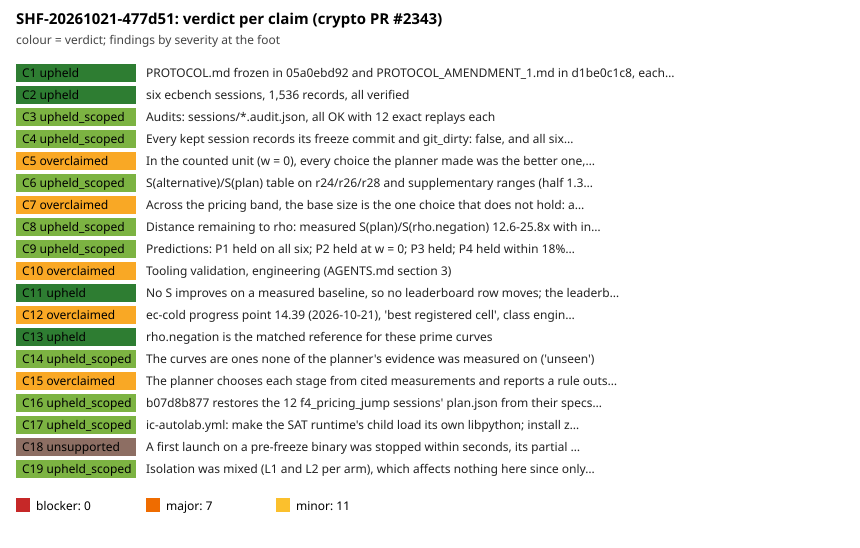

# Sheriff case SHF-20261021-477d51: crypto PR #2343 (IC planner and its validation)

**Target.** Everything aburan28/crypto PR #2343 merged to `main` (merge commit
`b4f056101`, 17 commits of producer session `session_01R35qGy…`):

- the `ic plan` / `ic bench --auto` planner
  (`src/cryptanalysis/ic_framework/planner.rs`, `src/bin/ic/{plan,bench}.rs`);
- the validation study `research/ic_planner_validation_20261020` (six ecbench
  sessions);
- the 12 restored `plan.json` files under `research/f4_pricing_jump_20261018`;
- the "Planner validation" leaderboard section, scoreboard rows and the
  `ec-cold` progress point 14.39;
- the `ic-autolab.yml` RUNPATH symlink and zstd change.

The tier is deep.

**Audit record only.** This case changes no research state. It repairs nothing
in crypto, and no file in crypto was edited.

**Independence.** This session (`session_01WAo1Hy…`) appears in none of the
audited commits (`checks/session-checks.txt`).

## Prior (first, as written before reading; `prior.md`)

I expected the following:

1. A protocol or amendment not strictly before its sessions.
2. Wording that generalises six toy-size cells.
3. `rho.negation` correctly matched, but with unsourced rho tables in the
   planner.
4. At least one planner citation that does not support its rule, and a fitted
   or recalled κ = 0.6.
5. The restored `plan.json` files legitimate but weakly evidenced.
6. A leaderboard or progress point that reads as a gain.
7. The workflow keeping its gate.

**How the prior fared.**

- (1) was *not* borne out.
- (2), (4) and (6) were borne out.
- (3) was half right: the tables trace to committed files, but carry
  `Measured` labels they have not earned.
- (5) came out better than expected: the restored bytes equal the
  `plan_sha256` sealed two days earlier.
- (7) was borne out.

## Instrument limits, stated first

This session's permission policy **denied building or running any code from
crypto**. That covers `cargo build --release --bin ecbench`, `ecbench`
itself, and the producer's scripts. So:

- **No `ecbench verify` replay was run.** The request asked for real replays
  on at least two sessions. That check is `not_covered`. The command is under
  "Not covered" below.
- **`ecbench compare`, `table` and `band` were not re-run.** The stats reader
  ported their methods to its own Python from a read-only reading of the
  source. The port matches all 1,536 producer values to 1e-9, all 396 values
  in `summary.json`, and all 156 values decoded from the figures.
- **The sweep ran text scans only (`--no-checkers`).** Its crypto-side
  checkers execute crypto code. The canary passed (15/15 caught, no false
  positives).

The sweep's other leads were dismissed:

- The two zk leads (`src/zk/groth16.rs`, `src/zk/plonk.rs`) and the four
  `tools/lean/selftest` leads are in files this PR did not touch.
- The `prose.strong_claim` leads in `benchmarks/README.md` are all older rows,
  except line 12, which is this PR's row and is covered by C5.
- The 200 `outside_sparse` rows are paths outside this PR.

## Verdicts

| claim | producer's words (short) | verdict |
|:--|:--|:--|
| C1 | protocol frozen in 05a0ebd92, amendment in d1be0c1c8, each before its sessions; planner unchanged | **upheld** |
| C2 | six sessions, 1,536 records, all verified | **upheld** |
| C3 | audits OK, 12 exact replays each | upheld_scoped |
| C4 | all six ran the same binary d0527101…7771, clean tree | upheld_scoped |
| C5 | "in the counted unit, every choice the planner made was the better one, on all six curves" | **overclaimed** |
| C6 | S(alt)/S(plan) table and supplementary ranges | upheld_scoped |
| C7 | doubled base 2–8% / 4–9% cheaper at w = 1; "not separated" | **overclaimed** |
| C8 | distance to rho 12.6–25.8×, predictions inside intervals, within 18% | upheld_scoped |
| C9 | P1 held on all six; P1–P4 held; P5 failed for double base | upheld_scoped |
| C10 | class "engineering" (AGENTS.md §3) | **overclaimed** |
| C11 | no leaderboard row moves; rows equal the frozen files | **upheld** |
| C12 | `ec-cold` progress point 14.39, "best registered cell", engineering | **overclaimed** |
| C13 | `rho.negation` is the matched reference for these curves | **upheld** |
| C14 | the curves are unseen by the planner's evidence | upheld_scoped |
| C15 | planner rules evidence-backed; outside measured sizes "extrapolated, never known" | **overclaimed** |
| C16 | 12 `plan.json` restored as a deterministic expansion, hashing to `plan_sha256` | upheld_scoped |
| C17 | ic-autolab change: child loads its own libpython; zstd; gate intact | upheld_scoped |
| C18 | first launch "stopped within seconds … deleted unread" | unsupported |
| C19 | mixed L1/L2 isolation "affects nothing here" | upheld_scoped |

Totals:

- **Claims:** 4 upheld, 9 upheld_scoped, 5 overclaimed, 1 unsupported, 0
  broken.
- **Findings:** 0 blockers, 7 major, 11 minor.

## Blockers

None. No answer is wrong, no seal was modified, no protocol was edited after
data, and no record was dropped from the analysis.

## Major findings

**F1 (C5): the headline ranks at one weight, and generalises past what was
tested.**

- "Every choice the planner made was the better one" ranks at w = 0, which
  §5a forbids ("rank only where the conclusion holds at every weight").
  Against the doubled base, the order reverses at w = 1 on all six curves.
- "Every choice" also covers more than was tested:
  - the base was tried only at ×0.5 and ×2, and the red team's
    proves-too-much control shows any N in about [0.78N, 1.41N] passes that
    test;
  - the oracle was tried only against `rootfind` (known 31–64× worse), never
    against m = 3 or the unblocked builder.
- The README says no IC wall time is used. It does not say that the admitted
  wall comparison (median 0.68–0.76 on all six curves, outside A/A noise)
  also favours the doubled base. I confirmed the six medians in
  `sessions/*/comparisons/plan__double-base.json`.
- **Fix:** rescope the headline to the five tested alternatives at w = 0, and
  call the base size unresolved across the band. Add the wall median as a
  practicality note. Run the cheapest falsification on the registered specs:
  base arms at 1.125N and 1.25N, plus m = 3 and unblocked-builder arms.

**F2 (C7, C9): the decision rule applied is not the frozen one.**

- `scripts/summary.jq:20-22` checks an interval only at w = 0, and point
  means at w = 0.1 and 1. It can never return "refuted" above w = 0. I
  confirmed this by reading the script. `PROTOCOL.md:68-71` requires the
  interval at every band weight. The deviation is not listed under
  Deviations.
- Per-weight intervals make the double-base label depend on the method:
  - the stats reader's two-stage interval contains 1 on all six curves;
  - the red team's one-stage paired interval lies below 1 on r28
    [0.880, 0.991] and c30 [0.914, 0.999].
- The per-curve detectable effect (about 10%) is larger than the 2–9% effect,
  so "not separated" reflects a lack of power, not equivalence.
- **Fix:** record the deviation, compute per-weight intervals with one stated
  method, report the base size as "unresolved, underpowered", and
  pre-register the method and N for the follow-up.

**F3 (C10, C12): misclassed as "engineering".**

- Crypto `AGENTS.md` §3 defines engineering as "`S` fell … an improvement to
  the baseline: a success". The study itself says no `S` fell.
- The label appears in the README, the REPORT, the leaderboard section, the
  scoreboard and the progress chip.
- **Fix:** relabel it as a validation or diagnostic with no class gain.

**F4 (C12): the progress point reads as frontier progress.**

- The `ec-cold` point 14.39 is r24's w = 0 S(plan)/S(rho) = 14.3905
  [11.63, 18.45]. It traces correctly.
- But it is the *best* of three registered cells, and a quotient of two
  lower-bound arms.
- It is placed in the series defined as "the repository's own definition of
  faster than rho", with an engineering chip and no lower-bound or diagnostic
  label.
- It moves no frontier or best value. The series' last point, 4.669 (rule
  v8), stays lower.
- **Fix:** move it to the bounded-counts series, or label it, and use the
  declared primary cell or all three, not the best.

**F5 (C3, C6): no independent replay, and none at all for the five baseline
arms.**

- `ecbench verify --replay N` samples evenly spaced records (`audit.rs:489-499`).
  With 8 arms in alternate order, `--replay 12` landed only on `rho-neg` and
  `plan-aa`. The counts of the five baseline arms, the denominators of every
  ratio, were never replayed.
- CI runs `--replay 0`. Every replay ran on the producer's own host class.
- The sheriff could not replay (execution denied).
- **Fix:** run `--replay 192` per session on another host class, and stratify
  the replay sampler by arm.

**F6 (C15): the planner's honesty contract is not implemented.**

- `planner.rs:9-11` promises that a rule applied outside its measured sizes
  is reported as extrapolated, never as known. The code does not do this:
  - the prime size rule is `Support::Measured` over 23.4–32 bits, yet Table
    B's "family optimum" is the rule's own output, and the 32-bit grid starts
    at 1,024, above the rule's 813;
  - the oracle, target and linalg choices are `Measured` at every size;
  - `planner.rs:480` says "m = 2 beats m = 3 and root finding by 4–60×",
    while Table B has m = 3 at 1.05–3.2× and rootfind at 31–64×.
- **Fix:** honest support labels, and reason strings that quote the cited
  numbers.

**F7 (C15): the wrong rho reference for j = 0 and 1728.**

- For j = 0 and j = 1728 the planner names `rho.negation` as the matched rho
  (`planner.rs:643-648`).
- ecbench ships `rho.cubic` and `rho.quartic`, and the planner's own cited
  GLV note gives the matched folded rho √3 / √2 fewer steps. So the planner
  misstates the gap there.
- The campaign does not exercise this path.
- **Fix:** name the folded rho as the reference, or mark the outlook
  unmeasured for those curves.

## Minor findings

**F8: number slips.**
- The r24 rho-interval upper bound, 18.4487, is printed as **18.5**. It
  should be 18.4: `README.md:77`, `REPORT.typ:55`, both PDFs. I confirmed the
  value in `analysis/summary.json:59`.
- "five native counters unpriced" (`README.md:55`) is wrong for the rootfind
  arm, which has six.
- "P1–P4 held on all six" (`REPORT.typ:70`) omits "at w = 0".

**F9: the A/A control is degenerate.** `plan-aa` shares `plan`'s seeds, so the
pairs are identical and 1.000 [1, 1] only checks determinism. An A/A with
different seeds, built from the same data, gives about [0.92, 1.09].

**F10: the dropped first launch left no trace.** It was "deleted unread", and
no metadata survives to verify that (C18 is unsupported).

**F11: the amendment came after the original data.** It was frozen after the
c-session data were committed, and it re-designated which sessions are
primary. It is disclosed, only the curves changed, and the results agree.

**F12: L2 isolation was not met for whole arms.** This is disclosed, and the
counts are unaffected (identical on 45 mixed-level pairs).

**F13: the restoration changed sealed directories.** The 12 `plan.json` files
added to sealed f4 sessions are byte-identical to the sealed `plan_sha256`.
But the restoration is not documented beside those sessions, they now pass
`verify` only because of it, and their `git_commit` was already null.

**F14: the binary carries no build commit.** It records
`git_commit_source runtime_worktree`, so the binary hash is not bound to a
build.

**F15: two binding weaknesses.**
- Target isolation is by function signature, not by process: the measured
  child holds the planted k in memory, though no solver path reads it.
- The `prime_search` specs pin their curve only together with a rand-crate
  version.

**F16: unlabelled outlooks and an unmeasured constant.**
- The rho outlooks are not labelled as w = 0 lower-bound quotients.
- The prime end points were measured at N = 48 and 1,024, not at the rule's
  41 and 813.
- The Koblitz outlook mixes units.
- κ = 0.6 is a hand fit to eight unkept picks. Six small curves pin it to
  [0.561, 0.629); it runs 25–33% high at n37/n41, and the source model gives
  0.794.
- No `ic plan` output is committed for the six curves.

**F17: a pre-existing gap in the SAT interpreter gate.** It hashes the
`python3` launcher, not `libpython`. zstd is installed without a version
assertion.

**F18: context outside the PR.** `6a3605965` added this row to
`benchmarks/PRE_GATE.json`, a file marked "may only shrink".

## Per-beat results

**B1 (claims).** 19 claims were inventoried, including claims by omission:
- the wall comparison left out of the README (F1);
- the A/A presented without saying it is a determinism check (F9);
- the w = 0 scope missing from P1–P4 (F8).

**B4 (certificates).** Pass. Checked with independent arithmetic:
- [k]G = Q and recovered = planted on 1,536/1,536 records;
- k re-derived from `uniform_scalar_sha256_v1`;
- p and r prime, [r]G = O, and Hasse forcing #E = r;
- a and b nonzero, j ≠ 0, 1728;
- r24/r26/r28 equal their registry entries;
- the c-curves solved from their points and matched to their ICV1 hashes.
Target independence holds on the code path (F15 minor).

**B5 (cost model).** Fail on F1, F3, F4, F6 and F7.
- Pass on matched rho for the six curves: `automorphisms_used` = 2, the same
  `ecbench.gae` unit and S = total/√r on both arms.
- Pass on phases: every phase present, setup charged cold per target.
- Pass on the band: recomputed to 1e-11.
- The gap to rho is reported as **distance remaining, not pass/fail**, in the
  README ("These are the distances remaining, not a pass/fail gate"), the
  REPORT and the leaderboard. The one framing issue is that it is not labelled
  as a w = 0 lower-bound quotient (F16): it is 15.6–30.7× at w = 1.
- The planner's predictions (11.46/19.33/24.55; 12.23/14.45/20.08) and base
  sizes (113/300/469; 128/175/323) re-derive exactly from its formulas and
  tables.
- `PRIME_RHO_POINTS` (19.10 → 6.6671; 32.0 → 32.955) and the binary and
  Koblitz points trace to committed files. The interpolation is log-linear in
  log2 r, and the label "interpolated" is correct for the campaign's sizes.

**B6 (statistics and preregistration).** Freeze order passes.
- **Ancestry:** each protocol commit is the direct parent of its data commit.
- **Run times:** the sessions ran after their freeze (c 17:00–17:16Z after
  16:55:46; r 17:40–17:46Z after 17:35:49).
- **Run commit:** each session ran at its freeze commit as worktree HEAD,
  clean.
- **No later edits:** neither protocol file was edited after its freeze
  commit (`git log --follow`, at `b4f056101` and at `origin/main`).
- **Same code:** `src/`, `Cargo.toml` and `Cargo.lock` are identical from
  `a29bead23` through `b4f056101`.
- **N:** N planned = N written = 256 per session, all verified, no failure
  rows, warm-ups excluded.
- **Fail:** the decision rule as implemented (F2), and the best-of-3 progress
  point (F4).
- **Minor:** F9–F12.

**B7 (provenance).**
- Seals pass: records, spec, plan and host hashes and session ids recompute
  for all 18 sessions. Every campaign file has exactly one commit, its add,
  so nothing was resealed.
- The `plan.json` reconstruction is a deterministic expansion (C16).
- Replays are `not_covered` (F5).
- The binary hash is `not_covered` (F14).
- Workflow: the gate code and records are unchanged and still fail closed; a
  dangling link fails the step (`checks/workflow-ic-autolab.md`).

**B8 (prose).**
- 207/209 prose numbers match (F8).
- `REPORT.pdf` (created 03:13:03Z) post-dates the last `.typ` and number
  change (commit 03:13:25Z), and its text equals `REPORT.typ`
  (`checks/REPORT.pdf.txt`).
- All copies under `benchmarks/20261020-ic-planner-validation/` are
  byte-identical to the study's files.
- The leaderboard rows equal `summary.json` (C11).

**Not applicable.** B2 (no execution-proof language is used) and B3 (no Lean
in this PR).

## Not covered, and the command that would cover it

- **Replays:** `ecbench verify --dir research/ic_planner_validation_20261020/sessions/<s> --replay 192`
  for each of the six sessions, on another host class. This needs `cargo
  build --release --bin ecbench`, which was denied here. Use 192, not 24:
  with this sampler, 24 also lands only on `rho-neg` and `plan-aa`.
- **ecbench re-runs:** `compare`, `table` and `band` with the producer's
  binary, as in `scripts/summary.sh`. These were replaced by an independent
  port that matches.
- **Binary hash:** rebuild at `05a0ebd92` and `sha256sum` against
  `d05271011cd7…7771`.
- **Sweep checkers:** the crypto-side checkers, via `python3 tools/sheriff.py
  sweep --target crypto: --deep` with execution permitted.
- **CI after the PR:** `gh run list -R aburan28/crypto -w ic-autolab.yml`,
  plus the ic-leaderboard runs. GitHub access here is scoped to
  crypto-autoresearcher.
- **Re-renders:** `REPORT.typ`, `scripts/plots.py` and
  `scripts/build_ic_leaderboard.py --check` were not re-run (producer code).
- **Unseen curves:** whether `ic_frontier_campaign_20261015`, the source of
  r24/r28, informed the planner's rules informally (C14).

## What this case does not establish

- That the planner chooses well outside the five one-change alternatives
  tested, or at sizes other than 23.5–29.6 bits. The same goes for binary,
  Koblitz or j = 0/1728 curves.
- That the counts reproduce on another host. No replay ran here, and the
  baseline arms were never replayed by anyone.
- Execution integrity. Hashes, seals and the producer's replays are not
  execution proofs (`docs/execution-proof-chain.md`).
- Any change of research status. That is the Coordinator's.

## Verified delta, honestly sized

The study improves on no baseline: no `S` fell, and no leaderboard row moves
(C11). Its value is calibration:

- At w = 0, the planner's rho outlook is within 1–18% (low) of the measured
  gap on six prime curves of 23.5–29.6 bits.
- At w = 0, the plan beats the five one-change alternatives tested.

Distance remaining to matched `rho.negation`: **12.6–25.8× at w = 0, and
15.6–30.7× at w = 1**, as lower-bound quotients. Rho remains cheaper on every
curve.

## Files

| path | contents |
|:--|:--|
| `sweep.{json,md,svg}` | deterministic sweep; canary passed |
| `prior.md` | the prior |
| `findings.yaml` | the case; `check-case` passes |
| `readers/receipts.yaml`, `scripts/readers/receipts/` | validator: certificates, seals, plan.json, replays |
| `readers/stats.yaml`, `scripts/readers/stats/` | validator: blind statistics re-derivation, number trace |
| `readers/costmodel.yaml`, `scripts/readers/costmodel/` | red team: cost model, planner, class, leaderboard |
| `checks/session-checks.txt` | session's independence, chronology, copies and PDF-currency checks |
| `checks/REPORT.pdf.txt` | text extracted from the producer's PDF |
| `checks/workflow-ic-autolab.md` | session's workflow analysis |
| `checks/band-spotcheck.txt`, `scripts/session/band_spotcheck.py` | session's re-check of the w = 0/0.1/1 rho gap and the double-base/plan band |
| `problems/ecbench-replay-sampler-aliases-multi-arm-sessions.md` | problem record for F5 (all 72 producer replays fell on `plan-aa` or `rho-neg`) |
| `verdicts.svg`, `scripts/session/verdict_chart.py` | verdict chart |
| `report.typ`, `report.pdf` | this report rendered, with `sweep.svg` embedded |
