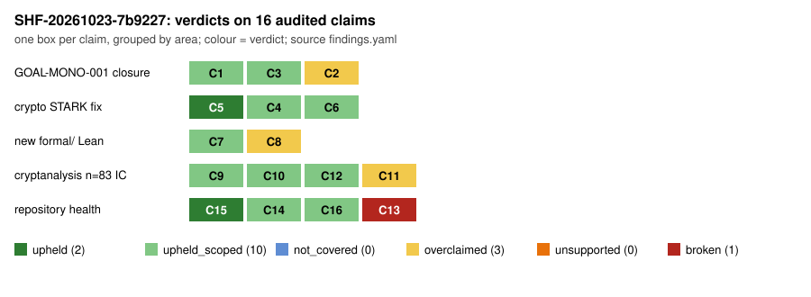

# Sheriff case SHF-20261023-7b9227: `all`, deep tier

This case is a deterministic sweep of crypto-autoresearcher, crypto and
cryptanalysis on `origin/main`. On top of it, five independent readers audited
the claims that carried weight among what merged in the week since
SHF-20261017-e4d7f6. It is an **audit record**: it changes no research state
and repairs nothing. The verdicts are in `findings.yaml`, which passes
`tools/sheriff.py check-case`. The sweep output is in `sweep.json` and
`sweep.md`.

**Result:** of 16 claims, 2 are upheld, 10 are upheld with a narrower scope, 3
are overclaimed and 1 is broken. There is no blocker. The breakthrough-class
claim (the closure of GOAL-MONO-001) holds. Its mathematics survived a blind
re-derivation and an exhaustive falsification search. Only the wording of its
confidence overstates the review. The one broken claim is that the `validate`
gate guards main: it does not, because it fails on every run.

## Scope and binding

| repository | commit | how |
| --- | --- | --- |
| crypto-autoresearcher | `e9b91d62a9` (origin/main) | in place, on branch `claude/sheriff-all-20261023` |
| crypto | `6ed792e86` (origin/main) | sparse partial clone; `ecbench` rebuilt from this commit |
| cryptanalysis | `6dfc25d` (origin/main) | sparse partial clone, now attached with credentials |

- **Instrument:** sha256 `15bc9e08e242…`, which includes the I1 fixes from
  #2319. The canary passed: 15 planted defects caught, 0 false positives.
  Sparse checkouts now count as *partial* coverage rather than a pass. As a
  result, 413 rows are `not_covered` (`sheriff.outside_sparse` and
  `paper.trace_partial`). Each of them is a lead that this case did not read,
  not a defect.
- **Independence:** this session wrote crypto-autoresearcher #2330 and the two
  earlier cases, so those are excluded. The STARK fix (`999d4eefc`) and the
  ledger repairs in #2326 were written by other sessions, so they are in
  scope.
- **Disk:** at most 4.4 GB was free. That allowed Lean builds of the
  Mathlib-free modules only. The deep sweep ran with elan hidden from it,
  because its Lean checker would otherwise have downloaded all of Mathlib.

## Prior

Written before the sweep (`prior.md`):
- I expected the STARK fix to hold against the known mutants, with residual
  risk in its AIR identifier. That was confirmed, as a minor untested
  finding.
- I expected the ledger to have grown. It shrank, from 157 to 141.
- I expected CI to still be off. It is partly on, and the gate that came back
  on is red.
- I expected new strong wording. That was confirmed in the FROB C5 report and
  in the MONO confidence note.
- I expected the cryptanalysis K-N residues to still be open. They were mostly
  fixed by #944.

## Verdicts

| id | claim | verdict | basis |
| --- | --- | --- | --- |
| C1 | KN-FIND-bdcd60: Semaev-cover monodromy (Z/2)^{m-2} / (Z/2)^{m-2}⋊S_{m-1}, Frobenius rule | upheld_scoped | blind re-derivation; orders 2/24/192/1920/23040; 0 violations in 2.1 M admissible fibres over every nonsingular curve at small p; symmetric base measured at m=4,5,6; primitivity needs m≥4 stated |
| C2 | "established; re-derived blind and independently; three derivations agree" | **overclaimed** | one derivation, one blind re-derivation from an answer-shaped card, one guided verification; one model family (MN-3) |
| C3 | GOAL-MONO-001 completed | upheld_scoped | closed on criterion (c), a recorded instrument no-go; the relation-rate question stays open |
| C4 | STARK verifiers bind the statement; the forgeries are rejected (V1, V3) | upheld_scoped | 55-row harness on the new API: every previously accepted mutant rejected, no panics; `zk::stark` 41/41; v1 grindable at unsized q=20 (documented), 0/20,000 at sized q=333; new-design attacks not run |
| C5 | stark_v2 soundness text (V2) | upheld | conjectured bound with its assumptions, SHA-256 cap, no level claimed; `spot_check_queries` exact over 380 cells |
| C6 | ecbench `records_bound` (E1-R) | upheld_scoped | correct and tested; no consumer reads it |
| C7 | 21 new formal/ Lean modules | upheld_scoped | no holes in 20 files; constants re-derive; **6 Mathlib-free modules built here**, 30 theorems standard axioms only, 2 mutants fail; 15 modules never built by anyone's CI |
| C8 | "the certificate proves C5 for the resulting exact matrices" | **overclaimed** | two C5 steps are checked in Sage, not Lean (LN-1) |
| C9 | n=83 closure 6.4444 / 7.6558 / replication 7.4133 | upheld_scoped | re-derived blind from raw records (A/A 0.9991); 174/174 answers verify; preregistration from GitHub metadata; gain is fewer unknowns, not cheaper relations (N83-1) |
| C10 | n=83 engineering chain 1.7406 / 1.1169 / 1.0196 / 1.0165 / 1.5733 | upheld_scoped | wall time only, on a different CPU each; sub-2% effects not separable from code layout |
| C11 | n=83 row: cold gap 3.9242, band "not computable" | **overclaimed** | gap 3.9242 [3.16, 5.22], host-dependent 4.00–5.43; band computable and unranked |
| C12 | #944 fixes K-N1..K-N4, R1-R | upheld_scoped | K-N2, K-N3, K-N4 and R1-R fixed; K-N1 partly (no group-operation counts) |
| C13 | `validate` guards main | **broken** | re-enabled 2026-10-17, fails on every main run since (ledger job); 141 ledger errors |
| C14 | finished runbook sessions audited | upheld_scoped | 2 unaudited; this case audited both with fresh nonces, both clean |
| C15 | crypto #2066 L-N1, L-N7 | upheld | trusted-native list clean; the 3 cited CI jobs re-read via API, all green including `leanchecker --fresh` |
| C16 | fb-archive index | upheld_scoped | 2,681 archives, 0 problems; `refs.py` not covered |

## Findings, by severity

There is no blocker.

**Major (5):**

- **MN-3 (B6):** the MONO confidence wording overstates the review round.
  The mathematics stands, since it was re-derived blind in this case.
- **LN-1 (B8):** the FROB C5 report says Lean "proves C5". Lean proves the
  factor-kernel identities. The step T = h(π) and the fixed-line step were
  checked in Sage, where they hold.
- **N83-1 (B5):** each relation costs one generic table solve, so the
  closure's 7.4× gain comes from 600 → 16 unknowns. As K′ → 0 the method
  becomes the ledger's own non-IC BSGS on the quotient. The model fits the
  measurements within 0.3 %, and the row is already at its model optimum. The
  fix is to add a known-log comparator arm.
- **CI-1 (B7):** `validate` is red on every main run, so it cannot tell a new
  defect from the 141 existing ones.
- **CI-2 (B3):** `lean-verification` is still disabled, together with 16
  other workflows. CI has built none of the 21 new Lean modules.

**Minor (18):**
- **MONO:** MN-1, MN-2, MN-4, MN-5: an untraced tally, primitivity at m ≥ 4,
  an undefined "full wreath", and the meaning of "completed".
- **STARK:** ST-1, ST-2, ST-3: AIR fingerprint binding, panics on oversized
  statements, and an E1-R flag that nothing consumes.
- **Lean:** LN-2, LN-3, LN-4: theorems that are true for any F, receipts
  missing for two modules, and scope gaps in the Semaev certificates.
- **n=83:** N83-2 to N83-9: no Pareto field, the band is computable, no
  interval and host dependence, A/A blind to code layout, squash commits,
  pair order confounded with point, a stale branch path, and a replay without
  `env_class_id`.
- **Repository:** M2-R2 and X-1: the ledger's 141 errors (with one question
  about this session's own #2330 left to the Coordinator), and the unaudited
  runbook sessions.

## Per beat

- **B2 (STARK):**
  - The fix is real. Every mutant the 2026-10-17 harness found accepted is now
    rejected. That includes frozen heart, q = 1, truncation, zero-fold FRI, a
    garbage last FRI root, non-canonical encodings, and values of 2^300
    (which no longer panic).
  - Not covered: the attacks on the new design. Those are a collision on the
    AIR identifier, and statements large enough to force huge allocations.
    The reader's attack code was stopped by a safety check, and it was not
    retried.
- **B3 (Lean):**
  - A reading of all 20 files found no hole and no trusted-base escape. Every
    constant re-derives in Python or Sage.
  - Built here with bare `lean`, from the `formal/lean-toolchain` pin
    (`scripts/lean-build/`): the Endosweep DkExact chain and two Semaev
    certificates. All 30 theorems depend only on the standard axioms. A wrong
    rank, and a one-digit change to E-521's trace, both fail to elaborate.
  - CI has re-run and passed `leanchecker --fresh` for crypto's three Lean
    projects.
- **B4/B5/B6 (n=83):** every headline ratio was re-derived from raw records,
  every answer was verified with independent GF(2^83) arithmetic, and
  preregistration was proven from GitHub run metadata. The invalid n=19 runs
  were archived under gates declared in advance, so the results are not
  best-of-k.
- **B7:**
  - The ledger has 141 new errors.
  - `validate` is red on main, and `lean-verification` is off.
  - The two runbook audits are clean.
  - fb-archive is clean.
  - #2066's residue fixes are confirmed, including the CI jobs they cite.
- **B8:** the overclaims are LN-1, MN-3 and the n=83 row's band statement.
  The new untraced-number leads sit in papers outside the sparse sets; they
  are `not_covered`, not read.

## Not covered, and what would cover it

- **The 15 Lean modules that depend on Mathlib:**
  `./formal/setup.sh && python3 tools/rebuild_formal_root.py --workspace formal && cd formal && lake build && lake env lean AxiomAudit.lean`
  needs about 6 GB of disk. Re-enabling `lean-verification` would also cover
  them.
- **The STARK attacks on the new design (ST-1, ST-2):** run the
  identifier-collision and oversized-statement controls.
- **The sweep's 413 `not_covered` leads, from sparse coverage:** re-sweep with
  full checkouts.
- **`refs.py check`, `curve-names`, `ecbench bound check`, and the ecbench
  session integrity of 497 sessions outside the sparse set:** need full
  checkouts.
- **Literature dominance for KN-FIND-bdcd60.**

## What this case does not establish

- That KN-FIND-bdcd60 is new, or that it bears on relation rates. The finding
  itself disclaims both.
- That the n=83 IC beats rho. The row is 3.92× above matched rho, and IC and
  rho are unranked across the GAE band.
- That any of the 15 Mathlib-dependent Lean modules builds.
- Anything about this session's own #2330 or about the two earlier cases.
- Any execution proof.

## Readers

| reader | joint | report |
| --- | --- | --- |
| validator-breakthrough | MONO blind re-derivation | `readers/mono-validator.yaml` |
| red-team-breakthrough (claude-fable-5-1) | MONO scope and decision logic | `readers/mono-redteam.yaml` |
| validator | STARK | `readers/stark.yaml` |
| validator | Lean | `readers/lean.yaml` |
| red-team | n=83 | `readers/n83-costmodel.yaml` |

Reader paths under `/tmp/...` refer to the staging copy, which is mirrored here
under `scripts/readers/`. The n=83 reader extracted 24 MB of raw records from
cryptanalysis git. They are not committed; `scripts/readers/n83/data-manifest.sha256`
lists their hashes so they can be re-extracted and compared.
