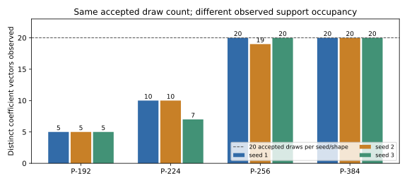
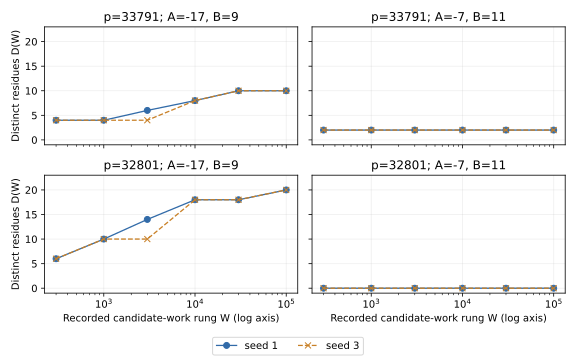
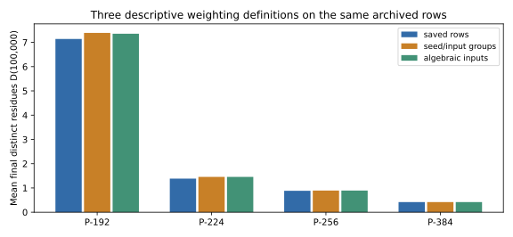

# Sampler support and within-input variation — 2026-10-18

## Sampler support and accepted-draw multiplicity

2026-10-18: descriptive reanalysis of saved data and an exact finite coefficient/prime reference. No fresh field/curve point search ran. Interpretation stays with the owner.

Source EXP-ECDLP-4c6a09 / RUN-ECDLP-e89532 has 1,395 rows, grouped into 279 contiguous five-curve field blocks. Its random-g arm has 240 accepted field draws and 1,200 curve rows: 20 draws for each shape/seed, across seeds 1, 2 and 3. Rejected attempts and the raw RNG draw stream were not saved.

Coefficient support: 2^(w-1) times binomial(d-1,w-2), before filters. Enumerating the coefficient vectors gives 8, 24, 560 and 2,640 patterns for degrees 3, 7, 8 and 12. Their observed unions across seeds contain 5, 10, 55 and 60 polynomials. Higher-degree admissible support is not classified here.

Exact cubic reference: all eight monic weight-three cubics have no rational root (the only candidates are +1 and -1), hence are irreducible over Q. Exhaustive trial division of all 72 values at k=4..12 leaves five polynomials with an eligible prime >=2^12. Every one occurs in each archived seed, and every recorded cubic prime/k matches that polynomial's first eligible value. The independent modular irreducibility-screen outcomes are not enumerated; observed acceptance establishes acceptance of these five.

For cubic seeds 1, 2, 3, accepted-draw multiplicities are respectively [1,2,5,5,7], [2,3,4,4,7] and [1,2,3,4,10] after sorting. Seven-degree unique counts are 10,10,7; degree eight 20,19,20; degree twelve 20,20,20. These are accepted-draw occupancies, not uniformity tests or estimates of rejected-draw probabilities.

Native status remains invalid_output, attributed by the receipt to the legacy manifest format. Producer and built-in checker codes are both zero. All original rows, statuses and weighting remain unchanged. Sources and exact hashes are in observation.yaml and data/summary.json.

| Shape | Pre-filter coefficient support | Observed union | Exact admissible support |
| --- | ---: | ---: | ---: |
| P-192 | 8 | 5 | 5 |
| P-224 | 24 | 10 | not computed |
| P-256 | 560 | 55 | not computed |
| P-384 | 2640 | 60 | not computed |

## Within-input variation across two saved seeds

Four exact algebraic inputs occur under both saved seeds 1 and 3. Identity is (g,p,reduction root,A,B), not number-field isomorphism. Pick the first saved row per input/seed for plotting, while retaining every repeated row index. There are eight representative attempts and 48 recorded rung rows.

The two g are [-1,0,1,1] at p=33791 and [1,1,0,1] at p=32801, both with reduction root 32. Each occurs with (A,B)=(-17,9) and (-7,11). Auxiliary-prime lists match within each input; torsion bounds also match (2 for the first displayed input and 1 for the others). These are incidental overlaps, not a deliberately balanced replication panel.

What is worth inspecting: at W=3,000, the (-17,9) curve has D=6 versus 4 for p=33791, and D=14 versus 10 for p=32801. At W=100,000 the paired counts match at 10 and 20. The other two inputs match at every saved rung, ending at 2 and 0. No claim of equal full point sets follows from equal residue counts.

All four paired inputs have identical saved sample-point lists. Those lists are capped at eight points: identical prefixes do not establish identical trajectories or full search outputs. Two actual trajectories differ despite identical saved sample lists and equal final counts.

The source seeds coefficient-shell enumeration with the search seed and degree. Curves/fields are generated upstream using the same top-level seed. Thus changing a CLI seed generally changes inputs as well as search order; the four incidental overlaps allow only this small conditional comparison. No population-level variance or confidence interval is estimated.

Source RUN-ECDLP-e89532; selectors and every raw row index are in data/within-input-groups.json and data/within-input-trajectories.csv. Straight segments connect recorded rungs; no interpolation model or unrecorded measurements are asserted.

## Row weighting and input weighting

Three views retain the same archived random-g rows: mean over rows; mean over seed/input groups after averaging repeats within a group; and mean over algebraic inputs after equal weighting of their observed seeds. They answer different descriptive questions. None replaces the original estimator.

Mean D(100,000), row / seed-input / input: degree 3 = 7.140000 / 7.391892 / 7.357143; degree 7 = 1.383333 / 1.455224 / 1.455224; degree 8 = 0.883333 / 0.891525 / 0.891525; degree 12 = 0.416667 / 0.416667 / 0.416667. Group counts respectively are 300/74/70, 300/134/134, 300/295/295 and 300/300/300.

Gamma summaries and all missing-value counts remain in data/weighting-views.json. Defined row counts are 217/300, 129/300, 93/300 and 40/300. Defined input counts are 54/70, 62/134, 93/295 and 40/300. Missing gamma is not zero and is not silently included in a mean. No uncertainty interval is supplied for these descriptive weighting comparisons.

Checks: mechanical replay by this authoring session checks 72 cubic evaluations by a separate divisor scan, four supports by ternary enumeration, twelve draw strata, 48 trajectory rows and eight weighting rows. This is not independent scientific review. Analysis took approximately 0.11 wall seconds on Python 3.12.14; the exact observed timings/host are in data/summary.json, not performance comparisons.

Next proposed check: prepare a fixed-input interface with field, curve, auxiliary configuration and search seed recorded separately; use unique inputs with fresh per-input seed strings and persist more than capped sample prefixes. Keep original coupled-seed data alongside the future panel. The current launcher has no fixed-input CLI, and no such new replicas ran in this session.

Canonical graphs, hypothesis/goal statuses, existing frozen protocols and run outputs are unchanged. No scientific verdict is issued. Source EXP-ECDLP-4c6a09 / RUN-ECDLP-e89532; native invalid_output and separate zero process codes are retained.

| Shape | Row mean D | Seed/input mean D | Input mean D | Rows/seed-inputs/inputs |
| --- | ---: | ---: | ---: | --- |
| P-192 | 7.140000 | 7.391892 | 7.357143 | 300/74/70 |
| P-224 | 1.383333 | 1.455224 | 1.455224 | 300/134/134 |
| P-256 | 0.883333 | 0.891525 | 0.891525 | 300/295/295 |
| P-384 | 0.416667 | 0.416667 | 0.416667 | 300/300/300 |

| Shape | Defined gamma rows | Defined seed/input gamma | Defined input gamma |
| --- | ---: | ---: | ---: |
| P-192 | 217/300 | 57/74 | 54/70 |
| P-224 | 129/300 | 62/134 | 62/134 |
| P-256 | 93/300 | 93/295 | 93/295 |
| P-384 | 40/300 | 40/300 | 40/300 |

