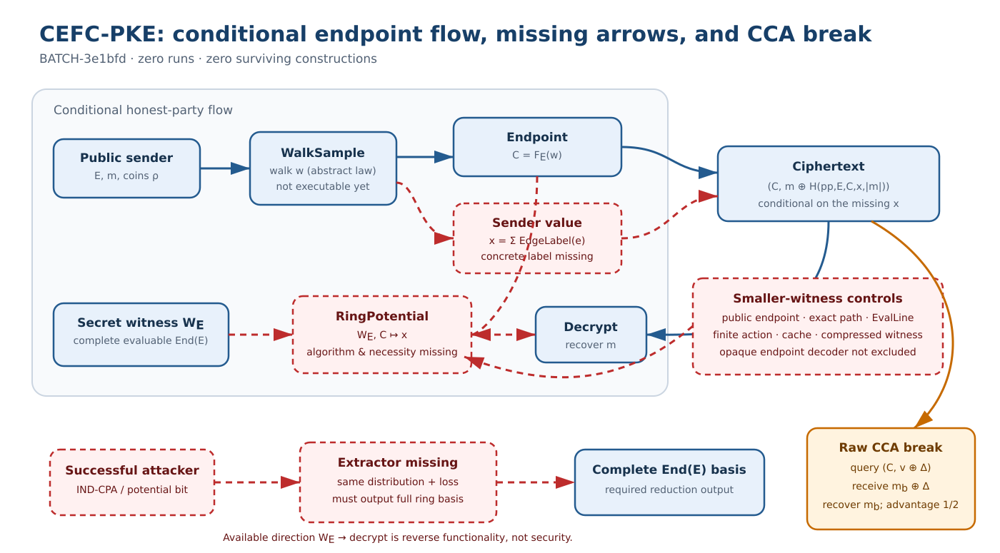

# CEFC-PKE endpoint-fiber search: candidate and adversarial evaluation

**GOAL-SSI-2fa82a · BATCH-3e1bfd · TASK-20261013-c6961f · 2026-10-13**

## Result

This round did **not** produce a complete or secure public-key encryption scheme. It produced one conditional construction interface, **CEFC-PKE** (Conservative Endpoint-Fiber Cocycle PKE), and independently evaluated it under the frozen O1–O6 methodology.

The candidate asks for a public edge label whose sum along an isogeny walk depends only on the endpoint, while a holder of a complete evaluable `End(E)` basis can recover that endpoint value without seeing the walk. No concrete nontrivial edge label, exact key/endpoint distribution, polynomial complete-ring endpoint evaluator, or attacker-to-complete-EndRing extractor was supplied. The exact unauthenticated XOR syntax is also IND-CCA2-insecure: one related-ciphertext query recovers the challenge message.

The composed result is therefore **zero survivors**. O1 is open; O2 is contradicted for the submitted complete-and-efficient construction claim; O3–O6 are open. Novelty, IND-CPA security, a complete-EndRing reduction, QPT/QROM security, and NIST Category 5 are all **not established**. No experiments, implementations, benchmarks, formalizer runs, or parameter-selection runs occurred [R1].

The editable source is [flow.mmd](flow.mmd). Blue arrows are declared public or conditional operations; dashed red arrows are missing algorithms or reductions; the orange path is the worked raw-CCA break.

## Frozen propose/evaluate method

The opening admitted one mechanism because the decision-changing question was narrow: can public walk sampling, endpoint-fiber invariance, complete-EndRing-assisted endpoint evaluation, and attacker-to-complete-EndRing extraction coexist in one exact interface [O1]?

The review plan assigned one sole owner to each load-bearing joint:

| Joint | Owner | Frozen question | Verdict |
|---|---|---|---|
| J1 | `TASK-20261013-47054b` | Are O1/O2 and the forward map, distributions, encodings, and algorithms complete and efficient? | `REJECT` |
| J2 | `TASK-20261013-414c2f` | Do fiber invariance, actual-message correctness, and complete-ring necessity hold? | `FAIL` |
| J3 | `TASK-20261013-883a47` | Are O5/O6 and the novelty, quantum, and Category-5 dispositions correct? | `holds` only because the packet correctly leaves them open |

Composition copied those verdicts without voting or repair [R1]. The automated independence checker exited `2` because the standalone review-plan schema lacks the nested `review_plan` block expected by the tool. That administrative format defect is preserved and is **not** reported as a pass [C1]. The three reviewers separately attest that they did not read sibling reports.

## Candidate CEFC-PKE

For public parameters `pp`, a public supersingular curve `E`, and a sampled admissible walk `w=(e_1,…,e_L)`, define

`F_E(w) = terminal endpoint C`,

`I_E(w) = Σ_i EdgeLabel(pp,e_i)` in an encoded additive group `A`.

The desired fiber theorem is

`F_E(w_0)=F_E(w_1)  ⇒  I_E(w_0)=I_E(w_1)`

for every pair of honest walks in the same endpoint fiber. A complete evaluable basis `W_E` of `End(E)` is intended to support

`RingPotential(pp,E,W_E,C)=I_E(w)`.

Encryption would output

`c=(C, m XOR H_pad(pp,E,C,I_E(w),|m|))`,

and decryption would recompute the same endpoint potential using `W_E` [P1]. This is a typed conditional relation, not an instantiated algorithm.

### What the conditional identity does establish

If both parties obtain the identical encoded potential `x`, then XOR cancellation recovers the actual selected message. Likewise, any function constant on every `F_E` fiber factors set-theoretically through the endpoint. These are valid definitional consequences.

They do not show that a nontrivial public local label exists, that a complete ring computes its endpoint potential in polynomial time, that failures are negligible, or that the complete ring is necessary.

## Construction and correctness review

### J1: exact distributions and executable algorithms

J1 stopped at the first construction gate [R2]. `TrapCurveGen_ER` and its public marginal are undefined; `WalkSample` is abstract; `EdgeLabel`, `CompleteEvalBasis`, and `RingPotential` are absent; encodings, retry tails, bit lengths, and costs are open. As submitted, the sender cannot compute its label sum and the recipient cannot compute the same value from `W_E` and `C`.

Accordingly, O1 remains open and O2 is contradicted **for the submitted claim that the construction is complete and efficient**. This is not a proof that the missing algorithms cannot exist.

### J2: fiber collisions and ring necessity

J2 considered two same-length walks containing distinct subpaths `P` and `Q` between the same intermediate vertices [R3]. If their label sums differ, the walks have the same endpoint but different sender values, so no endpoint-only recipient can decrypt both. The packet supplies neither a concrete collision nor a theorem excluding all such collisions because the sampler and label are uninstantiated.

A decisive negative control is the public coboundary

`EdgeLabel(U→V)=h(V)-h(U)`.

Its sum telescopes to `h(C)-h(E)`, giving perfect fiber invariance and correctness—but no secret asymmetry. Thus fiber invariance alone cannot establish complete-ring necessity.

More generally, decryption observes `W_E` only through the function

`D_E(C)=RingPotential(pp,E,W_E,C)`.

No theorem excludes implementing `D_E` with a public endpoint computation, exact-path trapdoor, one evaluator, finite torsion action, cache, compressed witness, or opaque decoder. O3 and O4 remain open.

## Security review

### Missing reduction in the required direction

The required security arrow begins with an exact-distribution complete-EndRing challenge `E`, uses a successful PKE adversary in a byte-identical game, and outputs a verifier-accepted complete evaluable saturated rank-four basis of `End(E)` with an explicit success/loss and QPT/QROM cost [R4].

No such extractor exists in the packet. The available arrow

`complete EndRing → RingPotential → decrypt`

is recipient functionality or an attack route for someone already holding the ring. It is the reverse of the required security reduction. At most the public syntax suggests a conditional hybrid to a newly named endpoint-potential pseudorandomness game, plus unproved QROM hiding and collision/failure terms. That intermediate game is not EndRing and is not relabelled as such.

### Worked IND-CCA2 break

For challenge `c*=(C,v)`, choose nonzero `Δ` and query the byte-distinct ciphertext

`c'=(C,v XOR Δ)`.

The declared decryption uses the same endpoint potential and pad, so it returns `m_b XOR Δ`; XORing `Δ` recovers `m_b` and therefore the challenge bit. This uses one decryption query and no random-oracle query, reaching advantage `1/2` under `|Pr[b'=b]-1/2|` [R4].

This refutes IND-CCA2 only for the frozen unauthenticated XOR syntax. It does not rule out every transform or every EndRing-based PKE.

## Obligation and gate ledger

| Gate | Composed status | Decisive evidence boundary |
|---|---|---|
| O1 exact hard distribution | open | no exact `TrapCurveGen_ER` or real key/endpoint law |
| O2 complete efficient algorithms | contradicted for submitted claim | honest algorithms stop at absent subroutines |
| O3 quantified correctness | open | conditional XOR identity; no concrete fiber/failure theorem |
| O4 complete-ring necessity | open | endpoint decoder may factor through public or smaller witnesses |
| O5 attacker → complete EndRing | open | no same-distribution extractor, output relation, or loss |
| O6 complete adversarial/cost view | open | malformed, repeated, auxiliary, QPT/QROM, and costs incomplete |
| Raw IND-CPA | not established | unsupported endpoint-potential and QROM hybrids |
| Raw IND-CCA2 | contradicted for exact syntax | one related-ciphertext query |
| Novelty | not established | no primary-source or knowledge-base novelty audit |
| QPT/QROM | not established | no quantum theorem, loss, or quantum EndRing extractor |
| NIST Category 5 | not established | no normative-source audit, parameters, attacks, or resource table |

## Category-5 and novelty boundary

No parameter set was selected. The packet contains no completed classical or quantum attack portfolio, reduction loss, memory/data/preprocessing accounting, qubit/depth/gate estimates, smaller-witness attack cost, or measured implementation resource. It also did not inspect a current normative NIST Category-5 source. A field size or nominal bit count cannot substitute for those obligations [P2, R4].

No external primary-source novelty search occurred inside the frozen producer scope. Internal comparisons distinguish CEFC-PKE from earlier complete-Hom enumeration, prescribed-path, one-evaluator, public-conjugation, and external-XWE/Naor–Yung directions, but nonduplication among internal drafts is not a literature novelty result [P3].

## Scope and exact next boundary

The result applies to CEFC-PKE exactly as frozen. It does not establish universal nonexistence of a conservative isogeny edge label, a complete-ring endpoint evaluator, an EndRing-based PKE, or a CCA transform.

No automatic successor is authorized. A later separately ranked construction packet must jointly supply an exact real key/walk law and one concrete nontrivial `EdgeLabel`/`RingPotential` pair, an executable honest trace, and a proved fiber theorem before implementation, parameters, or security reductions are reconsidered [R1].

## Evidence map

- **[O1] Opening and frozen methodology:** `coordination/design/TASK-20261013-6b28a0/` and `DEC-20261013-c399a4`.
- **[P1] Producer packet:** `TASK-20261013-64d436`, frozen by `TASK-20261013-fc14f6`.
- **[P2] Category-5 evidence plan:** `TASK-20261013-64d436/cat5-evidence-plan.yaml`.
- **[P3] Source ledger:** `TASK-20261013-64d436/source-ledger.yaml`.
- **[R1] Composition:** `TASK-20261013-474c15`, SHA-256 `f8e548a2…530c85`.
- **[R2] J1:** `TASK-20261013-47054b`, SHA-256 `47713e6e…84f79`.
- **[R3] J2:** `TASK-20261013-414c2f`, SHA-256 `ad3b5228…7e8e3`.
- **[R4] Blind J3:** `TASK-20261013-883a47`, SHA-256 `d42d55d5…9ad36`.
- **[C1] Review custody:** `EV-SSI-a6d309`, `DEC-20261013-e28a61`, and `TASK-20261013-32f2a8`.
