# EigenX/CEST adaptive-OneEnd bridge: zero-run evidence record

**Date:** 2026-10-13  
**Goal:** `GOAL-SSI-2fa82a`  
**Question:** `RQ-SSI-1946c9`  
**Batch:** `BATCH-44a1ce`  
**Report task:** `TASK-20261013-7ddb22`

## Result at a glance

**[Independently reviewed]** The exact Page--Wesolowski adaptive bounded-OneEnd oracle contract is supported (`J1: holds`). The submitted three-interface portfolio does not supply that oracle (`J2: breaks`, `J3: breaks`), the frozen EigenX/CEST candidate does not contain the required attacker-to-complete-EndRing reduction (`J4: breaks`), and the six-obligation construction gate is not met (`J5: breaks`). The composed result is **zero bridge survivors** and **EigenX construction not established** [S7--S11].

**[Independently reviewed]** This round retains one conditional functionality result: for every accepted valid key, every allowed message, and every nonzero nonce, `psi_E([r]P) = [r]psi_E(P) = [r]A`, so the honest sender and recipient derive identical canonical pad inputs and recover the selected message. This is the sole reviewed discharge, `O3`; it does not establish efficient `KeyGen`, confidentiality, or a complete PKE [S10, S11].

**[Independently reviewed]** The frozen unauthenticated syntax has an exact one-query IND-CCA2 malleability break. The separately named `CEST-XFER-KI` classical-ROM hybrid and public two-pairing recognition predicate remain distinct from EndRing [S10, S11].

**[Unmeasured]** The batch performed zero scientific, implementation, experiment, formalizer, benchmark, and parameter-selection runs. There is no parameter set, measurement, or quantitative performance graph. The explanatory visual is available as editable [Mermaid](bridge-flow.mmd) and browser-rendered [SVG](bridge-flow.svg).

## Evidence labels and scope

- **[Proposed]** is a producer mechanism, interface, assumption, or future gate.
- **[Derived]** is recomputed from frozen definitions but is not a measured result.
- **[Independently reviewed]** is owned by a frozen J1--J5 review and copied by the final composition.
- **[Source-supported conditional]** is a literature route only under its stated oracle premises.
- **[Unmeasured]** marks absent experimental or performance evidence.

This report follows the frozen [methodology](methodology.md). It documents one bounded three-interface search and one frozen EigenX/CEST candidate. It does not quantify over all public OneEnd samplers, all non-black-box reductions, or all EndRing-based encryption designs.



## Frozen question and source boundary

**[Proposed]** The round asked whether a public-only polynomial interface could answer every bounded-OneEnd call made by the exact sourced reconstruction and, if so, whether it repaired the correctly directed EigenX reduction and all six PKE obligations [S1, S2]. EigenX is the user-facing alias for the existing CEST-PKE candidate; the batch created no new scheme identity [S1, S5].

**[Independently reviewed]** The hash-matched Page--Wesolowski version of record supports the following J1 contract [S7, S15]:

- Input is an arbitrary supersingular curve `E/F_(p^2)` for `p > 3`.
- A bounded-OneEnd oracle returns an efficiently represented non-scalar endomorphism on every queried curve; the source defines no `FAIL` branch or bad-instance set.
- Phase 1 repeatedly queries endpoints of fresh length-`k1` simple 2-isogeny walks from the original `E` until the generated order has rank four.
- Phase 2 chooses a factor `N` from the current transcript, fixes `k2(p,N)`, and makes triples of fresh queries; later factors, lengths, retries, and stopping depend on earlier answers.
- If `Q1` and `Q2` denote the phase iteration counts, the exact underlying oracle count is `Q = Q1 + 3 Q2`. The source proves expected polynomial time, not a deterministic total-query cap or an explicit memory formula.

**[Derived and independently reviewed]** A fallible compiler therefore needs a guarantee at every reachable prefix `tau`, not only average success under an independent endpoint law. For a deterministic cap `Q_max`, a valid conditional accounting has the form

```text
Pr[any abort]
 <= Pr[Q > Q_max]
    + sum over j <= Q_max of sup over reachable tau
        (conditional bad-curve mass at tau + same-curve retry failure).
```

No independence assumption converts a marginal `D_ER` statement into this bound [S3, S7, S8].

## Positive, negative, and inconclusive routes

### Positive results in their exact scope

**[Independently reviewed] J1 source contract.** The reachable-query bounded-OneEnd target and two-phase adaptive transcript are supported. This says what a bridge must emulate; it does not provide the bridge [S7, S11].

**[Independently reviewed] Accepted-key correctness (O3).** For accepted valid keys and correct declared interfaces, the actual plaintext is recovered with conditional failure probability zero because sender and recipient encode the same `(pk_ser,R,[r]A)` random-oracle input [S10, S11].

**[Independently reviewed] Scalar-transfer recognition boundary.** Let `q` be prime, let `P,A` have exact order `q`, require `e_q(P,A) != 1`, set `R=[r]P`, and write a supplied `T in E[q]` as `T=[x]P+[y]A`. With `g=e_q(P,A)`,

```text
e_q(P,T) = e_q(R,A)  iff  y = r,
e_q(A,T) = 1         iff  x = 0.
```

The first equation alone accepts all `q` points `[r]A+[x]P`. Both equations plus `q`-torsion membership uniquely recognize the supplied point `T=[r]A`. Recognition does not compute `T`, prove `CEST-XFER-KI` hardness, produce reusable evaluator code, or identify `End(E)` [S10, S11].

**[Independently reviewed] Separate conditional hybrid.** In the exact single-user classical-ROM `CEST-XFER-KI` game, the real-or-random pad can form `v=m_beta XOR K`; the real branch is an honest challenge and the independent branch hides `beta`. This is a correctly directed conditional route to the separately named intermediate assumption, not to EndRing [S10, S11].

**[Source-supported conditional] Final reconstruction arrow.** Page--Wesolowski Algorithm 3 returns a complete rank-four `End(E)` basis in expected polynomial time only when given the exact bounded-OneEnd oracle on its adaptive internal query curves [S7, S15].

### Negative results in their exact scope

**[Independently reviewed] I3 path-correlated pushforward.** For a supplied `alpha in End(E)` and fresh outer path `phi:E->C` of degree `d`, the local map

```text
T_phi(alpha) = phi o alpha o dual(phi) in End(C)
```

is typed, non-scalar, additive, and injective on the stated inputs. It nevertheless has type `(E,alpha,phi) -> End(C)`, not endpoint-indexed `O(C)`, and the surrounding source pullback is

```text
dual(phi) o T_phi(alpha) o phi = [d^2]alpha.
```

For an allowed deterministic or singleton-support base sampler, all phase-1 results remain in `Z + Z alpha`, so their rank is at most two. The loop never reaches rank four: whole-transcript success is zero and total time is unbounded for this exact family. This breaks I3 at J2 and J3; it is not a universal obstruction [S8, S9, S11].

**[Independently reviewed] Correct reduction direction.** A complete EndRing solution can select `psi_E`, evaluate `psi_E(R)`, and decrypt. That is the reverse attack route

```text
complete EndRing solver -> break EigenX,
```

not the required security route

```text
EndRing challenge + successful EigenX attacker
    -> complete evaluable rank-four End(E) basis.
```

For a bare challenge curve `E`, the reducer cannot even sample the exact public `A=CanonicalBoundedEnd(E,W,B)(P)` law without `W` or an equivalent evaluator. Giving an auxiliary preformed public key removes that embedding mismatch only by changing the input; it still supplies no complete-ring extractor [S6, S10, S11].

**[Independently reviewed] Strict evaluator quotient.** Valid ciphertexts exercise only the homomorphism `EvalLine_(P,A):[x]P -> [x]A`. Replacing the complete witness `W` by an efficient evaluator on this reachable line preserves every accepted decryption result but does not yield a rank-four basis, action on an independent torsion direction, or a global rational map. Thus complete-ring necessity/extraction is not established for the frozen transcript [S10, S11].

**[Independently reviewed] Exact IND-CCA2 break.** In the standard game with bytewise exact-challenge exclusion, receive

```text
c* = (pk_ser, R*, v*).
```

Choose any nonzero `Delta` of the message length and query

```text
c' = (pk_ser, R*, v* XOR Delta).
```

The bytes differ from `c*`, all stated validation checks still pass, and decryption returns `m_beta XOR Delta`. XORing `Delta` again recovers `m_beta` and therefore `beta` in one decryption query. This is an exact scoped break of the frozen unauthenticated syntax; it says nothing about a different authenticated construction [S10, S11].

### Inconclusive routes

| Interface | Independently reviewed disposition | Exact missing evidence |
| --- | --- | --- |
| `I1-pointwise-total-direct` | `J2: inconclusive`, `J3: inconclusive`; conditional interface, not a survivor | No uniform public sampler on every supersingular query curve; no instantiated success, representation, degree, time, memory, or stopping-tail bounds. |
| `I2-transcript-conditional-law-compiler` | `J2: inconclusive`, `J3: inconclusive`; conditional interface, not a survivor | No base constructor; no every-prefix `mu_tau` bad-mass or walk-law certificate; no explicit full stopping tail or complete resource bound. |

Missing constructions and bounds are not evidence that I1 or I2 cannot exist [S8, S9, S11].

## Exact independent owner verdicts

The following text is copied from the sole joint owners through the final composition, without voting [S11].

### J1 — `holds`

> The Page--Wesolowski source supports the reachable-query, bounded-OneEnd
> oracle target, and the exact two-phase adaptive transcript can be derived
> without producer material. This is only a verdict on J1: it establishes the
> oracle contract that a bridge would have to emulate. It does not establish
> that any bridge, sampler, EndRing solver outside that black-box premise,
> PKE construction, security claim, or universal impossibility exists.

### J2 — `breaks`

> The portfolio-wide proposition that every submitted interface supplies a
> public, uniform, correctly typed source-oracle construction breaks on I3.
> I1 and I2 remain inconclusive rather than broken. I3's individual maps
> are valid non-scalar self-maps, but its algorithm has type
> (E,alpha,phi)->End(C), not O(C), and its output is correlated with the
> very outer path whose randomization the source proof uses.

### J3 — `breaks`

> The portfolio-wide proposition that every submitted interface has a
> polynomial whole-transcript success/cost bound breaks on I3: an allowed
> deterministic or singleton-support base sampler makes the phase-1 ring
> stay of rank at most two forever. I1 and I2 remain inconclusive because
> their uniform success, conditional bad-prefix, stopping-tail, and memory
> premises are not supplied.

### J4 — `breaks`

> The frozen candidate does not contain the required reduction. This is
> not a proof that no black-box, non-black-box, distribution-specific,
> or modified-construction reduction can exist.

### J5 — `breaks`

> J5 breaks because the construction gate requires all six obligations
> to have reviewed discharges. The per-obligation statuses below are
> independent findings; one open item does not substitute for another.

## EigenX O1--O6 construction gate

| Obligation | Reviewed status | Composed finding |
| --- | --- | --- |
| O1 — exact hard problem and real-key distribution | `open` | The symbolic auxiliary games are named, but `TrapCurveGen` and the exact real-key law are not executable, and no bare-EndRing-to-real-key bridge or full-ring witness pullback is supplied. |
| O2 — honest algorithms | `open` | `TrapCurveGen`, complete-ring certification, `CanonicalBoundedEnd`, canonical byte grammar, accepted mass, retry tails, time, memory, and output-size bounds are incomplete. |
| O3 — quantified correctness | `reviewed_discharge` | For every accepted valid key, every message `m`, and every nonzero `r`, `psi_E([r]P)=[r]psi_E(P)=[r]A` makes the canonical pad inputs identical, so decryption returns the selected message with conditional failure probability zero. This does not assert efficient `KeyGen`, unconditional termination, or confidentiality. |
| O4 — functionality mechanism and recipient strictness | `open` | Functionality factors through the strict evaluator quotient on `<P>`. Replacing `W` by a `psi_E` evaluator preserves all accepted decryption outputs, while no evaluator-to-complete-ring extractor is provided. |
| O5 — correctly directed reduction | `open` | The separate single-challenge classical-ROM reduction to `CEST-XFER-KI` is directionally valid on its exact key law, but no exact EndRing challenge embedding, attacker-to-complete-basis extractor, adaptive OneEnd compiler, success loss, or total cost exists. |
| O6 — complete adversarial view | `open` | The symbolic single-user classical IND-CPA view is enumerated, but the byte grammar remains abstract; active, multi-user, QPT/QROM, side-channel, malicious-key/setup, concrete-parameter, and implementation security are not established, and IND-CCA2 is broken. |

The construction gate therefore has one reviewed discharge and five open obligations. Template completeness, conditional algebra, or a bridge survivor would not automatically discharge the others [S10, S11].

## Typed reduction boundary

Figure 1 displays the exact type changes. In text, the intended chain is:

```text
successful IND attacker
  -> CEST-XFER-KI distinguisher
  -> scalar-transfer point [r]A
  -> reusable EvalLine code
  -> global rational-map psi_E
  -> one bounded OneEnd output on E
  -> adaptive bounded-OneEnd oracle on every internal curve
  -> complete evaluable rank-four End(E) basis.
```

**[Independently reviewed]** The exact-law classical-ROM hybrid reaches only the separate `CEST-XFER-KI` boundary. The two pairing equations recognize a supplied transfer point, but the composition does not promote the producer's proposed scalar-transfer extraction into an EndRing chain. The first bare-challenge gap is public-key embedding; after an auxiliary public key is granted, complete-ring extraction remains absent. The adaptive-coverage gap persists between one initial-curve map and the oracle required by the sourced reconstruction [S10, S11].

## Zero-run accounting and controls

| Activity | Count |
| --- | ---: |
| Scientific runs | 0 |
| Implementation runs | 0 |
| Experiment runs | 0 |
| Formalizer runs | 0 |
| Benchmarks | 0 |
| Parameter-selection runs | 0 |
| Measured observations | 0 |

**[Derived]** Reading, hashing, YAML/JSON parsing, symbolic derivation, diagram rendering, PDF rendering, and visual inspection are administrative/documentation operations, not scientific runs [S11, S13]. Because there are no measurements to compare, a quantitative graph would misrepresent this round; Figure 1 is an explanatory typed-arrow diagram.

The frozen controls were exercised as follows [S7--S11]:

- A single high-mass `D_ER` law does not supply every adaptive conditional query law.
- Per-curve non-uniform advice is not one public uniform algorithm.
- The I3 path pushforward is locally typed but cancels the outer conjugation and can force exact rank collapse.
- One pairing equation is nonunique; two equations recognize but do not compute the transfer point.
- The evaluator-only quotient reproduces decryption without producing a complete ring.
- The scalar-only nearby object reduces the algebra to hashed Diffie--Hellman but fails the unchanged basis predicate, so it is not an accepted EigenX key.
- A full EndRing solver decrypts only in the reverse attack direction.
- The classical-ROM boundary is not QROM or post-quantum; quantum discrete logarithm recovers `r` and then `[r]A`.

## Limitations and canonical problem

The canonical obstruction remains [EigenX/CEST EndRing reduction is not established](../../../problems/eigenx-cest-endring-reduction-not-established.md) [S12]. This batch refines that problem; it does not resolve it.

- The composition covers exactly I1, I2, I3, and the frozen EigenX/CEST transcript.
- I1 and I2 are inconclusive. Their absent constructor, conditional law, stopping tail, and resource bounds are missing evidence.
- I3 breaks only for the frozen path-correlated pushforward family and its allowed singleton-support control.
- O3 is conditional on accepted valid keys and correct interfaces; it does not repair O1, O2, O4, O5, or O6.
- The reviewed confidentiality boundary is single-user, single-challenge, classical PPT with classical random-oracle access and a separate `CEST-XFER-KI` assumption.
- No parameter set, bit-security estimate, implementation, benchmark, novelty comparison, performance result, practicality result, deployment assessment, or measured result was produced.
- The review-independence checker returned eight plan-schema alias diagnostics. The composition preserved the nonzero result and separately recorded a limited one-to-one ownership/blindness comparison; neither was presented as a scientific failure or as a checker pass [S11].

## One nonautomatic next action

`ENDRING-MATERIALLY-DISTINCT-RECIPIENT-MECHANISM` — A future Coordinator may rerank and bound one construction-or-obstruction round for a materially different EndRing recipient mechanism whose exact challenge-simulatable transcript exposes ring-identifying behavior beyond the public-key-determined line evaluator. Advancement would require executable honest algorithms, an exact real-key distribution, actual-message correctness, a strict recipient mechanism, complete simulation/extraction/loss/cost accounting, a complete adversarial view, and independent review. The action excludes another wrapper around `EvalLine_(P,A)`, hidden `W`-correlated advice, relabeling `CEST-XFER-KI` as EndRing, and any automatic implementation, experiment, successor, or claim [S11].

## Sources and inspected scope

| Ref | Source | Provenance and scope used here |
| --- | --- | --- |
| S1 | [Opening contract](../../../coordination/design/TASK-20261013-ba3742/opening.yaml) | `internal`; complete batch objective, quantifiers, controls, and outcome rules. |
| S2 | [Methodology](methodology.md) | `internal`; complete zero-run method and interpretation boundary. |
| S3 | [Adaptive bridge packet](../../../coordination/design/TASK-20261013-ba3742/tasks/TASK-20261013-a9f4e6/adaptive-bridge.yaml) | `internal`; complete producer interfaces I1--I3 and symbolic accounting. |
| S4 | [Bridge proof-search map](../../../coordination/design/TASK-20261013-ba3742/tasks/TASK-20261013-a9f4e6/proof-search-map.yaml) | `internal`; complete P0--P8 search map. |
| S5 | [EigenX scheme contract](../../../coordination/design/TASK-20261013-ba3742/tasks/TASK-20261013-ca4c9a/eigenx-scheme-contract.yaml) | `internal`; complete producer O1--O6 artifact. |
| S6 | [Reduction boundary](../../../coordination/design/TASK-20261013-ba3742/tasks/TASK-20261013-ca4c9a/reduction-boundary.yaml) | `internal`; complete typed RB-00--RB-11 producer analysis. |
| S7 | [J1 blind source rederivation](../../../coordination/design/TASK-20261013-ba3742/reviews/TASK-20261013-794750/review.yaml) | `internal`, independently reviewed; complete J1 owner record. It reports the primary Page--Wesolowski version-of-record bytes as `retrieved`, SHA-256 `55c054a8b4e75041fc2aef62438ac1bd5071f34fec7dea298bafecd6a62280ff`, with inspected article sections named in the record. |
| S8 | [J2/J3 independent review](../../../coordination/design/TASK-20261013-ba3742/reviews/TASK-20261013-f41a55/review.yaml) | `internal`, independently reviewed; complete interface and joint verdicts. |
| S9 | [Transfer assessment](../../../coordination/design/TASK-20261013-ba3742/reviews/TASK-20261013-f41a55/transfer-assessment.json) | `internal`, companion review artifact; complete typed correspondence and cost boundary. |
| S10 | [J4/J5 red-team review](../../../coordination/design/TASK-20261013-ba3742/reviews/TASK-20261013-3e1698/review.yaml) | `internal`, independently reviewed; complete reduction, obligation, pairing, parsing, CCA, and model controls. |
| S11 | [Final composition](../../../coordination/design/TASK-20261013-ba3742/composition/TASK-20261013-a6dbb9/final-composition.yaml) | `internal`; complete non-voted J1--J5 composition, obligation table, limitations, and successor action. |
| S12 | [Canonical problem](../../../problems/eigenx-cest-endring-reduction-not-established.md) | `internal`; complete named proof/construction gap and exit criteria. |
| S13 | [Producer snapshot receipt](../../../coordination/design/TASK-20261013-ba3742/archives/TASK-20261013-83d718/snapshot-receipt.json) | `internal`; complete content-first hashes and zero-run custody boundary. |
| S14 | [Frozen original candidate](../../../coordination/design/TASK-20261007-9c36ba/tasks/TASK-20261007-913665/candidate.md) | `internal`; mechanism source, as independently audited by J4/J5. |
| S15 | [Frozen Page--Wesolowski source ledger](../../../coordination/design/TASK-20261009-1c8974/tasks/TASK-20261009-daf6ab/source-ledger.yaml) | `internal` record of `retrieved` primary-source verification; bounded OneEnd/EndRing direction and adaptive-oracle boundary. |

The report copies owned verdicts at their reviewed scope. It records no complete or secure EigenX PKE, no EndRing confidentiality implication, no novelty finding, no practicality or deployment judgment, and no universal impossibility result.
