# EigenX-v2 prescribed path: scoped obstruction and conditional control

**Date:** 2026-10-13  
**Goal:** `GOAL-SSI-2fa82a`  
**Question:** `RQ-SSI-1946c9`  
**Batch:** `BATCH-be2a37`  
**Report task:** `TASK-20261013-26410a`

## Result at a glance

**[Independently reviewed]** `EigenX-v2-Path-FO-KEM` is not admitted as a
complete-EndRing-secure PKE or KEM. All five independently owned joints break;
the composed obligation vector is `O1 open, O2 open, O3 open, O4 contradicted,
O5 contradicted, O6 open`. There are zero reviewed discharges. The construction
and material-difference gates fail [S10--S15].

**[Independently reviewed]** The decisive mechanism result is narrower than a
universal impossibility theorem. For this exact Seta-style `M=1`,
endpoint-plus-full-`N`-torsion interface, every accepted decapsulation factors
through

```text
q_N = (d,e,theta(P_N),theta(Q_N)),
Decaps((pk,W,z),c) = Decaps_Q((pk,q_N,z),c).
```

The unused remainder of the saturated evaluable rank-four witness `W` can be
erased after `q_N` is computed. This proves that the complete ring is not
necessary for the declared recipient operation; it does not prove that `q_N`
cannot be lifted to `W`, and it says nothing universal about differently typed
EndRing mechanisms [S5, S10, S14].

**[Independently reviewed]** The required security-reduction direction is also
absent. A complete EndRing solver may enable decryption, but that is the reverse
attack route. No reduction embeds a bare complete-EndRing challenge into the
exact real key law, simulates decapsulation without `W`, or converts one
attacker bit or one recovered path into the arbitrary-input OneEnd/Isogeny
oracle needed to reconstruct a complete ring [S6, S11, S14].

**[Conditional control only]** `CTRL-CEST-AUTH-XFER` is a separate accepted-key,
single-user, classical-ROM control under `CEST-XFER-COMP`. It conditionally
closes the old raw-XOR bit-flip when paired with the stated one-time IND-CCA
DEM, but it factors through `EvalLine_(P,A)`, is not EigenX-v2, is not
EndRing-bound, and cannot repair `O4`, `O5`, or the material-difference gate
[S7, S12, S14].

**[Unmeasured]** This was a zero-run symbolic and source audit: no scientific,
implementation, experiment, formalizer, benchmark, or parameter-selection run
was performed. No parameter set, quantitative performance graph, practicality,
deployment, or post-quantum claim is present [S14]. The mechanism and reduction
boundaries are shown in editable [Mermaid](mechanism-flow.mmd) and
browser-rendered [SVG](mechanism-flow.svg).

## Evidence labels and scope

- **[Proposed]** identifies the frozen producer candidate, interface, or theorem target.
- **[Derived]** records a symbolic consequence of frozen definitions, not a measurement.
- **[Independently reviewed]** is owned by a valid J1--J5 review and copied without voting by the final composition.
- **[Source-supported conditional]** is a literature result only under its exact hypotheses.
- **[Conditional control only]** belongs to the separate CEST control, not to EigenX-v2.
- **[Unmeasured]** marks the absence of experimental or performance evidence.

This report follows the frozen [methodology](methodology.md). It assesses one
prescribed-path/torsion-binding candidate and one separately named control. It
does not construct a new scheme or quantify over all EndRing PKE/KEM designs.



## 1. Frozen candidate and separate control

### Rejected candidate: `EigenX-v2-Path-FO-KEM`

**[Proposed]** The internal deterministic `PathPKE` samples a canonical
nonbacktracking degree-`D` path `x`, evaluates `phi_x:E -> E_x`, and binds the
path with the endpoint and the images of a full public `N`-torsion basis:

```text
c0 = Encode(version, Hash(pk), CanCurve(E_x),
            phi_x(P_N), phi_x(Q_N)).
```

Under the Seta conditions, including `N^2 > 4D`, endpoint plus full torsion
action is injective for this family and Seta Algorithm 1 conditionally recovers
the path/kernel. Endpoint-only injectivity or recovery is not supplied. The
HHK transformation `U` then conditionally gives a classical-ROM IND-CCA KEM
from a `delta_1`-correct OW-PCA base PKE over uniform `X_D` [S4, S5, S13].

The intended secret is `(pk,W,z)`, where `W` is a saturated rank-four basis of
exactly `End(E)` with efficient evaluators, and `z` is the independent uniform
implicit-rejection seed. This is a conditional interface, not an executable
scheme: `TrapCurveGen_ER`, `SelectTrap`, canonical endpoint/point transport,
validation, total `Dec0`, the exact real key law, and bounded retry/cost
accounting remain unavailable [S4, S5, S12].

### Separate control: `CTRL-CEST-AUTH-XFER`

**[Conditional control only]** The control uses an accepted legacy CEST key,
samples `r`, publishes `R=[r]P`, derives `T=[r]A`, and hashes canonical
`(pk,R,T)` in a classical random oracle. Public pairings uniquely recognize a
*supplied* `T`:

```text
e_q(P,T)=e_q(R,A)  and  e_q(A,T)=1
    iff T=[r]A,
```

given the stated prime-order membership and nondegeneracy conditions. The
recognizer does not compute `T`. The frozen producer reduction conditionally
establishes

```text
Adv_KEM(A) <= Succ_CEST-XFER-COMP(B)/2,
Adv_PKE(A) <= Succ_CEST-XFER-COMP(B_X) + Adv_otIND-CCA_DEM(B_D).
```

This control is useful only at its named XFER/EvalLine boundary. Its legacy
key-generation law remains incomplete, and no transfer-solver-to-complete-ring
reduction is supplied [S7, S12, S14].

## 2. Decisive functionality factorization

**[Independently reviewed]** Let

```text
Compress_N(W) = q_N = (d,e,theta(P_N),theta(Q_N)).
```

For the frozen `M=1` recovery mechanism, `Dec0` consumes only `q_N`, public
data, and the ciphertext torsion images. The complete accepted KEM behavior
therefore factors through `(pk,q_N,z)`. Two complete witnesses with the same
quotient, or one full witness and the quotient alone, produce the same accepted
decapsulation outputs [S10, S14].

This is a functionality quotient, not a public inverter. Publishing `q_N`
would also publish the recipient recovery operation and destroy the intended
asymmetry. Keeping it secret yields the finite-action Seta/TCSSI-style
trapdoor; it does not make the unused part of `W` necessary. The control is
strictly scoped:

| Route | Reviewed disposition | Boundary |
| --- | --- | --- |
| Endpoint plus full `N`-torsion images | Conditionally functional, but `W` is unnecessary | Seta injectivity/recovery uses only `q_N` under its conditions. |
| Endpoint only | Inconclusive | The only retrieved injectivity and polynomial inversion theorem is lost. |
| Public `q_N` | Negative confidentiality control | The public can perform recipient recovery. |
| Full `W` to decrypt | Reverse attack route | Sufficiency for attack is not a security reduction. |

No reviewed artifact proves that `q_N` is easy to compute, that it cannot imply
`W`, or that every EndRing-bound recipient mechanism has such a quotient.

## 3. Required reduction direction and exact failures

The required direction is:

```text
complete-EndRing challenge E + successful complete-view IND-CCA2 attacker
    -> saturated efficiently evaluable rank-four basis of End(E).
```

**[Independently reviewed]** The frozen chain fails at distinct typed arrows
[S6, S11, S14]:

1. A bare challenge curve does not include `W`, an unknown prescribed path,
   or the auxiliary state needed to sample the exact `TrapCurveGen_ER` public
   key law. No equal- or bounded-distance challenge embedding is supplied.
2. Without `W` or an equivalent recovery interface, the reducer cannot
   simulate the exact decapsulation oracle on every allowed nonchallenge byte
   string.
3. The adversary returns a distinguishing bit. Even granting extraction of one
   accepted path, a connecting path is not a non-scalar endomorphism of the
   challenge curve; composing it with its dual gives the scalar `[deg(phi)]`.
4. Page--Wesolowski reconstruction requires valid bounded-OneEnd answers on
   every curve queried adaptively. One KEM sample or one recovered path does
   not instantiate that arbitrary-input oracle.

The opposite direction,

```text
complete EndRing solver -> derive trap action/path -> break the KEM,
```

is an attack upper bound. It cannot be reversed by relabeling. The exact frozen
IND-CCA2 failure is therefore **non-instantiation**, not a demonstrated
ciphertext attack against a completed EigenX-v2 implementation: HHK Theorem 4
only applies after `PathPKE` is a PPT PKE with a quantified real-law
correctness bound and OW-PCA security. Those premises are not established
[S11--S14].

For contrast, the old unauthenticated CEST syntax had a one-query raw-XOR
bit-flip. The separate authenticated CEST control removes that exact payload
shape and conditionally covers same-`R`/changed-DEM queries under its one-time
IND-CCA DEM assumption. This does not transfer security to EigenX-v2 [S7,
S12].

## 4. Exact O1--O6 composition

The final composition applies the obligations conjunctively. No joint votes
against, substitutes for, or repairs another [S14].

| Obligation | Composed status | Exact composed finding |
| --- | --- | --- |
| O1 — exact hard problem | `open` | CompleteEndRing-KG can be typed, but the exact real KeyGen public-key law, accepted-key conditioning, public auxiliary-data distribution and a distribution-equal or bounded challenge embedding are unavailable. |
| O2 — honest algorithms | `open` | The shell names algorithms and failure branches, but `TrapCurveGen_ER`, `SelectTrap`, canonical endpoint/point transport, total `Dec0`, validation, exact costs and bounded retry behavior are not executable complete algorithms on the real law. |
| O3 — quantified correctness | `open` | Accepted-key/per-path correctness is conditional. No terminating exact KeyGen law or quantified `delta_1` bound over the actual correctness experiment is established, so the producer's proposed discharge is not promoted to a reviewed discharge. |
| O4 — recipient mechanism | `contradicted` | For the exact `M=1` endpoint-plus-full-`N`-torsion interface, Decaps factors through `q_N=(d,e,theta(P_N),theta(Q_N))` and `z`. The complete saturated evaluable rank-four `End(E)` witness is not necessary for the declared recipient operation, and the algebraic core is Seta's finite-action prescribed-path mechanism. |
| O5 — correctly directed reduction | `contradicted` | No correct-direction attacker-to-complete-EndRing reduction exists in the packet. The EndRing challenge does not supply an unknown prescribed path; the decapsulation oracle cannot be simulated without the withheld `W`; and a recovered single path or distinguisher bit does not instantiate the arbitrary-input OneEnd/Isogeny oracle required for complete-ring recovery. This contradicts the tested reduction for this frozen interface, not every possible new reduction or mechanism. |
| O6 — complete adversarial view | `open` | The packet has a substantial symbolic classical-ROM inventory and rejects free auxiliary advice, but the real-law adversarial distribution, canonical malformed-input grammar, failure schedule, exact bit/operation/memory/preprocessing costs, source-complete comparison and implementation observables remain incomplete. |

The vector has `0` reviewed discharges, `4` open obligations, and `2`
contradicted obligations. The candidate disposition is `scoped_obstruction`;
complete IND-CCA2, a correctly directed EndRing reduction, novelty/material
difference, and implementation eligibility are not established [S14].

## 5. Positive, negative, and inconclusive routes

### Positive only within stated conditions

- **[Source-supported conditional]** Seta supports endpoint-plus-full-torsion
  injectivity and recovery for its exact family and conditions, and explicitly
  identifies the `M=1` finite torsion-action requirement [S10, S13].
- **[Source-supported conditional]** HHK Theorem 4 supports the displayed
  OW-PCA-to-IND-CCA outer transform in the classical ROM, with
  `Adv_IND-CCA <= q_H/|X_D| + Adv_OW-PCA` and correctness error `delta_1`, if
  its base-PKE premises hold [S12, S13].
- **[Conditional control only]** The CEST recognition-table simulation is a
  coherent accepted-key classical-ROM route to the separately named
  `CEST-XFER-COMP` assumption [S7, S12].

### Negative for this exact frozen interface

- Complete `W` is not necessary for accepted decapsulation: `q_N` suffices.
- The algebraic core is not materially different from Seta's finite-action
  prescribed-path mechanism.
- No correctly directed scheme-attacker-to-complete-EndRing reduction is
  supplied.
- The construction gate and material-difference gate fail [S10--S14].

### Inconclusive and still open

- Endpoint-only exact-path injectivity and polynomial full-ring recovery.
- A distribution-matched `TrapCurveGen_ER` and semantic `SelectTrap` with
  total polynomial algorithms, retry tails, and complete evaluator costs.
- Any new correctly directed reduction or materially different EndRing
  recipient mechanism.
- Whether a separately proved finite-action-to-complete-ring lift exists on
  the exact real key law.

Missing evidence is not evidence of universal nonexistence [S14, S15].

## 6. Exact independent owner verdicts

The following verdict text is copied exactly from the sole joint owners through
the final composition, without voting [S14].

### J1 — `breaks`

> The recipient operation is conditionally well typed as a Seta-style
> prescribed-path inverter, and the public key alone does not provide that
> inverter. The joint nevertheless breaks because the complete evaluable
> rank-four witness W is not necessary for the declared mathematical
> Decaps operation. For every accepted key, all W-dependent recovery data
> can be cached as q_N=(d,e,theta(P_N),theta(Q_N)); complete KEM behavior
> then factors through (pk,q_N,z), where z is the independent implicit-
> rejection seed. This is a scoped result for this exact M=1 Seta-style
> endpoint-plus-torsion interface, not a universal result about EndRing PKE.

### J2 — `breaks`

> J2 only. The allowed opening does not supply a typed reduction with the
> required direction. This is not a whole-candidate verdict and is not an
> impossibility result for every prescribed-path or EndRing-based KEM.

### J3 — `breaks`

> The frozen EigenX-v2-Path-FO-KEM packet does not instantiate a complete
> IND-CCA KEM. HHK Theorem 4 supports the displayed OW-PCA-to-IND-CCA outer
> transform conditionally, but the base PathPKE is not a PPT PKE with a
> quantified correctness law: TrapCurveGen_ER, SelectTrap, canonical
> endpoint/point transport, validation, and total Dec0 recovery remain
> unavailable. The malformed and related-ciphertext rules are therefore a
> conditional interface rather than an executable complete syntax. This is
> a verdict only on J3, not on the other review joints or the whole claim.
> The separate authenticated CEST packet survives J3 as a coherent
> accepted-key, classical-ROM conditional control under CEST-XFER-COMP; it
> does not repair EigenX-v2 or supply an EndRing theorem.

### J4 — `breaks`

> On the frozen zero-run packet, the producer has a substantially complete
> symbolic checklist for a single-user classical-ROM cost/view audit and
> correctly rejects zero-cost or view-free auxiliary advice. It establishes
> no instantiated total cost or complete real-key adversarial view. All
> concrete, asymptotic, implementation and comparative cost claims remain
> open, and the conclusion is limited to this prescribed-path/torsion-binding
> interface.

### J5 — `breaks`

> J5 breaks any admission of EigenX-v2-Path-FO-KEM as a materially new,
> complete-EndRing-secure construction. This is a scoped source-overlap and
> assumption-separation verdict, not a universal impossibility theorem for
> all EndRing PKE or KEM designs.

## 7. Source normalization and corrected metadata

**[Independently reviewed]** Seta dominates the functional algebraic core.
SiGamal/C-SiGamal and the inspected key-updatable PKE work are adjacent but use
different operations and assumptions. The retrieved LIT-SiGamal abstract is
insufficient for a theorem-level comparison. Page--Wesolowski supplies
relevant problem reductions but not exact sender-path recovery or the missing
IND-CCA-attacker extractor. HHK supplies only the conditional outer transform
[S13, S14].

The valid J5 review corrected three producer titles and normalized a fourth
citation [S13, S14]:

1. Aurel Page and Benjamin Wesolowski, “The Supersingular Endomorphism Ring
   and One Endomorphism Problems are Equivalent,” EUROCRYPT 2024, LNCS 14656,
   pp. 388--417, DOI `10.1007/978-3-031-58751-1_14`.
2. Edward Eaton, David Jao, Chelsea Komlo, and Youcef Mokrani, “Towards
   Post-Quantum Key-Updatable Public-Key Encryption via Supersingular
   Isogenies,” SAC 2021, LNCS 13203, pp. 461--482, published 2022, DOI
   `10.1007/978-3-030-99277-4_22`.
3. Pratima Jana and Ratna Dutta, “UPKE and UKEM Schemes from Supersingular
   Isogenies,” IACR ePrint 2025/1010, 2025.
4. Tomoki Moriya and Miha Stopar, “LIT-SiGamal: An efficient isogeny-based PKE
   based on a LIT diagram,” IACR ePrint 2024/521, 2024; the landing page calls
   it a minor revision of the ASIACRYPT 2025 publication.

LIT-SiGamal full text was unavailable: the ePrint PDF returned HTTP 403 and the
Springer route returned HTML rather than an inspectable PDF. The ePrint
2025/1010 PDF also returned HTTP 403. Landing-page metadata establishes none
of novelty, non-overlap, equivalence, or EndRing security.

## 8. Review independence and J5 replacement

The valid five-report independence checker returned:

```text
PASS: 5 report(s), every joint owned and attested, blindness respected, controls declared
```

This is a mechanical ownership/attestation check, not a scientific verdict
[S14]. J5 attempt 1, owned by `eigenx-v2-j5`, had a strict mutual-blindness
deviation: a filename-format search mechanically scanned current J1/J3 file
names without displaying their contents. The attempt was abandoned before any
artifact was created and has no scientific ownership. J5 attempt 2, owned by
`reviewer-eigenx-j5-clean`, was an independent replacement, completed cleanly,
accepted by the checker, and is the sole scientific J5 owner [S14, S16, S17].

## 9. Zero-run accounting, limitations, and canonical problem

| Activity | Count |
| --- | ---: |
| Scientific runs | 0 |
| Implementation runs | 0 |
| Experiment runs | 0 |
| Formalizer runs | 0 |
| Benchmarks | 0 |
| Parameter-selection runs | 0 |
| Measured observations | 0 |

Reading, hashing, YAML/JSON parsing, running the review-independence checker,
composing owner verdicts, diagram/PDF rendering, and visual inspection are
administrative documentation operations rather than scientific runs [S14].
Because the batch contains no measurements, a quantitative chart would imply
evidence that does not exist; Figure 1 is an explanatory typed-arrow diagram.

The canonical problem remains [EigenX/CEST EndRing reduction is not
established](../../../problems/eigenx-cest-endring-reduction-not-established.md),
with status `investigating`; its exit criteria are not met [S15]. Exact limits:

- This result covers only the frozen prescribed-path/torsion interface and is
  not a universal impossibility result for EndRing PKE/KEM.
- Missing algorithms, source full text, parameters, costs, and lemmas remain
  open evidence obligations, not proof that replacements cannot exist.
- Conditional accepted-key correctness and an applicable outer transform do
  not establish complete syntax, unconditional correctness, or EndRing
  security.
- The authenticated CEST result is a separate XFER/EvalLine control in the
  single-user accepted-key classical ROM; it is neither the candidate nor a
  discharge of the batch objective.
- No parameter set, bit-security estimate, implementation, benchmark,
  practicality, deployment, QROM, multi-user, or post-quantum security claim
  is established.

## 10. Exactly one nonautomatic action

`TASK-20261013-26410a` — produce this frozen Markdown, editable Mermaid,
browser-rendered SVG, inspected PDF, and visual-inspection record without
adding a scientific result or security label. This report set completes that
one nonautomatic action. After the already queued J6 documentation review and
ledger archive, the frozen stop boundary is to close `BATCH-be2a37`; no
successor construction round is authorized without a new explicit coordinator
decision and user-authorized scope [S14].

## Sources and inspected scope

| Ref | Source | Provenance and scope used here |
| --- | --- | --- |
| S1 | [Opening contract](../../../coordination/design/TASK-20261013-0348f3/opening.yaml) | `internal`; full objective, candidate/control boundary, obligations, and zero-run rule. |
| S2 | [Review plan](../../../coordination/design/TASK-20261013-0348f3/review-preparation/review-plan.yaml) | `internal`; J1--J5 ownership, mutual blindness, controls, and composition rule. |
| S3 | [Producer snapshot](../../../coordination/design/TASK-20261013-0348f3/archives/TASK-20261013-1dd311/snapshot-receipt.json) | `internal`; content-first frozen paths and producer hashes. |
| S4 | [Candidate packet](../../../coordination/design/TASK-20261013-0348f3/tasks/TASK-20261013-613c4e/candidate.md) | `internal`, producer; full candidate syntax, factorization argument, controls, and limits. |
| S5 | [Scheme contract](../../../coordination/design/TASK-20261013-0348f3/tasks/TASK-20261013-613c4e/scheme-contract.yaml) | `internal`, producer; typed O1--O6 contract and conditional HHK statement. |
| S6 | [Reduction boundary](../../../coordination/design/TASK-20261013-0348f3/tasks/TASK-20261013-311565/reduction-boundary.yaml) | `internal`, producer; exact arrow types, earliest gaps, source-interface mismatch, and controls. |
| S7 | [Authenticated CEST control](../../../coordination/design/TASK-20261013-0348f3/tasks/TASK-20261013-311565/authenticated-cest-control.yaml) | `internal`, producer; accepted-key classical-ROM XFER control and optional DEM composition. |
| S8 | [Cost and adversarial-view packet](../../../coordination/design/TASK-20261013-0348f3/tasks/TASK-20261013-311565/cost-adversarial-view.yaml) | `internal`, producer; complete symbolic checklist with uninstantiated values. |
| S9 | [Source-overlap packet](../../../coordination/design/TASK-20261013-0348f3/tasks/TASK-20261013-613c4e/source-overlap.yaml) | `internal`, producer; Seta, SiGamal, UPKE, LIT-SiGamal, PW24, and HHK comparison with retrieval limits. |
| S10 | [J1 review](../../../coordination/design/TASK-20261013-0348f3/reviews/TASK-20261013-460f4d/review.yaml) | `internal`, independently reviewed; complete-ring necessity and factorization. |
| S11 | [J2 review](../../../coordination/design/TASK-20261013-0348f3/reviews/TASK-20261013-8361f9/review.yaml) | `internal`, independently reviewed; reduction direction, embedding, simulation, and extraction. |
| S12 | [J3 review](../../../coordination/design/TASK-20261013-0348f3/reviews/TASK-20261013-37ee89/review.yaml) | `internal`, independently reviewed; complete syntax, correctness, HHK scope, and CEST control. |
| S13 | [J4 review](../../../coordination/design/TASK-20261013-0348f3/reviews/TASK-20261013-8a6d75/review.yaml) | `internal`, independently reviewed; cost and adversarial-view audit. |
| S14 | [J5 review](../../../coordination/design/TASK-20261013-0348f3/reviews/TASK-20261013-5f8b99/review.yaml) and [final composition](../../../coordination/design/TASK-20261013-0348f3/composition/TASK-20261013-a7be35/final-composition.yaml) | `internal`; source normalization plus exact non-voted joint/obligation composition and limits. |
| S15 | [Canonical problem](../../../problems/eigenx-cest-endring-reduction-not-established.md) | `internal`; unresolved named reduction gap and exit criteria. |
| S16 | [J5 attempt-1 release](../../../coordination/goals/GOAL-SSI-2fa82a/batches/BATCH-be2a37/claims/TASK-20261013-5f8b99.1.release.json) | `internal`; abandoned administrative deviation, no artifact. |
| S17 | [J5 attempt-2 release](../../../coordination/goals/GOAL-SSI-2fa82a/batches/BATCH-be2a37/claims/TASK-20261013-5f8b99.2.release.json) | `internal`; completed clean replacement and bound valid J5 artifact. |
