# EigenX-v3 ring-witness PKE: incomplete candidate and scoped CCA obstruction

**Date:** 2026-10-13  
**Goal:** `GOAL-SSI-2fa82a`  
**Question:** `RQ-SSI-1946c9`  
**Batch:** `BATCH-5313dc`  
**Report task:** `TASK-20261013-5d2db8`

## Result at a glance

**[Independently reviewed]** EigenX-v3-RW-NY-PKE is **not established as a
secure scheme**. The exact owner vector is `J1 inconclusive, J2 inconclusive,
J3 inconclusive, J4 breaks, J5 inconclusive`. Conjunctive composition leaves
`O1 open, O2 open, O3 open, O4 open, O5 contradicted, O6 open`. The result is
an `incomplete_candidate_with_scoped_CCA_transform_obstruction`, not a
complete, IND-CCA2, EndRing-only, practical, deployable, post-quantum, or
universally novel construction [S6--S11].

**[Derived; independently reviewed conditionally]** The proposed relation
`R_CER` has a meaningful full-ring boundary: if its still-incomplete map,
dual, field, degree, and torsion verifiers are correctly instantiated, every
accepted witness is a saturated evaluable rank-four basis of `End(E)`. This
is witness-interface necessity. It is not a theorem that every functionally
equivalent decoder must store or use a complete-ring representation [S1, S3,
S6, S8].

**[Independently reviewed]** The proposed CCA proof breaks at one exact step.
Real decryption uses both ring witnesses and rejects if either core decryption
fails or if the outputs disagree. The reduction knows only the independently
sampled component witness. Under the stated honest average core-correctness
assumption, a true-`L_EQ` query with adversarially selected valid encryption
coins can make real decryption return `bottom` while the one-witness simulator
returns a message. The displayed reduction has neither a robust-correctness
game nor a `q_D`-scaled term for this mismatch [S4, S9, S10].

**[Proposed, not instantiated]** `EI-DXWE[R_CER,D_ER]` is the new core
assumption intended to turn a distinguisher on an externally supplied EndRing
instance into an accepted full-ring witness for that same instance. Ordinary
WE/AS/XS does not provide this exact external-instance, adaptive-auxiliary
interface, and EndRing hardness does not imply it. The optional
relation-specific external-auxiliary xO route is also a separate,
uninstantiated stronger assumption [S1--S3, S7, S11].

**[Measured: none]** This was a zero-run theory and source-review round. It
performed no scientific, implementation, formalizer, experiment, benchmark,
or parameter-selection run. There are no measured sizes, timings, operation
counts, memory values, failure rates, or security levels [S5, S11].

The mechanism, reduction direction, separated assumptions, and break are
shown in the editable [Mermaid source](flow.mmd) and rendered
[SVG](flow.svg).

## Evidence labels and scope

- **[Proposed]** is frozen producer syntax, a target theorem, or an assumption.
- **[Derived]** is a symbolic consequence of stated definitions; it is not a measurement.
- **[Independently reviewed]** copies a sole owner's scoped J1--J5 result as composed without voting.
- **[Source-supported]** is supported only within the cited source's inspected scope.
- **[Measured]** would identify empirical evidence; this report has none.

The [methodology](methodology.md) fixes one candidate, five mutually blind
review joints, zero runs, and conjunctive composition. Hash custody and the
independence checker establish the reviewed packet and procedure, not scheme
security [S5, S11].



*Figure 1 is qualitative and contains no measured data. Its editable source is
`flow.mmd`.*

## 1. What was built

### 1.1 Complete-ring certificate relation `R_CER`

**[Proposed]** An instance `x` canonically encodes a supersingular curve
`E/F_(p^2)`. A witness contains four typed map circuits `C_i:E→E`, claimed
degrees, product traces, integral multiplication constants, and a small-prime
full-torsion equality suite. The verifier is intended to establish:

1. each `C_i` is a genuine efficiently evaluable endomorphism and `C_0=id`;
2. dual/degree, closure, and trace equalities hold as maps;
3. the trace matrix has rank four and absolute determinant `p^2`; and
4. the generated lattice is therefore the complete geometric endomorphism ring.

**[Derived]** For each asserted equality `A=B`, the proposed suite chooses a
square-free product `N` of small primes with `N^2` larger than a certified
degree bound for `A-B`. If both maps agree on bases of every `E[ell]`, then
`A-B` kills `E[N]`; a nonzero endomorphism would have degree divisible by
`N^2`, contradicting the bound. Closure and the trace pairing then make
`O=Σ_i Z C_i` a rank-four order. For a supersingular curve,

```text
disc(O) = [End(E):O]^2 disc(End(E)),    |disc(End(E))| = p^2.
```

Thus `|det(T)|=p^2` forces index one, provided all preceding map and equality
checks are sound [S1--S3].

**[Independently reviewed: J1 inconclusive]** The algebraic implication is
conditional, not a completed verifier. The frozen packet does not fully define
primitive gate certificates, gate-by-gate dual construction, coefficient-field
embeddings into a common evaluation field, total extension/tower-degree caps,
exceptional-input behavior, or exact conservative `DegUB` algorithms. It also
does not state an exact `Decode_CER` output grammar. Consequently polynomial
verification and evaluation are not established as executable algorithms
[S6, S11].

**[Independently reviewed: J3 inconclusive]** One endomorphism, an isogeny
path, a finite torsion image, an abstract quaternion order without curve-map
evaluators, a rank-one quotient, and a strict full-rank suborder all fail the
declared witness grammar or discriminant test. That proves only that those
objects are not accepted `R_CER` witnesses. No non-factorization theorem rules
out a compressed evaluator, cached state, reconstructed witness, strict
quotient, or opaque circuit that implements the same decryption function on
identical public data [S8, S11].

### 1.2 Honest generation `K0`

**[Proposed; open]** `TrapRingGen` must output `(x,W)` with exact public
marginal `D_ER`, negligible capped failure, a complete typed evaluator
certificate, and erasure of path, ideal, orientation, kernel, seed, division,
and alternative-representation state. Key generation needs two independent
samples. A suggested route through a known base order, a smooth ideal/isogeny,
the target right order, and Page--Wesolowski `Divide` is only a route sketch;
no inspected source supplies the end-to-end sampler, law, tail, succinct
circuits, or erasure proof [S1--S3, S7, S11].

### 1.3 External-instance extractable witness encryption

**[Proposed; separate strong assumption]** `EI-DXWE[R_CER,D_ER]` exposes
`DX.Setup`, `DX.Enc(ep,x,m;r)`, and `DX.Dec(ep,x,W,c)`. Its defining security
property is not ordinary true-statement secrecy. For any uniform PPT
distinguisher under the exact real or simulated CCA auxiliary view, an
effective uniform extractor must work on the **same externally supplied**
`x←D_ER`, receive no witness-correlated advice, and output `W` accepted by
`Verify_CER(x,W)` with an explicit polynomial loss `L_X` and negligible
remainder `nu_X` [S1--S3, S7].

**[Independently reviewed: J2 inconclusive]** This gives the correct
attacker-to-witness direction only if the external instance, adaptive
auxiliary input, uniformity, distribution matching, setup, and runtime/loss
quantifiers are all assumed exactly. None is instantiated. A self-sampled XS
primitive cannot solve an independently supplied challenge merely because its
instances have the same marginal distribution: witness extraction must be for
the identical `x*` [S7, S11].

**[Source-supported boundary]** Bellare--Hoang's inspected WE/AS/XS material
does not state this exact external-instance auxiliary-input theorem. Garg,
Gentry, Halevi, and Wichs give a conditional implausibility result for
general-purpose auxiliary-input EWE; that does not unconditionally refute this
restricted relation and distribution, but it prevents treating the assumption
as standard or routine. The optional xO circuit
`F_(x,m)(w)=m` iff `Verify_CER(x,w)=1` is therefore only a syntactic
conditional route, not an available realization [S3, S7, S11].

### 1.4 Two-key Naor--Yung structure

**[Proposed]** Key generation samples two independent pairs
`(x_0,W_0),(x_1,W_1)`, two core setup strings, and a real CRS. Encryption
creates independent core encryptions of the same fixed-length message and a
NIZK proof for the byte-bound language

```text
L_EQ(pk,c_0,c_1) = { (m,r_0,r_1) :
  c_0 = DX.Enc(ep_0,x_0,m;r_0) and
  c_1 = DX.Enc(ep_1,x_1,m;r_1) }.
```

The ciphertext embeds the exact public-key bytes. Real decryption checks the
proof, decrypts **both** components, and returns a message only when both are
fixed-length and byte-equal. The intended NIZK has adaptive multi-theorem zero
knowledge and strong unbounded simulation soundness covering a new proof for
the same simulated false statement. This exact strength is needed because the
CCA game excludes only the exact challenge ciphertext bytes; the same
components with different proof bytes remain a legal query [S1, S2, S4, S9].

**[Source-supported boundary]** Cramer--Hofheinz--Kiltz supports the
replication/consistency-proof architecture and exact challenge-ciphertext
exclusion, but its specialized algebraic KEM/HPS theorem is not the generic
EI-DXWE plus strong-sUSS theorem proposed here. No concrete NIZK, complete
game, parser, CRS ceremony, proof size, or reduction cost was selected [S3,
S9, S11].

## 2. Correct reduction direction—and the point where it breaks

**[Proposed]** The required direction is:

```text
classical IND-CCA2 attacker
  -> EI-DXWE distinguisher on the same external x*
  -> uniform extractor output W* accepted by Verify_CER(x*,W*)
  -> complete evaluable basis of End(E*).
```

An EndRing solver enabling decryption is the reverse attack direction and is
not a security proof. In the intended hybrid, a solver embeds external `x*` as
component `i`, honestly samples the other pair and witness, uses simulated
proofs, and answers valid equality queries from the known component [S2, S7,
S11].

**[Independently reviewed: J4 breaks]** That last oracle step is invalid under
the stated core assumptions. `L_EQ` certifies that both ciphertexts were
generated from the same message and explicit coins; it does not certify that
both calls to `DX.Dec` return that message for adversarially selected coins.
Honest correctness averaged over uniform coins permits a negligible bad set
that an adversary can choose deliberately. For a query using such coins:

```text
real Dec with W_0,W_1:   one side is bottom/disagrees -> return bottom
simulator with W_(1-i):  known side returns m          -> return m
```

The responses are observably different. The proposed IND-CCA2 bound has no
pointwise/robust correctness premise and no `q_D`-scaled oracle-simulation
error. Therefore the exact O5 reduction is contradicted as written. This is a
scoped, repairable transform obstruction—not an impossibility theorem for
Naor--Yung, EI-DXWE, EndRing PKE, or a future amended candidate [S9, S10].

**[Independently reviewed]** Full-key binding, canonical exact-byte challenge
exclusion, two independent core keys, and strong same-false-statement/new-proof
simulation soundness are still load-bearing and conceptually appropriate.
They do not repair the distinct two-decryptions-versus-one-decryption
simulation mismatch [S9].

## 3. Exact independent-review composition

The review plan assigns each load-bearing joint to one owner; the independence
checker passed with all five reports and declared controls. Composition copies
the owner results and applies the obligation gate conjunctively; it does not
vote or average [S5, S11].

| Joint | Exact verdict | Scoped result |
| --- | --- | --- |
| J1 — `R_CER`, decoder, correctness | **inconclusive** | Algebra and average correctness rederive conditionally; executable map/dual/field verification, total bounds, decoder grammar, and per-key correctness quantifiers remain incomplete [S6]. |
| J2 — extraction and reduction direction | **inconclusive** | Same-`x` attacker-to-witness direction is coherent only under the exact new EI-DXWE assumption, sound `R_CER` decoder, distribution match, and adequate NIZK; no instantiation or unconditional theorem exists [S7]. |
| J3 — full ring versus quotient | **inconclusive** | Accepted-witness necessity holds conditionally; universal decoder non-factorization and representation lower bounds are absent [S8]. |
| J4 — CCA and malformed handling | **breaks** | One-witness simulation does not reproduce real two-component rejection for adversarially valid ciphertexts under average correctness [S9]. |
| J5 — sources, setup, assumptions, cost | **inconclusive** | Assumptions are separated and nearby inspected mechanisms differ, but K0, EI-DXWE/xO, NIZK, setup, encodings, parameters, total costs, and universal novelty remain open [S10]. |

## 4. O1--O6 obligation vector

| Obligation | Composed status | Exact boundary |
| --- | --- | --- |
| O1 — exact problem and distribution | **open** | `R_CER` is only conditionally sound as an executable relation; `D_ER`, exact challenge embedding, and `K0` are not instantiated. |
| O2 — honest algorithms | **open** | Gate/dual/field verifiers, total nested parsers, `TrapRingGen`, DXWE, NIZK, CRS validation, failures, encodings, and costs are incomplete. |
| O3 — actual-message correctness | **open** | The average union bound `2 delta_K0 + 2 epsilon_DX + epsilon_N` is conditional; per-key and adversarial-valid-ciphertext robustness are not established. |
| O4 — recipient functionality | **open** | Complete-ring witness syntax is conditional and EI-DXWE is uninstantiated; no universal lower bound excludes smaller equivalent decoders. |
| O5 — directed security reduction | **contradicted** | J4's two-component real-decryption versus one-known-witness simulation mismatch breaks the exact proposed CCA hybrid. |
| O6 — adversarial view | **open** | The abstract exact-byte game is useful, but strong-sUSS syntax, parsers, CRS/setup, malformed behavior, side channels, multi-user and quantum views remain unfinished. |

**[Independently reviewed]** There are zero reviewed discharges. A contract
template, complete symbolic category inventory, or passing custody checker
does not change this vector [S11].

## 5. Assumptions stay separate

| Component | Role | Reviewed status |
| --- | --- | --- |
| `EndRing_D_ER` | External search hardness for `x←D_ER` | Named, but its exact distribution depends on unresolved `K0`; it does not imply encryption or extraction. |
| `K0_TrapRingGen` | Honest two-key sampling, evaluable witnesses, retry tail, erasure | Open and uninstantiated. |
| `EI-DXWE[R_CER,D_ER]` | Public core encryption plus same-external-instance attacker-to-witness extraction | New, strong, separate, and uninstantiated. |
| Relation-specific external-aux xO | Optional realization route for EI-DXWE | Stronger and uninstantiated; not obtained from EndRing. |
| Adaptive ZK + strong unbounded sUSS NIZK | Equality proof and simulated-oracle safety, including alternate proof bytes | Separate and uninstantiated. |
| Canonical parsing, CRS, erasure | Exact games and operational setup | Described abstractly; not implemented or verified. |

**[Independently reviewed]** The hidden-auxiliary control passed only as an
assumption-separation check: if auxiliary input contained `W`, extraction
would be tautological and circular. The frozen definition explicitly forbids
that advice. This does not establish EI-DXWE's existence or plausibility
[S10].

## 6. Cost, deployment, and source limits

**[Derived; unmeasured]** A real key would contain two complete evaluator
certificates, two core parameter strings, and a CRS. Key generation would pay
for two capped `K0` executions, circuit construction, all torsion equality
suites, validation, serialization, setup, erasure, and peak overlapping
memory. Encryption would pay for two DXWE encryptions and one proof;
decryption would pay for parsing, proof verification, two core decryptions,
comparison, and either repeated `R_CER` verification or authenticated cache
creation. None of these terms has a selected primitive or concrete value
[S1, S2, S10].

**[Independently reviewed]** No closed asymptotic total, concrete byte count,
operation count, peak-memory figure, retry tail, parameter set, failure rate,
implementation, benchmark, or deployment claim can be derived. A future
KEM/DEM layer is not part of this PKE and would require its own game,
rejection rules, KDF/DEM assumptions, composition theorem, and costs [S9,
S10].

**[Source and retrieval limits]** The review preserves these limits:

- J5 retrieved only LIT-SiGamal landing metadata and an abstract. The ePrint PDF returned HTTP 403; the Springer PDF endpoint returned an HTML interstitial. Its algorithms, proof, and costs were not inspected.
- Direct inspection found Seta, FESTA, SiGamal, supersingular key-updatable PKE, and EigenX-v2 materially different in scoped mechanism or target. The set is not exhaustive and does not establish universal novelty.
- J2's recent WE/xO additions were abstract- or limited-section reads; they do not establish the exact sampler, auxiliary view, extractor, or loss required by EI-DXWE.
- The producer did not inspect a new primary point-counting source, and no inspected primary theorem packages the exact torsion-suite verifier or the generic EI-DXWE plus strong-sUSS Naor--Yung theorem.
- J1 could not retrieve the curve-algebra skill's linked math-contract resource. Its result rests on the frozen packet and committed contracts.
- J5's review contains disclosed source-path metadata defects. Its recorded hashes match the actual frozen producer packet, but the invalid path strings are not treated as evidence [S11].

These are evidence limits, not proof that a repaired or different EndRing-based
PKE is impossible.

## 7. One next action

**[Coordinator composition; exact action]** Freeze one bounded transform
amendment that requires either perfect pointwise witness-independent DX
correctness for every valid setup, accepted `R_CER` witness, message and Enc
coin string, or a formal adversarial-valid-ciphertext robustness game with its
`q_D`-scaled loss; include the exact byte-level strong-sUSS game, total
parser/CRS behavior, and a line-by-line hybrid coupling real two-component Dec
to the known-one-witness simulator, then obtain a new sole-owner J4 verdict on
that amendment.

**[Independently reviewed boundary]** A J4 `holds` result on that amendment
would remove only the present scoped transform contradiction. J1, J2, J3, J5,
`K0`, EI-DXWE/xO, NIZK instantiation, total cost, and the complete construction
gate would remain open [S11].

## Sources and evidence artifacts

All internal links below identify the exact frozen or reviewed artifact. PDF
source files retrieved during review were not committed.

| ID | Artifact or primary source | Inspected use and limit |
| --- | --- | --- |
| S1 | [Frozen candidate](https://github.com/aburan28/crypto-autoresearcher/blob/goal/eigenx-v3-fullring-native/coordination/design/TASK-20261013-451ecb/tasks/TASK-20261013-46b108/candidate.md) | Proposed relation, K0, EI-DXWE, algorithms, reduction, controls, and disclaimers. Producer artifact; not independent proof. |
| S2 | [Scheme contract](https://github.com/aburan28/crypto-autoresearcher/blob/goal/eigenx-v3-fullring-native/coordination/design/TASK-20261013-451ecb/tasks/TASK-20261013-46b108/scheme-contract.yaml) | Exact games, O1--O6, assumptions, correctness target, and symbolic cost inventory. |
| S3 | [Relation and source boundary](https://github.com/aburan28/crypto-autoresearcher/blob/goal/eigenx-v3-fullring-native/coordination/design/TASK-20261013-451ecb/tasks/TASK-20261013-46b108/relation-and-source-boundary.yaml) | Relation details and primary-source scopes for Page--Wesolowski, Bellare--Hoang, Garg--Gentry--Halevi--Wichs, and Cramer--Hofheinz--Kiltz. |
| S4 | [Proof-search map](https://github.com/aburan28/crypto-autoresearcher/blob/goal/eigenx-v3-fullring-native/coordination/design/TASK-20261013-451ecb/tasks/TASK-20261013-46b108/proof-search-map.yaml) | Proposed reduction graph, controls, loss, and producer-open obligations. |
| S5 | [Methodology](methodology.md) | Zero-run boundary and independent-review procedure. |
| S6 | [J1 review](https://github.com/aburan28/crypto-autoresearcher/blob/goal/eigenx-v3-fullring-native/coordination/design/TASK-20261013-451ecb/reviews/TASK-20261013-8c1d9b/review.yaml) | `inconclusive`; algebra, verifier, decoder, and correctness. |
| S7 | [J2 review](https://github.com/aburan28/crypto-autoresearcher/blob/goal/eigenx-v3-fullring-native/coordination/design/TASK-20261013-451ecb/reviews/TASK-20261013-172e43/review.yaml) | `inconclusive`; blind external-instance reduction rederivation and extraction boundary. |
| S8 | [J3 review](https://github.com/aburan28/crypto-autoresearcher/blob/goal/eigenx-v3-fullring-native/coordination/design/TASK-20261013-451ecb/reviews/TASK-20261013-dd9b7c/review.yaml) | `inconclusive`; witness-interface versus universal decoder necessity. |
| S9 | [J4 review](https://github.com/aburan28/crypto-autoresearcher/blob/goal/eigenx-v3-fullring-native/coordination/design/TASK-20261013-451ecb/reviews/TASK-20261013-9117c2/review.yaml) | `breaks`; CCA oracle-simulation mismatch and malformed/setup boundary. |
| S10 | [J5 review](https://github.com/aburan28/crypto-autoresearcher/blob/goal/eigenx-v3-fullring-native/coordination/design/TASK-20261013-451ecb/reviews/TASK-20261013-7b385a/review.yaml) | `inconclusive`; sources, nonduplication, setup, assumption separation, and cost. |
| S11 | [Final composition](https://github.com/aburan28/crypto-autoresearcher/blob/goal/eigenx-v3-fullring-native/coordination/design/TASK-20261013-451ecb/composition/TASK-20261013-836352/final-composition.yaml) | Exact verdict vector, conjunctive obligation statuses, source limits, disposition, and sole action. |

Primary-source metadata recorded in S3 and S10: Aurel Page and Benjamin
Wesolowski, EUROCRYPT 2024, DOI
`10.1007/978-3-031-58751-1_14`; Mihir Bellare and Viet Tung Hoang, PKC 2015,
DOI `10.1007/978-3-662-46447-2_14`; Sanjam Garg, Craig Gentry, Shai Halevi,
and Daniel Wichs, CRYPTO 2014, DOI
`10.1007/978-3-662-44371-2_29`; Ronald Cramer, Dennis Hofheinz, and Eike Kiltz,
TCC 2010, DOI `10.1007/978-3-642-11799-2_10`. Those sources support only the
scopes attributed above; none proves the complete EigenX-v3 construction.
