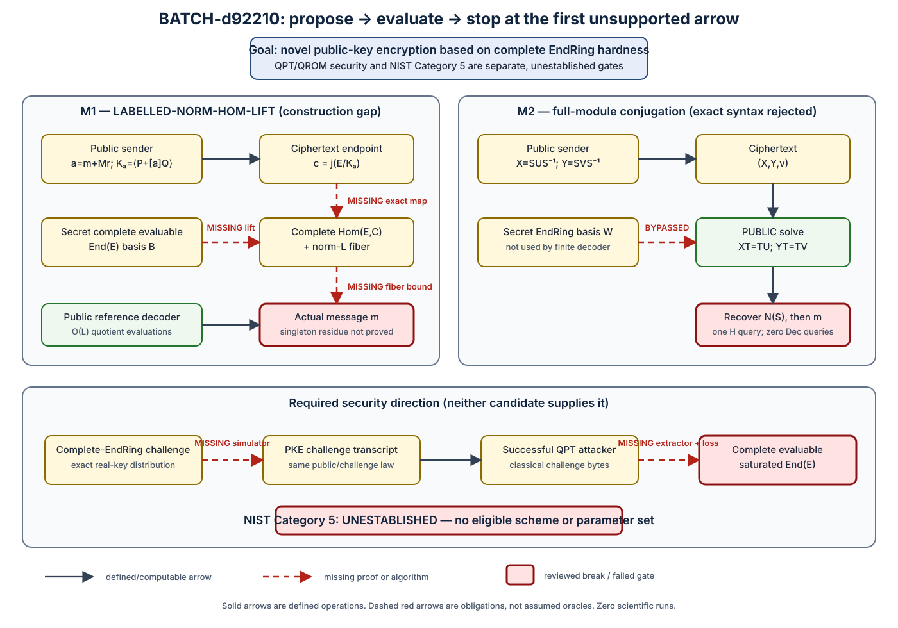

# Two EndRing recipient mechanisms: proposal and adversarial evaluation

**GOAL-SSI-2fa82a · BATCH-d92210 · TASK-20261013-9e1246 · 2026-10-13**

## Result

This round did **not** build a secure PKE. It produced and independently evaluated two materially different candidate interfaces:

- **M1, LABELLED-NORM-HOM-LIFT:** a construction gap. The public sender is exact, but the claimed recipient-only Hom-lattice lift, complete norm-fiber enumeration, fiber-correctness bound, and attacker-to-complete-EndRing extraction are absent.
- **M2, simultaneous full-module conjugation:** rejected for the submitted syntax. Public linear algebra recovers the normalized conjugator used by the mask, so one ordinary hash query and zero decryption queries reveal the selected message.

Novelty, QPT/QROM security, a correct-direction reduction to complete EndRing, and NIST Category 5 all remain **unestablished**. No parameter set was selected. Scientific, implementation, formalizer, benchmark, and parameter-selection runs were all zero. The evidence is symbolic design and review, not measurement.

The editable source is [recipient-flow.mmd](recipient-flow.mmd). Solid arrows are specified operations; dashed red arrows are missing algorithms or proof obligations. The security arrow is deliberately drawn in the required direction: successful PKE attacker → complete evaluable saturated `End(E)`.

## Question and frozen method

**[Proposed objective]** Can an encryption recipient use a complete supersingular endomorphism ring in a way that a public sender can target, a smaller witness cannot emulate, and a successful quantum attacker yields the complete ring—at concrete costs consistent with a Category-5 target?

The frozen method [R1] implemented the requested propose/evaluate loop:

1. admit at most two materially distinct recipient operations;
2. require exact KeyGen/Enc/Dec syntax, actual-message correctness, parsing, failure behavior, and total costs;
3. audit O1–O6 separately: hard distribution, algorithms, correctness, complete-ring necessity, correct-direction reduction, and cost/security evidence;
4. independently review correctness/novelty (J1/J2), simulation/extraction (J3/J4), and quantum/Category-5 claims (J5/J6);
5. reject an exact break, retain an incomplete idea only as a named gap, and never infer security from source or diagram quality.

The composition copied owner verdicts without voting [R1]: `J1=breaks`, `J2=inconclusive`, `J3=inconclusive`, `J4=breaks`, `J5=breaks`, `J6=inconclusive`. The vector combines candidate-specific findings; it is not a claim that every joint breaks both candidates.

## Candidate M1 — LABELLED-NORM-HOM-LIFT

### Proposed syntax

Let `E/F_(p²)` be supersingular, let `(P,Q)` be a public ordered basis of `E[L]`, and let `M | L`. To encrypt `m ∈ [0,M)`, sample `r ∈ [0,L/M)`, set

`a = m + M r`, `K_a = ⟨P + [a]Q⟩`, `c = j(E/K_a)`.

**[Derived]** The public sender can evaluate the quotient from the supplied kernel generator; it never needs the secret ring. A finite reference decoder enumerates all `a ∈ [0,L)`, recomputes the endpoints, and returns a message only when every matching label has one residue modulo `M` [P1].

The intended private operation, `LabelledNormHomLift`, would use a complete evaluable rank-four basis of `End(E)` to construct all of `Hom(E,C)`, enumerate all norm-`L` maps to a model `C` with `j(C)=c`, and recover the unique label residue.

### Evaluation

**[Reviewed] Correctness is not established.** If `F(c)={a:j(E/K_a)=c}`, the exact reference decoder succeeds on the selected `m` precisely when `{a mod M:a∈F(c)}={m}`. No negligible cross-message fiber bound is supplied [R2]. The model/twist and exceptional-automorphism cases belong to that same obligation.

**[Reviewed] Recipient asymmetry is not established.** Knowing `End(E)` does not by itself give a connecting map to the ciphertext curve, a complete `Hom(E,C)` basis, principalization, or bounded norm enumeration. When `L` is polynomially bounded, the identical public finite enumeration is already polynomial. A single norm-`L` Hom witness reveals at most one label; it is not a complete-ring separator [R2].

**[Reviewed] The security reduction is missing.** The required theorem is not “EndRing solves decryption.” It must turn a successful QPT distinguisher for the exact labelled-quotient distribution into a complete evaluable saturated basis of `End(E)`. No exact-law challenge simulator, extractor, loss, or adaptive-OneEnd bridge is supplied [R3, R4].

**Disposition:** O1–O6 remain open. M1 is a construction-gap record, not a PKE, security theorem, novelty claim, parameter proposal, or impossibility theorem.

## Candidate M2 — simultaneous full-module conjugation

### Proposed syntax

Let public `U,V ∈ M₂(F_ell)` generate the full matrix algebra. The sender samples `S ∈ GL₂(F_ell)`, publishes

`X = S U S⁻¹`, `Y = S V S⁻¹`,

and masks `m` with `H(pk || X || Y || N(S))`, where `N` is a fixed projective normalization [P2]. The intended private operation would lift the transcript using a complete EndRing representation.

### Public recovery

**[Derived and independently reviewed]** Solve the public homogeneous equations

`X T = T U`, `Y T = T V`.

For an honest ciphertext write `T=S C`. Then `C` commutes with both `U` and `V`. Since they generate `M₂(F_ell)`, their common centralizer is the scalar matrices. The solution space is exactly `F_ell S`; any nonzero solution normalizes to `N(S)` [R2, R4].

Consequently, a classical passive adversary—which is also a valid QPT adversary—recovers the exact hash input, makes one ordinary `H` query, and unmasks the selected message. It makes zero decryption queries. For distinct challenge messages its success is one and its advantage under `|Pr[correct]-1/2|` is `1/2` [R4].

**Disposition:** accepted-key actual-message correctness is conditionally discharged, but it is public correctness. O4 is contradicted for this exact normalized-conjugator-mask syntax. Adding an integral lift cannot hide a pad already fixed by public matrices. This result does not rule out every module mechanism or every EndRing PKE.

## Obligation ledger

| Obligation | M1 | M2 |
|---|---|---|
| O1 exact hard distribution | open | open |
| O2 total polynomial algorithms | open | open |
| O3 actual-message correctness | open | conditional reviewed discharge |
| O4 complete-ring recipient necessity | open | contradicted for exact syntax |
| O5 attacker → complete-EndRing reduction | open | open; submitted gate breaks |
| O6 complete costs / security evidence | open | open; Category-5 confidentiality rejected |

There are zero candidates eligible for implementation, benchmark, parameter selection, or a security claim [R1].

## Quantum-security and Category-5 boundary

NIST Category 5 requires attack resources comparable to or greater than key search on a block cipher with a 256-bit key across the relevant metrics [S1]. The retained NIST criteria page gives preliminary comparison guidance of `2^272` classical gates and `2^298 / MAXDEPTH` quantum gates; those are accounting references, not a certificate for a field size or a scheme [P1].

A future candidate would need, at minimum:

- a complete polynomial scheme and exact real-key distribution;
- a QPT/QROM game with query, width, depth, gate, memory, data, target, preprocessing, and success accounting;
- a typed reduction `Adv_PKE(A) ≤ L_red · Succ_EndRing(B) + δ_red`, with simulator/extractor resources;
- best classical and quantum attacks against the exact distribution, including multi-target and time-memory tradeoffs; and
- independently reproduced margins against every applicable Category-5 comparison metric.

M1 has none of the eligible algorithms, reduction losses, or parameters. M2 has a polynomial public break, so no parameter choice repairs its submitted confidentiality syntax. Bit length alone is not Category-5 evidence.

## Source and novelty boundary

The literature search retained NIST primary pages/call material and abstract- or metadata-level records for Séta [S2], SiGamal/C-SiGamal [S3], LIT-SiGamal [S4], and supersingular key-updatable PKE [S5]. Full normalized constructions were not available for every named neighbor; M2's producer claim of a full SiGamal inspection was rejected because its source ledger records abstract-level inspection only [R2].

The sources establish adjacent comparison targets, not novelty. M1 is adjacent to trapdoor quotient/isogeny inversion; M2 changes the finite algebraic operation but is publicly decoded. Neither packet demonstrates nonduplication, a complete EndRing recipient mechanism, or an advantage over prior work.

## Procedure deviations and limitations

The frozen independence checker exited `1` with eight diagnostics. Two review files omit `review_attestation.task_id`, so the checker does not recognize J1/J2, J5/J6, or the blind-rederivation assignment; J7 belongs to the later documentation review. The task IDs and owned joints are present elsewhere in those files, allowing a provenance-preserving composition, but the mechanical result is **not** reported as a pass [R1].

No experiment was run, so nothing here is labeled measured. Symbolic derivations are not timing results or security lower bounds. The M2 break is scoped to its exact syntax. M1's failure to supply an algorithm is not a proof that no such algorithm exists.

Canonical graph check: `knowledge/frontiers/ecdlp/` contains no graph source or rendering affected by these zero-survivor findings. Historical reports under `research/ssi-endring-pke/` are immutable snapshots and were checked but not edited. This round adds only the new editable diagram and rendering beside this report.

## Exact next check

No automatic successor is authorized. A later proposal must change the recipient relation materially and supply all four of these together: public encryption without the ring, an exact efficient operation available from the complete ring but not public finite data or a smaller witness, actual-message correctness on the exact distribution, and a QPT-compatible attacker-to-complete-EndRing reduction with explicit losses. Rewrapping either failed interface with a hash, authentication tag, or more evaluation points is not enough.

## References and evidence extent

- **[R1] Independently reviewed composition:** `TASK-20261013-44f353`, frozen by `TASK-20261013-b6cc59`; GOAL-SSI-2fa82a, BATCH-d92210.
- **[R2] J1/J2 review:** `TASK-20261013-962e06`, SHA-256 `8cdb374b…b3add1`.
- **[R3] J3/J4 review:** `TASK-20261013-235da3`, SHA-256 `8080ef82…fa398`.
- **[R4] J5/J6 blind review:** `TASK-20261013-0e9c61`, SHA-256 `9ae2c06f…6862b`.
- **[P1] M1 packet:** `TASK-20261013-f8430e`, especially `candidate.md`, `scheme-contract.yaml`, `cat5-evidence-plan.yaml`, and `source-ledger.yaml`.
- **[P2] M2 packet:** `TASK-20261013-6bd28a`, corresponding eight-file construction packet.
- **[S1] NIST**, [Security (Evaluation Criteria)](https://csrc.nist.gov/projects/post-quantum-cryptography/post-quantum-cryptography-standardization/evaluation-criteria/security-(evaluation-criteria)); retained local capture and 2016 call inspected for the stated category boundary.
- **[S2] Séta**, ePrint 2019/1291, title/search metadata and truncated abstract inspected; full construction not normalized in this round.
- **[S3] SiGamal/C-SiGamal**, ePrint 2020/613, metadata and abstract inspected; PDF retrieval failed in the producer search.
- **[S4] LIT-SiGamal**, ePrint 2024/521, metadata and abstract inspected; full construction not inspected.
- **[S5] Towards Post-Quantum Key-Updatable PKE via Supersingular Isogenies**, ePrint 2020/1593, metadata and abstract inspected.

