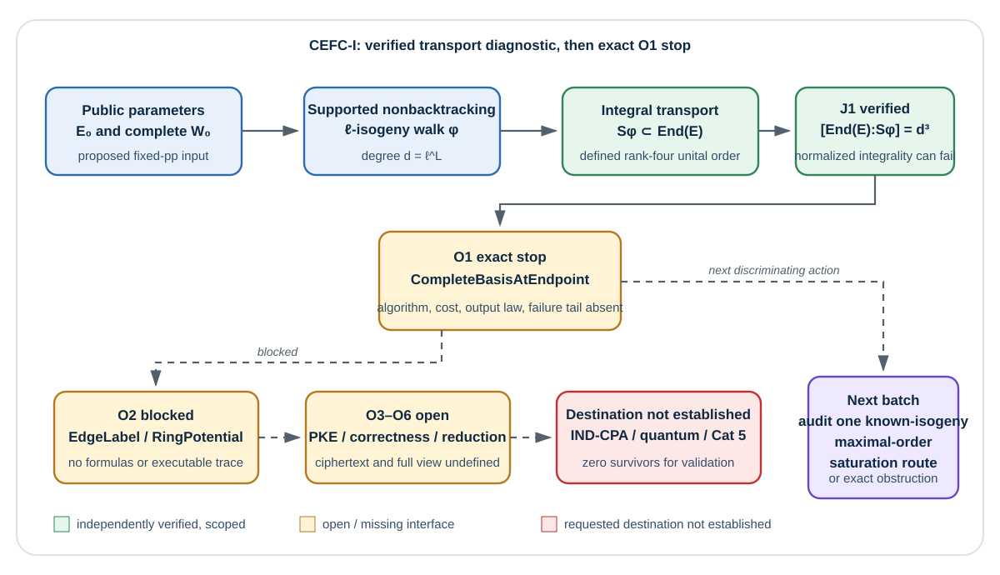

# Result at a glance

**Outcome — independently reviewed:** this round did **not** produce a public-key encryption scheme. It established one narrower algebraic diagnostic for the attempted CEFC-I key law: transporting a complete base endomorphism ring along a supported cyclic isogeny by integral pushforward produces a strict suborder of exact index $d^3$, while normalized conjugation is not uniformly integral. The next KeyGen call, `CompleteBasisAtEndpoint`, has no supplied algorithm, output law, verification method, polynomial cost, or failure law. The attempt therefore stops at O1.

All six construction obligations remain open. IND-CPA, active security, attacker-to-complete-EndRing extraction, novelty, QPT/QROM security, and NIST Category 5 are separately unestablished. There were no scientific, implementation, formalizer, experiment, benchmark, or parameter-selection runs.

{width=96%}

# Question and search scope

The goal asks for a novel supersingular-EndRing PKE that is quantum secure and satisfies a NIST Category-5 target. This batch tested exactly one mechanism, CEFC-I:

1. start from public parameters containing a supersingular curve E0 over the quadratic field and a complete evaluable saturated basis W0 of End(E0);
2. sample a length-L nonbacktracking chain of separable degree-ell isogenies with composite phi and degree $d=ell^L$;
3. derive a complete evaluable saturated basis WE of the endpoint ring;
4. use one public, nontrivial, zero-circulation `EdgeLabel` and a polynomial complete-ring `RingPotential` to obtain endpoint-fiber agreement;
5. build and evaluate a PKE, then separately discharge IND-CPA, active security, complete-EndRing extraction, novelty, quantum-model, and Category-5 gates.

The frozen methodology was “propose, evaluate, then stop at the earliest exact obstruction.” It prohibited replacing PKE with a KEM, keeping the walk or orientation as undeclared secret advice, treating full graph/Hom enumeration as polynomial, or asserting security from recipient functionality alone.

# The attempted key law

**Proposed:** for valid fixed public parameters, the first isogeny edge is uniform among the $ell+1$ actual cyclic subgroups; each later edge is uniform among the $ell$ actual outgoing edges other than the preceding dual. Parallel actual edges retain multiplicity. The endpoint distribution is the exact pushforward of these coin strings, not a uniform-curve distribution.

Let phi map E0 to E as the canonically transported composite, with degree $d$, and let


$$
W_0=(1,\alpha_2,\alpha_3,\alpha_4)
$$

be a complete basis of End(E0). The available integral maps are

$$
F_\phi(\alpha)=\phi\alpha\widehat\phi,
\qquad
S_\phi=\mathbb Z\cdot1+\sum_{i=2}^{4}\mathbb Z\cdot F_\phi(\alpha_i).
$$

**Derived by the producer and independently verified by J1:** S-phi is a rank-four unital order. Writing tau(alpha) for rational conjugation by phi, one has F-phi(alpha) = d times tau(alpha). Relative to the conjugate basis

$$
(1,\tau(\alpha_2),\tau(\alpha_3),\tau(\alpha_4)),
$$

the change is diagonal with entries $(1,d,d,d)$. Because the conjugate of End(E0) and End(E) are maximal orders of equal covolume, and S-phi is contained in End(E),

$$
[\operatorname{End}(E):S_\phi]=d^3>1.
$$

The normalized conjugates are not uniformly integral: integrality would require alpha to preserve the kernel of phi, whereas the complete ell-adic endomorphism order acts as the full matrix algebra and does not preserve a fixed kernel line for every alpha.

This establishes that two obvious substitutions fail:

- returning the transported four-element tuple returns only an index-$d^3$ suborder;
- dividing every transported element by $d$ does not uniformly return integral endomorphisms.

It does **not** establish a lower bound or the nonexistence of a polynomial saturation algorithm.

# Exact stopping point

The next honest pseudocode line would be:

```text
W_E <- CompleteBasisAtEndpoint(pp, phi, W0)
```

**Open:** no implementation, evaluable output representation, complete-ring certificate, conversion method, exact cost, retry law, or failure bound is supplied. KeyGen therefore does not complete. `EdgeLabel`, `RingPotential`, `Encrypt`, and `Decrypt` are literal null interfaces in the blind public statement, so no executable PKE trace follows.

The acceptance criterion for a successor is precise: for every declared valid parameter tuple and supported walk, give one uniform polynomial-bit-time and polynomial-memory algorithm that outputs a complete evaluable saturated basis of End(E), with full-ring verification, exact output representation, charged preprocessing/conversion, and a success/retry tail. The output must not hide retained path advice.

# Independent review composition

The review plan was frozen before review. J1, J2, and J3 ran in mutually blind sessions; J3 rederived from the literal public statement without reading producer proofs. The repository checker reported:

```text
PASS: 3 report(s), every joint owned and attested, blindness respected, controls declared
```

This is a procedure check, not a mathematical or security proof.

| Joint | Sole owner | Verdict | Scoped result |
|---|---|---:|---|
| J1: O1/O2 | `TASK-20261014-604885` | holds | The narrow integral-transport obstruction, exact $d^3$ index, and nonuniform normalized integrality hold. O1/O2 remain open; polynomial completion is not ruled out. |
| J2: O3/O4 | `TASK-20261014-9ff2ea` | inconclusive | No label, potential, PKE, relation domain, correctness theorem, or full-ring-necessity exclusion exists. O3/O4 remain open. |
| J3: O5/O6 and separate gates | `TASK-20261014-0754ea` | inconclusive | No real PKE game, extractor, complete adversarial view, novelty evidence, quantum interface, or concrete target exists. O5/O6 and all separate gates remain open. |

# Requirement-to-evidence table

| Requested requirement | Evidence achieved in this batch | Status |
|---|---|---:|
| Exact real key/walk law | Conditional fixed-parameter walk and endpoint marginal are explicit; Setup family, successful complete-key joint law, and retry law are absent. | open |
| Complete evaluable endpoint ring | Naïve transport is independently shown to have index $d^3$; completion/saturation algorithm is absent. | open |
| Public nontrivial zero-circulation label | No concrete group or label formula. | open |
| Polynomial complete-ring potential | No concrete potential algorithm or cost. | open |
| Executable PKE syntax | `Encrypt` and `Decrypt` are undefined. | not established |
| Correctness | No fiber theorem, message law, failure space, or bound. | open |
| Recipient asymmetry/full-ring necessity | Public coboundary/base-ring and smaller-witness controls are not excluded. | open |
| IND-CPA | No complete real PKE experiment or proof. | not established |
| Active security | No active syntax. Raw endpoint-plus-XOR would be conditionally IND-CCA2-broken by a one-query payload flip, but CEFC-I does not instantiate it. | not established |
| Attacker-to-complete-EndRing reduction | No challenge embedding, simulator, complete-basis extractor, success/loss, or runtime. | open |
| Novelty | No completed mechanism or primary-source comparison. | not established |
| QPT/QROM security | No quantum assumption, query interface, simulator/programming rule, extractor, or loss. | not established |
| NIST Category 5 | No completed scheme, normative comparison, parameters, attack portfolio, reduction loss, measurements, or matched cost evidence. | not established |

# Controls and security boundaries

The reviews applied controls whose conclusions are known to be false:

- A public coboundary `a(e) = h(head(e)) - h(tail(e))` has perfect circulation and endpoint agreement but makes the value public.
- A zero or constant label fails nontriviality and yields no recipient-only value.
- A path hash does not factor through endpoints without a same-endpoint collision/fiber theorem.
- Calling a full basis does not prove it is necessary: one evaluator, finite torsion action, cache, compressed decoder, or opaque advice could suffice unless excluded or converted to a complete basis.
- The implication “a ring witness enables decryption” runs in the wrong direction for an EndRing-only security reduction. A successful scheme attacker must be transformed into a solver outputting a complete evaluable saturated basis on the supplied challenge curve.
- For a raw pair `(C, u = m XOR z_E(C))` that accepts same-endpoint payload flips, querying `(C, u XOR Delta)` after the challenge recovers `m` with one byte-distinct CCA2 query. This is a conditional control, not an attack on the undefined CEFC-I encryption algorithm.

# Disposition and next discriminating action

**Independently reviewed composition:** CEFC-I has zero survivors for validation. It is not a complete PKE; IND-CPA and active security are not established; no complete-EndRing reduction, novelty result, quantum-security result, or Category-5 result exists.

The most discriminating next round is narrower than another full scheme proposal: investigate exactly one known-isogeny completion route. Starting from W0 and the factored cyclic phi, either provide a uniform polynomial algorithm that reconstructs and evaluates the saturated maximal order End(E), with a full-ring certificate and exact cost/failure law, or identify the earliest exact obstruction. Only after that succeeds should construction of `EdgeLabel` and `RingPotential` resume.

# Limitations and canonical-graph status

This was a symbolic zero-run round. It selected no parameter family, measured no performance, retrieved no new primary literature, and proves no universal impossibility. The result applies only to the frozen CEFC-I integral/normalized transport attempt and its null downstream interfaces.

Canonical graphs were checked and left unchanged. The related editable/rendered studies under `research/ssi-endring-pke/` were not historical evidence to mutate, and no canonical graph under `knowledge/frontiers/ecdlp/` depicts this mechanism. This batch establishes no new verified cryptographic edge or complete construction; adding one to a canonical graph would overstate the evidence. The new `flow.mmd`/`flow.svg` pair is therefore a batch-local evidence diagram.

# Frozen evidence and provenance

- Producer composition input (`final-composition.yaml`):

  `8dc5a0a5bb4f47d8f4831877adb178f164aa235f6a37ca3c284e9a6eec2fdc55`

- J1 review:

  `e1adcefc2bf4efb260d6ac6e972406fcde5d62f8de37d37a760bdafda965c6f4`

- J2 review:

  `e51a17a22f818a62fb16a240b27081c6094949edbdb873609b73162fc3545f09`

- J3 review:

  `bec42a21cf2752ba03dd0ca534a2cbb1aa56439f24190a076c4923728fd2be14`

Primary internal sources:

- `coordination/design/TASK-20261014-11b3d6/composition/TASK-20261014-efe1bc/final-composition.yaml`
- `coordination/design/TASK-20261014-11b3d6/tasks/TASK-20261014-460fea/obstruction.yaml`
- `coordination/design/TASK-20261014-11b3d6/reviews/TASK-20261014-604885/review.yaml`
- `coordination/design/TASK-20261014-11b3d6/reviews/TASK-20261014-9ff2ea/review.yaml`
- `coordination/design/TASK-20261014-11b3d6/reviews/TASK-20261014-0754ea/review.yaml`
- `coordination/design/TASK-20261014-11b3d6/archives/TASK-20261014-feb4ff/ledger-receipt.json`

Claim labels used in this report are proposed, derived, or independently reviewed. Nothing here is measured.
