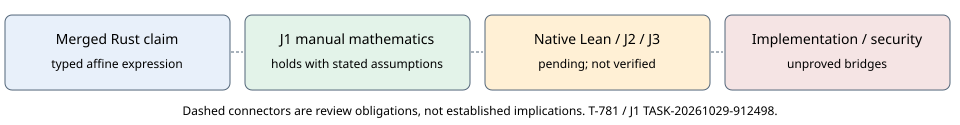

# Affine STARK proof review: progress snapshot

As of 2026-10-29 04:37 UTC. T-781 / TASK-20261029-4cdb4c.

Source proof commit: `45934075ea81628e699d7778a523b2923269aa6a`.
Review handoff commit: `9f5302e3ea60f04d5fa5ca55a3313eb1834c9bf6`.
PR: https://github.com/isogeny-labs/crypto-autoresearcher/pull/2681

## Observation

The merged Rust API restricts transitions to a*x+b*y+c. Candidate Lean source contains six declarations: recovery, coefficient uniqueness, extensionality, multiplication obstruction, missing-probe control, and the zero-ring control.

## Independent manual mathematics

J1 derived the statements from an isolated mathematical input. Recovery and uniqueness hold in all commutative rings, including the zero ring. Multiplication is not affine in a nontrivial ring; the zero ring is the exact exception. Two probes alone do not determine the affine family in a nontrivial ring.

## Verification and fidelity

Machine status: NOT VERIFIED. Fidelity: NOT REVIEWED. Overall outcome: INCONCLUSIVE. The native workspace job was running at 04:29 UTC; that observation is not completion. J2 needs actual elaborated types; J3 needs the native module, six axiom outputs and rejection of the false strengthening.

## Limits

Three probes determine a function within the affine family; they do not certify that an arbitrary function is affine. No proof of Rust BigUint/modular arithmetic, byte encoding, fingerprint injectivity, full STARK soundness, historical execution or performance is asserted.

## Next actions

Collect the existing native run without restarting it. Bind its exact source and verifier inputs. Obtain independent J2/J3 reviews and native negative-control evidence. Archive the completed packet, inspect all applicable final-head CI checks, and only then deliver the scoped proof.

## Graph and provenance

This diagram records proof obligations, not measured performance. No experiment or canonical performance graph changes follow from this partial review. Exact source and review hashes are in binding.json; the original reports remain immutable.
