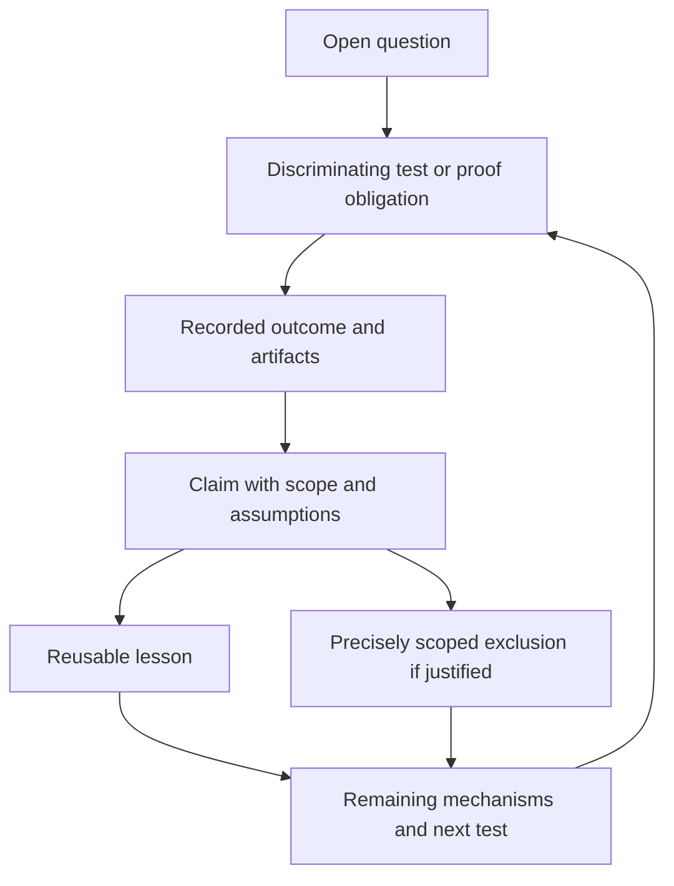

# Scoped evidence for the ten cryptanalysis leads

This advisory handoff preserves 19 records and ten open research questions.
Every record carries its exact scope, assumptions, non-implications, supporting
artifact digests, reusable lesson and next discriminating test. No direction is
marked exhausted and no official hypothesis status changes.

The records were imported without changing their bytes from a local shared
register. [Import provenance](provenance/shared-register-import.json) preserves
the original checkpoint and record hashes. They are observations and scoped
arguments pending the existing scientific review process, not approved progress
claims or a replacement for the canonical ledger.

## Retrieve a focused handoff

From any checkout of this branch:

```sh
python3 tools/scoped_evidence.py summary
python3 tools/scoped_evidence.py lead 6
python3 tools/scoped_evidence.py lead 7 --json
python3 tools/scoped_evidence.py find torsion
python3 tools/scoped_evidence.py check
```

The default check validates record structure and relationships. It explicitly
reports that artifact hashes and scientific truth were not verified. The tool
runs with the standard library and does not execute a proof assistant, change
research state, or add a prerequisite to experiment execution.

## Artifact access and full replay

The earlier raw packets were labelled private. They are not uploaded in this
public PR. Their names and SHA-256 digests are retained in [sources.json](sources.json).
Authorized readers with the packets can supply their own roots:

```sh
python3 tools/scoped_evidence.py \
  --source-root iteration=/authorized/extracted/crypto-ten-leads-iterative-2026-10-15 \
  --source-root questions=/authorized/extracted/crypto-ten-leads-questions-2026-10-15 \
  --source-root delivery=/authorized/delivery/crypto-ten-leads-iterative-2026-10-15 \
  check --artifacts --archive-dir /authorized/archives
```

Those roots bind 25 source artifacts and 37 recorded values in the initial
register. The command refuses missing access or changed bytes. Missing private
access is an access gap, never adverse mathematical evidence. A content digest
binds a file; it does not prove the interpretation of that file. The authorized
iteration packet contains its native source rebuild and replay instructions.

## Evidence classes and live alternatives

| Basis | What it establishes | Remaining boundary |
| --- | --- | --- |
| Execution limit | A named implementation reached its cap | No nonexistence claim follows |
| Implementation gap | A mechanism has not been implemented end to end | It has not been experimentally refuted |
| Bounded observation | A result on a specified panel under a recorded protocol | Other inputs and scaling remain open |
| Finite enumeration | A result on the exact enumerated domain, conditional on enumeration correctness | Other domains and transitions remain open |
| Native certificate | A specified checker accepted the bound object | This is distinct from a Lean kernel proof and independent scientific review |
| Written derivation | A mechanism is constrained under explicit assumptions | Changed assumptions need a new argument |

The original 19 imported records all retain `not_formalized`. A new, separate
[odd-torsion proof](torsion-proof-note.md) is provided in a dependency-free Lean
workspace; a kernel receipt does not promote the imported curve application.
The [remaining model and access gaps](../../problems/ten-lead-proof-scope-and-artifact-access.md)
are explicit. The other [Lean obligations](proof-obligations/) remain pending.

A full-width closure timeout became a native refutation after an implementation
change. The current five-sum producer's B³ endpoint enumeration is a fact about
that construction, not a lower bound on all constructions. A subgroup-only
translation obstruction leaves T-closed mixed domains open. The finite-group
order obstruction names particular destination groups and a homomorphism map
class; it does not exclude every higher-genus reduction.

## Continue without inheriting blanket rejection

Retrieve the relevant lead and keep its scope attached to citations. Name the
mechanism, implementation, domain or assumption changed by a successor. Define
an observable outcome that separates it from the previous test. A real scoped
obstruction still applies until a load-bearing assumption changes or its proof
is challenged; a timeout may instead call for a better implementation.

[Typed relationships](relations.json) distinguish changed interpretation,
different degree, distinct obstructions and remaining alternatives. They do not
turn a negative observation into a dependency that rejects an entire direction.



An updated interpretation is appended as a new record, with `supersedes` or
`contradicts` references where appropriate. The reader publishes each new claim
atomically and refuses overwrites; it requires source access to validate the
supporting hashes before an append. The initial-import lists remain historical,
while queries derive current views from the claim files. Never fabricate an
independent review or close a whole direction through this advisory API.

```sh
python3 tools/scoped_evidence.py --source-root NAME=/authorized/root add proposed-claim.json
python3 -m pytest tests/test_scoped_evidence.py
```

The README and AGENTS pointers make this register discoverable after a checkout
or merge. Existing running agents and other machines are not automatically
updated. Use [AGENT_HANDOFF.txt](AGENT_HANDOFF.txt) as an explicit startup pointer.
