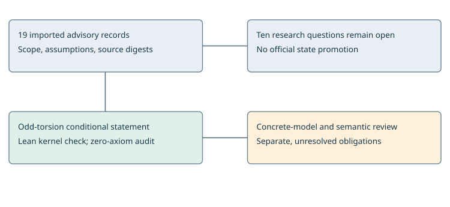

# Scoped evidence handoff and odd torsion proof

17 October 2026. This report records a software import and a named formal verification result. It makes no scientific promotion, cryptanalytic speedup claim, or conclusion that any of the ten research directions is exhausted.

The portable register imports 19 advisory records without changing their bytes. It exposes ten open questions, four original proof obligations, explicit inference limits and next tests. It separates a structural check from optional artifact verification using authorized source roots.

The diagram distinguishes imported records, an independently checkable formal statement, and the remaining model/review obligations. No comparable scientific runtime measurements were collected in this change, so a process diagram is used instead of a speed graph.

Raw evidence packets previously labelled private are not uploaded to the public repository. Their archive digests and source-file bindings remain available. Structural CI does not imply that those private artifacts were accessed; the explicit artifact-check mode refuses missing access.

The new reader uses explicit exceptions rather than optimization-removable assertions, validates references and recorded values, and publishes new records atomically without overwriting other writers. Its guards reject fabricated Lean labels and broad-direction closure attempts.

Discovery pointers in AGENTS.md and README.md make the handoff available after checkout or merge. Existing agents and remote machines are not automatically notified or synchronized.

# The exact formal result and remaining work

Let addition be associative and commutative with a two-sided zero. Define scalar multiples by repeated addition. Assume r=k+k+1, rP=0, T+T=0 and T is nonzero. Then r(P+T)=T, so P+T is not in the kernel of multiplication by r. Finiteness, inverse operations and primality of r are unnecessary for this conditional statement.

The existing repository verifier built the dependency-free project, checked the requested declaration as a theorem, ran the project and target axiom audits, and returned machine_verified. The project audit requires an empty axiom dependency list. It checked the equality lemma, kernel exclusion and the explicit control model.

The two-element XOR model supplies a positive instance. Real kernel tests reject false strengthenings without oddness or nonzero torsion, and reject submitting a definition as though it were a theorem. Earlier development compilation failure logs are separate from the accepted verifier receipt; they are not mathematical negative evidence.

The formal object has explicit additive-law fields. No concrete elliptic-curve representation, rational torsion certificate or factor-base membership checker is imported. Independent semantic-fidelity review remains pending. The imported curve-application record retains its original not_formalized label; this new generic proof does not silently promote it.

This scoped obstruction leaves T-closed mixed-domain constructions and tuple symmetries open. Next: review the exact theorem statement and construct a checked bridge to an intended curve/domain. The coprime-order, scalar-twist and Boolean-checker obligations remain separate pending tasks.

No canonical frontier graph is changed: this branch changes neither a pipeline cost bound nor an official research claim. The new diagram communicates the proof and evidence boundaries only.

Task: formal/targets/scoped-odd-torsion-translation.yaml

Theorem: ScopedObstructions.AdditiveModel.odd_translation_outside_kernel

Proof: formal/scoped-obstructions/ScopedObstructions/Torsion.lean

Receipt: research/ten-lead-evidence/verification/odd-torsion-20261017.json

Source commit: a43f1bdc6f49d1d6f1cb43846e2dfb782789ad91

Lean: Lean (version 4.22.0, x86_64-unknown-linux-gnu, commit ba2cbbf09d4978f416e0ebd1fceeebc2c4138c05, Release)

Problem: problems/ten-lead-proof-scope-and-artifact-access.md
